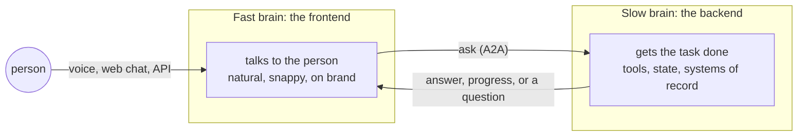

<!--BEGIN_BANNER_IMAGE-->

<picture>
  <source media="(prefers-color-scheme: dark)" srcset="/.github/banner_dark.png">
  <source media="(prefers-color-scheme: light)" srcset="/.github/banner_light.png">
  
</picture>

<!--END_BANNER_IMAGE-->
<br />


[](https://pepy.tech/projects/livekit-agents)
[](https://livekit.io/join-slack)
[](https://twitter.com/livekit)
[](https://deepwiki.com/livekit/agents)
[](https://github.com/livekit/livekit/blob/master/LICENSE)

<br />

> [!WARNING]
> **This is the Agents 2.0 beta.** The API is still changing and nothing here is released as
> stable. It runs on **LiveKit Staging** only, which is open to LiveKit employees for now. For the
> stable framework, use [v1 on `main`](https://github.com/livekit/agents/tree/main) and the
> [v1 docs](https://docs.livekit.io/agents/).

## What is Agents 2.0?

<!--BEGIN_DESCRIPTION-->

A framework for agents that hold a conversation with a person by voice and by text, across
days, and get real work done behind it.

<!--END_DESCRIPTION-->

In v1, one `AgentSession` did everything in one process: it held the call, ran the model,
called the tools and kept the history in memory until the room closed. In 2.0 an agent is
split in two:



- **The fast brain (frontend)** owns the conversation. It speaks, keeps the turn snappy, sounds
  like your brand, and handles interruptions and small talk. It knows nothing about your
  business. Its one tool is the slow brain.
- **The slow brain (backend)** owns the work. It holds the tools, the typed state and the
  systems of record, and it focuses on getting the task right. It can take its time: the fast
  brain keeps the person company and speaks its progress while it works.

The two halves talk over [A2A](https://a2a-protocol.org). The backend is just an endpoint, so a
frontend can ask your own backend, another team's deployment, or any A2A server.

Because the conversation lives in a durable **thread** rather than in a room, the same agent
answers a phone call today and a text tomorrow from the same history and the same state.

## What's new

| | v1 | 2.0 |
| --- | --- | --- |
| Shape | one `AgentSession` per room | a fast brain (frontend) delegating to a slow brain (backend) |
| Channels | voice, plus text over the room | voice and text doors into one thread: web chat, API clients, partner agents; SMS, WhatsApp and email coming |
| Memory | in the room, gone when it closes | a durable thread with a typed state, saved after every turn |
| An agent | a stateful object per session | `Agent(...)`, built once and shared; `await agent.run(message, ...)` is one turn |
| Tools | `@function_tool` with `RunContext[Userdata]` | `@agent.tool` with `RunContext[Deps, State]`, fully typed |
| Asking the person | tool logic plus `generate_reply` | a tool returns `InputRequired(question)`; `requires_approval=` reads a write back and runs it only on the person's yes |
| Multi-step flows | `AgentTask` on a call | the same `AgentTask`, now awaited by text as well, across turns and workers |

## Installation

```bash
pip install --pre "livekit-agents[openai]"
```

Point the workers at your LiveKit Staging project and its agent store, which holds the threads:

```bash
export LIVEKIT_URL=<your staging project URL>
export LIVEKIT_API_KEY=<key>
export LIVEKIT_API_SECRET=<secret>
```

The models: `OPENAI_API_KEY` for the phone door's realtime model, and the LiveKit inference
credentials, `LIVEKIT_INFERENCE_API_KEY` and `LIVEKIT_INFERENCE_API_SECRET`, for the text
agents.

## A fast brain and a slow brain

The smallest version of the pattern: a dental practice's front desk. The full example, with the
calendar and simulation scenarios, is [`examples/frontdesk/`](examples/frontdesk/README.md).

**The slow brain** (`backend_agent.py`) holds the calendar, remembers the patient, asks for what
it is missing, and reads the booking back before writing it:

```python
from pydantic import BaseModel

from livekit.agents import Agent, AgentHandler, InputRequired, RunContext
from livekit.agents.a2a import A2ASessionContext


class Patient(BaseModel):
    email: str | None = None  # saved on the thread after every turn


backend = Agent(
    instructions="You are the back office of Pearl Dental. ...",
    llm="google/gemma-4-31b-it",
    deps_type=Calendar,  # services for one run, never saved
    state_type=Patient,
)


async def read_back(
    ctx: RunContext[Calendar, Patient], slot_id: str, email: str | None = None
) -> str | InputRequired:
    if (email := email or ctx.state.email) is None:
        return InputRequired("What email address should the confirmation go to?")
    return f"Please confirm: slot {slot_id}, confirmation to {email}. Yes or no?"


@backend.tool(requires_approval=read_back)
async def schedule_appointment(
    ctx: RunContext[Calendar, Patient], slot_id: str, email: str | None = None
) -> str:
    """Book the slot.

    Args:
        slot_id: the slot's id, as list_available_slots wrote it
        email: where the confirmation goes
    """
    email = email or ctx.state.email
    await ctx.deps.schedule(slot_id, email)
    ctx.state.email = email
    return f"booked; the confirmation goes to {email}"


back_office = AgentHandler(lane="backend")  # its own lane in the patient's thread


@back_office.a2a_session(
    endpoint="backend",
    description="Pearl Dental's back office: openings and appointments.",
    public=False,
    state=Patient,
)
async def text(ctx: A2ASessionContext[Patient]) -> str:
    result = await backend.run(
        ctx.message, message_history=ctx.message_history, state=ctx.state, deps=calendar
    )
    return result.input_required or str(result.output)
```

**The fast brain** (`frontend_agent.py`) talks to the patient on the phone and by text. Its one
tool is the back office:

```python
from livekit.agents import Agent, AgentHandler, JobContext, LiveSession
from livekit.agents.a2a import A2ASessionContext
from livekit.agents.delegation import A2ADelegate
from livekit.plugins import openai

PERSONA = (
    "You are the front desk of Pearl Dental. Warm and brief, never a script. Anything about a "
    "visit goes to the back office, stated in full with what the patient said. Tell the patient "
    "what it answered in your own words, and never confirm anything it did not return."
)

back_office = A2ADelegate("<project URL>/agents/dentist/default/backend")

chat = Agent(
    instructions=PERSONA + " By text: one or two plain sentences.",
    llm="google/gemma-4-31b-it",
    tools=[back_office],
)
voice = Agent(
    instructions=PERSONA + " On the phone: one short sentence at a time.",
    tools=[back_office],
)

front_desk = AgentHandler()  # the worker's own lane: the phone and the text door share it


@front_desk.rtc_session()
async def phone(ctx: JobContext) -> None:
    session = LiveSession(llm=openai.realtime.RealtimeModel(), thread=ctx.thread)
    await session.start(agent=voice, room=ctx.room)
    if not session.history.items:  # a conversation that started by text picks up where it was
        await session.generate_reply(instructions="Greet the patient and offer to book a visit.")


@front_desk.a2a_session(endpoint="frontend", description="Pearl Dental front desk.")
async def text(ctx: A2ASessionContext) -> str:
    result = await chat.run(ctx.message, message_history=ctx.message_history)
    return result.input_required or str(result.output)
```

**One worker serves both** (`main.py`):

```python
import backend_agent
import frontend_agent

from livekit.agents import AgentServer, cli
from livekit.agents.storage import AgentDBStorage

server = AgentServer(storage=AgentDBStorage(), agent_name="dentist")
server.add(frontend_agent.front_desk, backend_agent.back_office)

if __name__ == "__main__":
    cli.run_app(server)
```

The back office could just as well run on its own worker, another team's deployment, or any A2A
server: the front desk only knows its URL.

What happens on a booking:

1. The patient says "book me Tuesday at 2", by voice or by text.
2. The frontend calls `ask` on the back office with the request in full, and says something
   short while it waits.
3. The backend has no email yet, so the read-back asks for it. The frontend asks the patient in
   its own words, and the answer goes straight back to the backend.
4. Now the read-back is complete. It reaches the patient exactly as written, since it is what
   they approve. The booking runs only when the backend's model repeats the call after the
   patient says yes: there is no flag the model could set to skip the question.
5. The backend saves the email in the thread's state, and the frontend confirms in its own words.

A second booking, a week later and by text, does not ask for the email again.

**Who words what.** The agent facing the person words everything it says, questions included.
When the exact words matter, the backend says so: `InputRequired(question, verbatim=True)`, or
`ToolResult(text, verbatim=True)` for a disclaimer or a confirmation number. Exact text crosses
the A2A hop flagged `livekit/verbatim`, and the frontend delivers it as written.

## Get started with the console

[`console/`](console/README.md) is a web app that talks to a fast brain the way your users
would: a chat, a call button that joins the same conversation, and a debug view of the thread
(each agent's history, state, tasks and journal) updating live beside it. It is the quickest way
to see the pattern work.

With the environment of [Installation](#installation), from the repository root, two
terminals:

```bash
uv sync --all-packages
cd console && uv run python console_api.py      # the console's API on :7795
cd console && pnpm install && pnpm dev          # http://localhost:3000
```

Open the console and pick an example, top right. One that is not running shows the command that
starts it, one click to copy, and connects once it is up; for the dentist it is:

```bash
cd examples/frontdesk && uv run python main.py dev   # both brains, one worker
```

Then type a request such as "can I come in Tuesday afternoon?", or press the speech button to
call into the same conversation. Each delegation to the back office shows
as a card in the chat.

## Threads

A **thread** is one conversation between a person and your agents, across channels and over
time. It replaces the v1 room as the unit of memory: a room lasts one call, a thread lasts as
long as the conversation does.

- **Its id** (`AT_...`) is minted by the platform on first contact. An A2A client gets it back
  as the `contextId` of the first reply and sends it with every message after that.
- **It holds a lane per agent.** The fast brain and the slow brain each keep their own history,
  typed state and tasks in the same thread. The slow brain remembers the patient's email; the
  fast brain needs no state at all.
- **Any worker can continue it.** The framework loads the lane before each turn and saves it
  after, so a turn runs on whichever worker gets it, and a crashed worker loses nothing.
- **It is found by its id and nothing else.** Your backend stores the id against its own user,
  order or lead, and passes it back as the `contextId`, or as `thread_id` in a call's dispatch.
- **It expires** after an idle period you choose, and deleting it deletes everything it holds.

From your backend, the threads service creates, lists and reads them:

```python
from livekit.agents.storage import AgentDBStorage

threads = AgentDBStorage().threads
info = await threads.create_thread(scope=user_id, attributes={"title": "New chat"})
page = await threads.list_threads(user_id, limit=30)  # a sidebar: newest first
items = await threads.get_thread_items(info.thread_id)  # the history
```

Inside a tool, `ctx.thread` is the same thread. More in [`docs/threads.md`](docs/threads.md).

## A thin web client

A website needs no LiveKit SDK to chat with the fast brain. Your server mints a token, and the
browser speaks A2A to the endpoint with `fetch`.

**On your server**, mint a thread grant for the signed-in user:

```python
from livekit.agents.a2a import AgentThreadGrant, Credentials

credentials = Credentials(LIVEKIT_API_KEY, LIVEKIT_API_SECRET)
token = credentials.thread_grant_token(
    AgentThreadGrant(scope=user_id, create=True, write=True, read=True),
    identity=user_id,
    ttl_seconds=3600,
)
```

**In the browser**, send a message and stream the answer. The first reply carries the thread
id; keep it and send it from then on:

```ts
const ENDPOINT = "<project URL>/agents/dentist/default/frontend";
let contextId: string | undefined; // the thread id, e.g. kept in localStorage

async function send(text: string, onUpdate: (kind: string, text: string) => void) {
  const response = await fetch(`${ENDPOINT}/v1`, {
    method: "POST",
    headers: { "Content-Type": "application/json", Authorization: `Bearer ${token}` },
    body: JSON.stringify({
      jsonrpc: "2.0",
      id: crypto.randomUUID(),
      method: "message/stream",
      params: {
        message: {
          messageId: crypto.randomUUID(),
          role: "user",
          contextId,
          parts: [{ kind: "text", text }],
        },
      },
    }),
  });
  const joined = (parts: { text?: string }[]) => parts.map((p) => p.text ?? "").join("");
  // server-sent events: the task, progress while the back office works, then the answer
  const reader = response.body!.pipeThrough(new TextDecoderStream()).getReader();
  let buffer = "";
  for (;;) {
    const { value, done } = await reader.read();
    if (done) break;
    buffer += value;
    const events = buffer.split("\n\n");
    buffer = events.pop()!;
    for (const event of events) {
      const { result } = JSON.parse(event.replace(/^data: /, ""));
      contextId ??= result.task?.contextId;
      const status = result.statusUpdate?.status;
      if (status?.message) onUpdate(status.state, joined(status.message.parts)); // progress, or a question
      if (result.artifactUpdate) onUpdate("answer", joined(result.artifactUpdate.artifact.parts));
    }
  }
}
```

A stock A2A client library works the same way, since every endpoint publishes its card at
`.well-known/agent-card.json`. The console's [`a2a.ts`](console/src/lib/a2a.ts) is a fuller
version with resume after a reload (`tasks/resubscribe`) and cancel.

**To add a call** to the same conversation, mint a room token that dispatches the fast brain
with the thread id in the dispatch metadata, and join the room with any
[LiveKit client SDK](https://docs.livekit.io/home/client/connect/):

```python
import json

from livekit import api

room_token = (
    api.AccessToken(LIVEKIT_API_KEY, LIVEKIT_API_SECRET)
    .with_identity(user_id)
    .with_grants(api.VideoGrants(room_join=True, room=f"call-{thread_id}"))
    .with_room_config(
        api.RoomConfiguration(
            agents=[
                api.RoomAgentDispatch(
                    agent_name="dentist", metadata=json.dumps({"thread_id": thread_id})
                )
            ]
        )
    )
    .to_jwt()
)
```

The call picks up where the chat left off, and a text sent during the call lands in the same
thread.

## Text, and what is coming

The text door, `@server.a2a_session`, is a standard [A2A](https://a2a-protocol.org) endpoint
that publishes an agent card. Web chats, API clients and other agents reach it the same way,
and any stock A2A client works without LiveKit code. Every door writes the same thread, so
voice and text share one history and one state.

| Channel | Status |
| --- | --- |
| Phone and WebRTC calls (`@server.rtc_session`) | in the beta |
| Web chat, API clients, partner agents (`@server.a2a_session`) | in the beta |
| SMS and WhatsApp, one thread per phone number shared with calls | coming |
| Email | coming, experimental |

When several messages arrive while a turn runs, the endpoint's `inbox` policy decides what
happens: interrupt, queue, or answer a burst of texts in one turn.

## Examples

| Example | What it shows |
| --- | --- |
| [`examples/frontdesk/`](examples/frontdesk/README.md) | Dental appointment booking. The pattern at its smallest: two backend tools, and a booking that asks for what it is missing and reads it back before writing. |
| [`examples/hotel-receptionist/`](examples/hotel-receptionist/README.md) | A hotel's bookings, lookups and cancellations. Multi-turn flows as `AgentTask`s awaited by text, verification, and approval before every write. |
| [`examples/airline-support/`](examples/airline-support/README.md) | An airline support inbox as a graph. An email comes in and a typed triage comes out: EU261 rules in code, a reviewed reply, payment only after approval. |
| [`docs/examples/use-cases/`](docs/examples/use-cases/README.md) | One complete agent per idea: appointments by phone and text, insurance eligibility, a claim with a photo, a hospital main line, and more. |

Each example ships `scenarios/*.yaml` for `lk agent simulate`, and [`console/`](console/README.md)
is a web frontend that chats with or calls any of them, with the thread's state shown live
beside the conversation.

## Coming from v1

The migration skill in [`skills/migrate-to-v2/`](skills/migrate-to-v2/SKILL.md) teaches a
coding agent to turn a v1 agent into a fast brain and a slow brain. Point your coding agent
at it:

```bash
npx skills add livekit/agents --skill migrate-to-v2
```

Then ask it to "migrate this agent to Agents 2.0". In short:

| v1 | 2.0 |
| --- | --- |
| `AgentSession(stt=, llm=, tts=, vad=)` | `LiveSession(...)` on the frontend's voice door |
| `class MyAgent(Agent)` with tools as methods | `Agent(...)` at module level, tools with `@agent.tool` |
| `session.userdata` / `RunContext[Userdata]` | `state_type=` (saved) and `deps_type=` (per run): `RunContext[Deps, State]` |
| `update_instructions`, `update_tools`, `update_chat_ctx` | `@agent.instructions` rendered from the state each turn, or a handoff |
| tools that need to ask the person | `return InputRequired("question")`, `@agent.tool(requires_approval=read_back)` |
| `session.say("...")` in a tool | `await ctx.update("...")` for progress, `ToolResult(text, verbatim=True)` for exact words |
| everything in one agent | persona on the frontend, tools and state on the backend, joined by `A2ADelegate` |

## Docs

The 2.0 docs are in [`docs/`](docs/README.md), one feature per page: agents, tools, state and
deps, human in the loop, agent tasks, threads, text endpoints, voice, multi-agent, and the A2A
wire. A page named `planned-*.md` describes design that is not built yet.

## Development

This project uses [uv](https://docs.astral.sh/uv/). The core is in Rust and builds as part of
the Python wheel, so a Rust toolchain is needed.

```bash
make install            # uv sync --all-extras --dev
make check              # format check, lint, mypy strict
uv run pytest --unit    # unit tests
```

To run the examples against a local stack (livekit-server with agent endpoints, and agent-db),
see [`examples/README.md`](examples/README.md).

## License

The Agents framework is licensed under [Apache-2.0](LICENSE). The LiveKit turn detection models
are licensed under the [LiveKit Model License](MODEL_LICENSE).

## Contributing

During the beta, file issues on this repo with the `v2` label, or open a PR against the `v2.0`
branch.

<!--BEGIN_REPO_NAV-->
<br/><table>
<thead><tr><th colspan="2">LiveKit Ecosystem</th></tr></thead>
<tbody>
<tr><td>Agents SDKs</td><td><b>Python</b> · <a href="https://github.com/livekit/agents-js">Node.js</a></td></tr><tr></tr>
<tr><td>LiveKit SDKs</td><td><a href="https://github.com/livekit/client-sdk-js">Browser</a> · <a href="https://github.com/livekit/client-sdk-swift">Swift</a> · <a href="https://github.com/livekit/client-sdk-android">Android</a> · <a href="https://github.com/livekit/client-sdk-flutter">Flutter</a> · <a href="https://github.com/livekit/client-sdk-react-native">React Native</a> · <a href="https://github.com/livekit/rust-sdks">Rust</a> · <a href="https://github.com/livekit/node-sdks">Node.js</a> · <a href="https://github.com/livekit/python-sdks">Python</a> · <a href="https://github.com/livekit/client-sdk-unity">Unity</a> · <a href="https://github.com/livekit/client-sdk-unity-web">Unity (WebGL)</a> · <a href="https://github.com/livekit/client-sdk-esp32">ESP32</a> · <a href="https://github.com/livekit/client-sdk-cpp">C++</a></td></tr><tr></tr>
<tr><td>Starter Apps</td><td><a href="https://github.com/livekit-examples/agent-starter-python">Python Agent</a> · <a href="https://github.com/livekit-examples/agent-starter-node">TypeScript Agent</a> · <a href="https://github.com/livekit-examples/agent-starter-react">React App</a> · <a href="https://github.com/livekit-examples/agent-starter-swift">SwiftUI App</a> · <a href="https://github.com/livekit-examples/agent-starter-android">Android App</a> · <a href="https://github.com/livekit-examples/agent-starter-flutter">Flutter App</a> · <a href="https://github.com/livekit-examples/agent-starter-react-native">React Native App</a> · <a href="https://github.com/livekit-examples/agent-starter-embed">Web Embed</a></td></tr><tr></tr>
<tr><td>UI Components</td><td><a href="https://github.com/livekit/components-js">React</a> · <a href="https://github.com/livekit/components-android">Android Compose</a> · <a href="https://github.com/livekit/components-swift">SwiftUI</a> · <a href="https://github.com/livekit/components-flutter">Flutter</a></td></tr><tr></tr>
<tr><td>Server APIs</td><td><a href="https://github.com/livekit/node-sdks">Node.js</a> · <a href="https://github.com/livekit/server-sdk-go">Golang</a> · <a href="https://github.com/livekit/server-sdk-ruby">Ruby</a> · <a href="https://github.com/livekit/server-sdk-kotlin">Java/Kotlin</a> · <a href="https://github.com/livekit/python-sdks">Python</a> · <a href="https://github.com/livekit/rust-sdks">Rust</a> · <a href="https://github.com/agence104/livekit-server-sdk-php">PHP (community)</a> · <a href="https://github.com/pabloFuente/livekit-server-sdk-dotnet">.NET (community)</a></td></tr><tr></tr>
<tr><td>Resources</td><td><a href="https://docs.livekit.io">Docs</a> · <a href="https://docs.livekit.io/mcp">Docs MCP Server</a> · <a href="https://github.com/livekit/livekit-cli">CLI</a> · <a href="https://cloud.livekit.io">LiveKit Cloud</a></td></tr><tr></tr>
<tr><td>LiveKit Server OSS</td><td><a href="https://github.com/livekit/livekit">LiveKit server</a> · <a href="https://github.com/livekit/egress">Egress</a> · <a href="https://github.com/livekit/ingress">Ingress</a> · <a href="https://github.com/livekit/sip">SIP</a></td></tr><tr></tr>
<tr><td>Community</td><td><a href="https://community.livekit.io">Developer Community</a> · <a href="https://livekit.io/join-slack">Slack</a> · <a href="https://x.com/livekit">X</a> · <a href="https://www.youtube.com/@livekit_io">YouTube</a></td></tr>
</tbody>
</table>
<!--END_REPO_NAV-->
