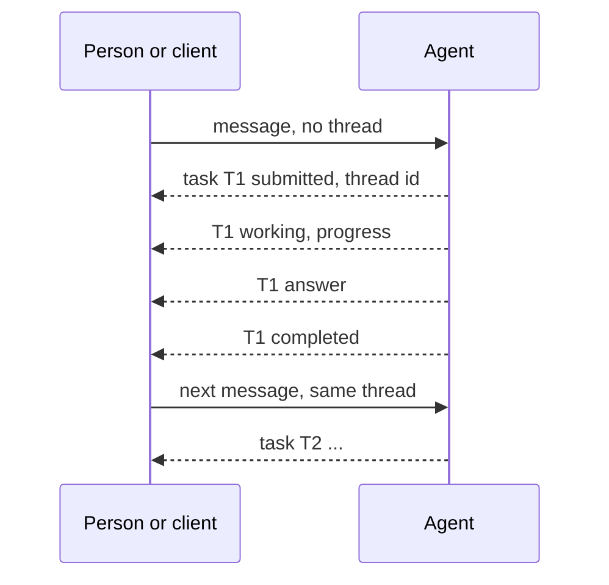
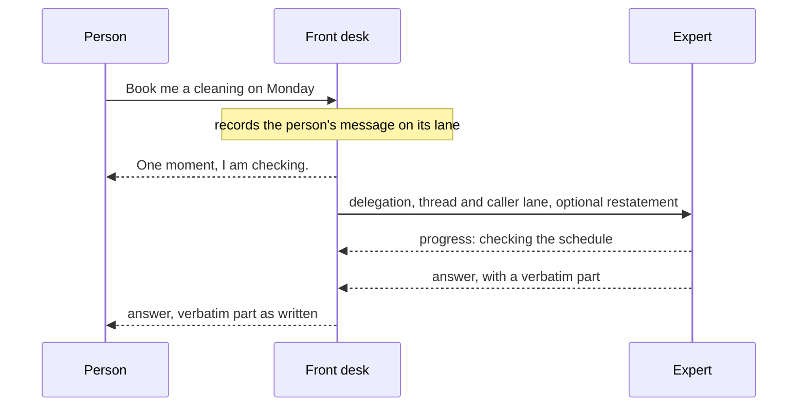
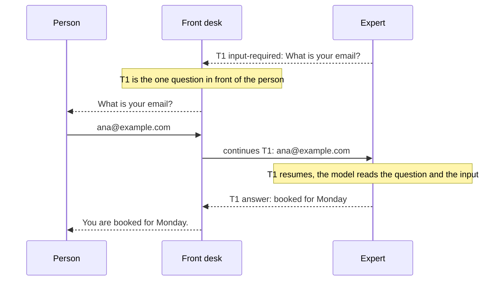
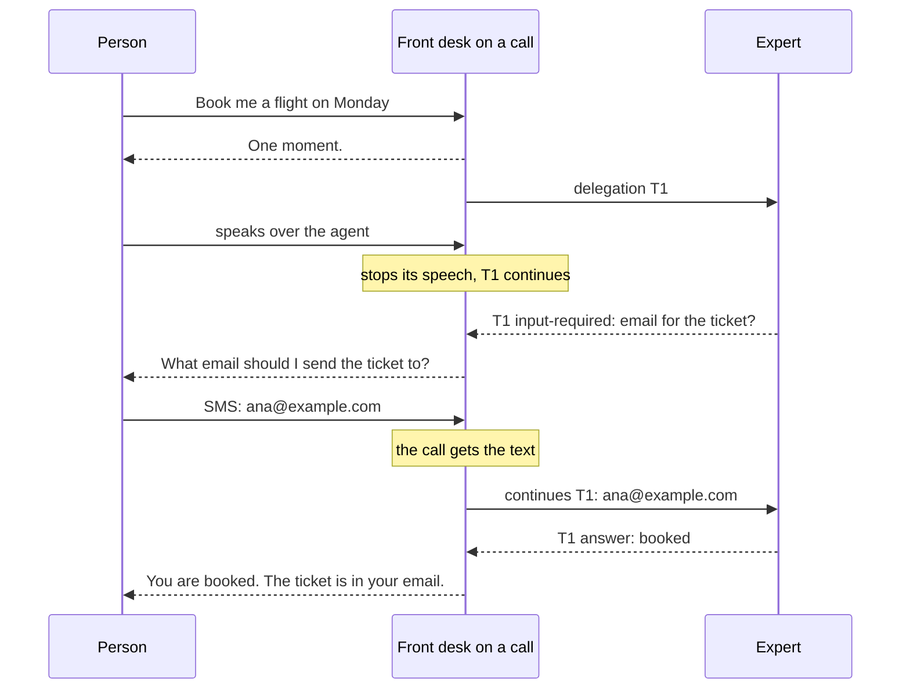

# Delegation and text over A2A

What agents do when a person or another agent sends them text over A2A, and
when one agent delegates work to another: what each party does and sees,
and why. [a2a-live-ext.md](a2a-live-ext.md) is the wire; this page is the
behaviour, and its last section says how the code does it.

## 1. Purpose and parties

This page defines what agents do when a person or another agent sends them text over A2A, and when one agent delegates work to another. It states what each party does and sees, and why. Section 8 says where it lives in the code.

The framework has one agent type, and one agent can serve every channel alone. The recommended shape is a fast/slow split: a front desk that talks to the person, and an expert that does the work. The default examples use this shape.

**Parties**

- **Person.** Talks to the front desk by voice or by text (web chat, SMS).
- **Front desk.** The agent that faces the person, on a call or over text. It owns the conversation with the person. The front desk can be one agent, or two agents (one for voice, one for text) that share one lane. The lane holds the conversation, and each agent is a door to it.
- **Expert.** An agent that the front desk delegates to. It never talks to the person directly. It is a LiveKit agent or any A2A server.
- **Client.** Any A2A client that is not a LiveKit agent: a web chat, a backend, an agent of another framework.

**Terms**

- **Thread.** One conversation. On the wire it is the A2A `contextId`.
- **Lane.** One agent's part of a thread: its history and its state. A front desk and its expert on one thread have two lanes. Only one worker writes a lane at a time.
- **Task.** One message and its answer. Every message is a task. A task ends `completed`, `failed`, `canceled` or `rejected`, or pauses in `input-required`.
- **Open question.** A task paused in `input-required`. This is not a final state. The task is saved and releases the floor at once, and it stays paused until an answer continues it.
- **The floor.** An agent holds the floor while it produces a reply or runs a tool that blocks. A tool releases the floor when it calls `ctx.update()`, and then continues in the background.
- **Inbox type.** What a lane does with a message that arrives while the lane is busy. This page adds one type, `live`, the default for `a2a` and `delegation` (the name is not final). The other types keep their behavior:

| Inbox type | A message that arrives while the lane is busy |
|---|---|
| `live` | runs when the floor is free. Messages that waited together run as one turn (section 7) |
| `interrupt` | stops the running turn at its next safe point, then runs |
| `queue` | waits until the running turn ends |
| `batch` | waits, and runs with the other waiting messages as one turn |
| `concurrent` | runs at once, with no lock, and writes no state |
| `reject` | is refused |

## 2. Flow A: a person or a client sends text over A2A

The first message without a thread starts a new thread. The task that answers it carries the thread id, and every later message names that thread. The agent answers each message on that message's own task: progress, then the answer, then the final state.

The answer belongs to the task, not to the connection. If the connection drops, the client subscribes to the task again and gets the full stream. If the client sends the same message again with the same message id, it gets the same task, and nothing runs twice.

If a message arrives while the agent is busy, the lane's inbox type decides what happens. A message from a person or a client interrupts by default: it stops the reply that the agent is producing. A tool stops only if it is marked cancellable, as in the voice pipeline.

A client stops a task with `tasks/cancel`. If a task fails because its worker died or its save failed, the task ends `failed` with the reason, and the client sends the message again with a new message id.

## 3. Flow B: the front desk delegates to an expert

The front desk records the person's message on its own lane before it delegates. A LiveKit expert can read the person's own words, not only the front desk's restatement. The expert's handler decides if it trusts the task text or reads the front desk's history. A third-party expert reads only the restatement in the task text. A LiveKit expert works on its own lane of the caller's thread. A stock A2A expert gets the request as text and keeps a context of its own, which the front desk remembers per thread.

As an option, the front desk acknowledges the request while it sends the delegation, so the person hears it at once. The expert sends progress while it works. The front desk decides when the person hears it: on a call it speaks it, in text it shows it as a working status. Once the front desk said something for that request, beside the call or after the first progress, later progress updates the task's status and the model's context only, and asks for no second reply. The front desk words the answer for the person, except the part that the expert marked verbatim, which it gives exactly as written. The expert's answer always carries its result: when its work ends in the background and its model says nothing, the tool's result is the answer. A task that still ends with no text reaches the front desk as that fact ("the expert finished with no answer"), never as its last progress line.

Under `live`, a delegation does not interrupt the expert. Under the other inbox types, the inbox type decides. A second delegation runs beside long work of the first, and each task answers on its own. If both answers reach the front desk together, the front desk gives them in one reply. If the second request asks for work that is already in flight, the expert's tool decides. If the delegation fails, the front desk gets a tool error and tells the person.

## 4. Flow C: the expert asks the person a question

The expert asks by pausing its task in `input-required` with the question. The task is saved and releases the floor. The front desk asks the person, in its own words or as written when the expert marked it verbatim.

The answer to a question is the person's next message after the question reaches the front desk. If that message cuts into the question, the expert gets it with what the person heard of the question, which can be nothing. A message the front desk has already handled is not an answer: a question that arrives after it is asked in a later turn. The answer continues the waiting task, and although an expert can leave several tasks in `input-required` at once, the front desk asks the person only one question at a time. The input goes as the person said it, and the front desk's model does not decide it. The task resumes, and the expert's model reads the question and the input. It can answer, or ask again.

Each lane records the question and the answer once. The call that asked keeps the question as its output, and the answer is the person's message on the continued task. On the front desk, the forward to the expert is a call the framework makes with the person's words, and its output is the expert's reply. A tool that requires approval runs on the repeat of its call that follows the person's answer to its read-back.

A client that talks to the expert directly, with no front desk, answers by sending the question's task id, as A2A specifies.

The question has no timeout. It waits until an input continues it, so an SMS a day later is still an answer.

## 5. Flow D: voice in front

On a call the front desk is a voice agent that delegates. The flow is Flow B and Flow C, with three differences.

- **Barge-in stops the voice, not the work.** If the person speaks over the agent, the agent stops speaking. The expert's task continues, and its answer still arrives. A text front desk behaves the same way: a new text from the person stops the front desk's reply, not the expert's work.
- **A text during the call goes to the call.** When the lane's text door is `live`, or the lane has no text door, the call holds the lane for the whole call, so it handles a text that arrives during the call. In the diagram, the email comes by SMS and the call sends it to the expert. The text's answer is the full reply the call generated for it, also the part that an interruption cut off: when the text answered a question, the call's wording of the expert's result. When the lane's text door has another inbox type, the call takes the lane for each voice turn, and the door that the message came in on handles the text.
- **A question is spoken at once.** An expert's question that arrives while the call works on something else is put to the person as soon as the call is free, and a verbatim one word for word, also on a realtime model that has no voice of its own to say a fixed text. Everything the framework adds to the call, a question, a forward and its result, a text from another door, reaches the model's own context before its next reply.
- **The realtime model can also speak.** The person's input goes to the expert without a model call. A realtime model can still answer the person on that turn by itself. The front desk's instructions keep that reply short. This is a known limit.

## 6. Where work runs

Between tasks, the thread is saved, and any worker can load it for the next message. Where a message runs matters only while it overlaps a busy lane.

With affinity routing, a message for a busy lane goes to the worker that holds the lane. That is the normal case. On that worker, the request tells the holder at once instead of through agent-db: in the same process through the lane's hub, which also hands the request its task's frames as the holder writes them and tells it when its task moved; in a job of the same worker (a call that holds its lane) through the worker's IPC. A call that delegates to a door of its own worker reaches it over the worker's loopback listener, not through the node. A lease holder is named `<worker>/<process>/<handle>`, so it shows where the lane is held.

Two rules keep the lane correct when affinity does not hold: only one worker writes a lane at a time, and a write fails if the lane changed after the writer read it. These cover a request that reaches another worker by mistake, a worker that drains, and a worker that dies.

The behavior is the same with or without affinity, and only the speed differs. Without affinity, the worker that received the message reaches the holder through agent-db. The holder runs the task and writes its durable answer stream, and the receiving worker follows that stream and relays it to the sender. Both poll agent-db for this, every second or so. Polling adds some delay, but its cost is small, because each thread has its own database. With affinity it happens only on a race between two channels.

Every task has its own durable stream, so a task that runs alone answers on its own. Messages that waited together are answered by one turn, and the earlier tasks end `completed`, merged into the last one (`mergedInto`), as under `batch`.

## 7. Behavior by situation

Each group gives the principle, the cases, and the reason.

### When the agent is busy

**Principle.** Under `live`, a new message runs as soon as the floor is free. Messages that waited together run as one turn. A message interrupts the reply by default, and a delegation does not.

| If | Then |
|---|---|
| a tool runs in the background | the message runs at once, beside the tool |
| the agent produces a reply, or a blocking tool runs | the message waits until that ends. If several messages wait, they run together in one turn, and the earlier tasks end `completed`, merged into the last one |
| the message interrupts | the reply stops, also while it streams; the part already shown is the interrupted task's answer. A tool stops only if it is marked cancellable. Other tools and background tools run to the end. The interrupted task ends `canceled`, with what it did. A task whose work goes on in the background stays `working` until the work ends, then answers and completes |
| a text arrives during a call | the call handles it, and the call's model sees it at once. Under the other inbox types, the door that the message came in on handles it |
| two answers reach the front desk together | the front desk gives them in one reply: the work that ended together is resumed in one turn, and the reply is the answer of each task, on its own stream. The earlier tasks are marked as answered with the last one (`answeredWith`), not merged into it. When one of the results asks the person, the reply gives the others first and then asks: the task whose work asked pauses in `input-required` with the question, and the others complete with the reply, which carries their results, not the question |
| an answer arrives after the front desk already replied on that topic | the front desk says only what it has not said yet, or nothing |
| a second request calls a tool that is already running | the tool's duplicate policy decides: refuse and name the running task, ask the person to confirm, or allow |
| a message has a message id that the thread already has | the sender gets the existing task, also while it runs: its stream from the first frame, under its id, with its answer |

**Reason.** Long work must not block the next request. Messages that waited together get one answer, because a model that sees them one by one answers each without the others. The sender knows if its message replaces the reply, and the server does not. An interrupted task ends `canceled` even when its tool finished, because the model never saw the result. The front desk combines answers because it is the one that talks to the person. Only the tool knows if two calls are the same work.

### When the expert asks a question

`input-required` is only for an input a tool needs to go on: an email, a yes or no on a read-back, a card number. A conversational question, such as which opening to take, is a plain reply, and the person's next message is a new request that the expert reads with its lane's history.

**Principle.** The answer to an `input-required` question continues the waiting task, and although an expert can leave several tasks in `input-required` at once, the front desk asks the person only one question at a time. The input does not pass through the front desk's model, and the expert's model decides what it means.

| If | Then |
|---|---|
| the expert needs the person | its task pauses in `input-required` with the question. The task is saved and releases the floor |
| several calls of one step ask, or work in the background asks while its task waits on a question | the task pauses once, on one question that holds every part in order and each once, verbatim only when every part is; a part that comes later joins it, and the question is asked again. The answer goes to the task's model, which reads every waiting call's question; a delegate's call takes it as said, for its expert |
| one expert has several tasks in `input-required`, or several experts ask | the front desk asks one question and keeps the others in a queue. It asks the next one when the current one is answered |
| the person sends the next input | the input goes, as said, to the task of the question in front of the person, and that task continues |
| the person's message cuts the question off: it was waiting when the question came back, or the person spoke over it | the question is kept and that message is its answer. The expert gets it with what the person heard of the question, often nothing (`livekit/heard`, and one line of the message text, so a stock expert's model reads it too). A question of the front desk's own tool goes to its model, which is told what the person had of it |
| several tasks of one lane wait at once | the lane keeps one history, and each item is marked with its task (`lk.task`). A continued task's model does not read the items that the lane's other open tasks added after its own last item, so it acts only on its own request; a read-back is answered only by a message of its own task |
| the input is not an answer ("why do you need my email?") | the expert's model handles it in the continued task and can ask again. If it asks again, see the next row |
| the answered task asks again | its new question goes first, ahead of the queue, as long as the task has not ended or released the floor. The follow-up is known by its task id, not by its words. When the task ends or releases the floor, the front desk asks the next question in the queue |
| a client answers the expert directly, with no front desk | it sends the question's task id with the answer. A message without a task id is a new input |
| nobody answers | the question stays open. There is no timeout. The questions in the queue wait behind it |
| the question was asked by text and is answered on a call, or the reverse | the input still reaches the expert. The open questions belong to the front desk's lane, not to one door |

**Reason.** The front desk cannot know if an input answers a question. A model that restates the input can change the words, or miss the delegation. Continuing the waiting task is how A2A answers a question, so a third-party expert works the same way. With one question in front of the person, the next input has exactly one task to go to, so a short "yes" never reaches two experts. A follow-up goes first so that one topic stays together, and the queue waits only while the answered task holds the floor, usually one model step. The judgment happens in the expert's own model call, which runs anyway.

### When work stops

**Principle.** An interrupt stops the reply. A cancel stops the work, and only `tasks/cancel` cancels.

| If | Then |
|---|---|
| the person speaks over the agent, or sends a new text while the front desk replies | the front desk's reply stops. The expert's task continues, and its answer still arrives |
| the person asks to stop the work ("cancel that") | it is a request. The front desk handles it with a new delegation, or with a developer tool that cancels. The framework gives the model no cancel tool |
| a task is canceled | its tools stop at their next wait point, outside the regions that they protect. The task ends `canceled` after its tools have stopped or finished, with what they did as its status: "stopped after:" and each tool's result, else the reply. `tasks/cancel` answers as soon as the task ended |
| the task already ended | the cancel does nothing, and the caller is told so |

**Reason.** The person interrupts the reply, not the request, and the work can be half done in an outside system. A cancel cannot undo work. It can only stop it, so it comes from a clear decision, not from a model reflex or a timer. The task waits for its tools before it ends, so the front desk always learns what was done.

### When something fails

**Principle.** A failure is reported on its task, and nothing runs again by itself.

| If | Then |
|---|---|
| the expert cannot be reached, or its task fails | the delegate tool returns an error, and the front desk tells the person in its own words |
| the connection to a running task drops | the delegate or the client subscribes again and reads the stream from where it stopped. The task is not affected |
| the worker that runs a task dies | the task ends `failed` with the reason `worker-lost`. The sender sends the message again with a new message id |
| a delegation names the caller's own lane | it is refused at once |

**Reason.** The tools of a lost task can have done part of their work, so only the sender can decide to try again. A network failure is not a task failure, because the stream is durable. A delegation to the caller's own lane waits for the lane that its caller holds, so it can never run.

## 8. How it is built

| What | Where |
|---|---|
| a message continues a task only by its `taskId`, and only while the task is `input-required`; the turn runs under that id, the answer is recorded once as the person's message, the asking call keeps its question as its output, and no row of its own or `mergedInto` is written | `lk-agents-storage` `turn.rs` (`run_message`, `exclusive`), `turn/step.rs` |
| a run marks what it records with its task (`extra["lk.task"]`); a read-back is answered when a user message of the same task follows it, and `requires_approval` runs only that task's repeat of the call; a continued task's model view leaves out the items of the lane's other open tasks after its own last item | `llm/tool_context.py` `approval_granted`, `as_model_reads`; `voice/agent_run.py` `_run_bound`; `storage/context.py` `TurnHost.handle` |
| a message from the person with no `taskId` goes to the question in front of them: the oldest `input-required` row of the lane that is not queued; a delegation with none is a new task. The door reads it on the connection the turn runs on | `a2a/methods.py` `_continued`, `front_question` |
| the turn tells the door which task a message is before it waits on anything (`TurnHost.accepted`): under `live` the request is acknowledged then, once the message is in the inbox; a resend is acknowledged under the existing task and relays that task's stream from its first frame | `turn.rs` `run_message`, `batch`, `exclusive`; `a2a/pump.py` `WireHost.accepted` |
| the lane's open questions are its `input-required` rows; `internal.ask` holds the question, the pending call, the delegate's tool that relays the answer, `queued`, `verbatim`; the row's metadata carries `livekit/queued` | `turn/step.rs`, `run/tasks.rs` |
| a question that a waiting message cuts off in `agent.run()` is written `input-required` with `ask.heard` (empty: nothing of it was shown), and no frame shows it; the next message that names no waiting task takes it over: its task runs with the question's call, the task that asked ends `completed` and `mergedInto` it, and the answer call carries `lk.heard`. A delegate (`relays_answer`) sends `livekit/heard` and one line; for any other question the model is told what was heard. On a call the same holds for a question whose speech the person cut (heard: what was spoken of it) and for one a call returned while the person spoke over the turn (`AgentActivity._cut_off`) | `turn/step.rs` (`taken`), `turn.rs` `ended`, `voice/agent_run.py` `ask`, `steps`; `delegation/a2a.py` `_send`; `voice/agent_activity.py` `_answer_pending_input`, `_cut_off` |
| every call of a step runs, and the step's questions are one (`joint_question`); a task's open question is read from the history: its calls whose output is the question and that no message of the task followed. A resumed turn whose task waits asks that question again, joined with what its work asks, or after its reply when the work asks nothing; a verbatim part's call carries `lk.verbatim`. A question that is asked while work of its step runs in the background is written at once, and the task keeps `livekit/background` | `voice/agent_run.py` `ask`, `open_question`, `steps`; `voice/agent_activity.py` `_joint`, `_put_question`; `turn/step.rs` |
| the answer to a delegate's question goes to its tool, as said, with no model call: the delegate marks its tool (`relays_answer`), `agent.run()` makes one call per relaying asking call with `extra["lk.answers"]`; on a call `AgentActivity._continue_question` does; `A2ADelegate` reads the asking call's `lk.delegation.task_id` and continues the expert's task by `taskId`. Any other answer goes to the task's model | `voice/agent_run.py` `_answer_calls`, `voice/agent_activity.py`, `delegation/a2a.py` |
| on a call, what the framework adds goes into the model's own context before a reply; a verbatim text on a model with no `say()` is spoken by asking the model; a question is asked once its speech is scheduled, and a failure is an `error` event on the call's lane | `voice/agent_activity.py` `_add_items`, `_say_as_written`, `_ask`; `storage/live.py` `error` |
| a text during a call is answered with the full text the call generated for its turn; an empty transcript is no turn | `voice/speech_handle.py` `_generated`, `voice/agent_session.py` `_answer_texts`, `voice/agent_activity.py` `_on_input_audio_transcription_completed` |
| `live`: the inbox rows of `batch`, drained with no debounce by the lane's holder; a waiting row that interrupts trips the running turn's boundary, which the run reads before each model call and, told by the lane's hub, while the reply streams | `turn.rs` `drain`, `turn/host.rs` `Boundary::live`, `voice/agent_run.py` `_infer` |
| a tool's first `ctx.update()` in `agent.run()` under `live` lets the run go on, and ends the turn on the reply beside the call when there was one; the tool runs in the worker, the task stays `working` with `livekit/background`, the holder keeps the lane while work runs; the work that ended is resumed in one turn, whose reply answers each task (`livekit/answeredWith`) and is told to tell the results, since no reply had them in front of it; when a result asks, the reply answers the others and the asking task waits (`HandlerOutput.asked_task`), and another task whose result asks waits behind it, queued (`HandlerOutput.waiting`); an expert's silent model answers with the results. The model step that reads only progress runs with `tool_choice="none"`, in text as on a call. On a call the "may be covered" rule applies only when a reply came after the result landed, and a later progress update asks for no reply once the turn said something for its call, beside it or in any reply after its first output (`told_for`) | `voice/events.py`, `voice/agent_run.py` `_execute`, `steps`, `voice/tool_executor.py` `_deliver_reply`, `storage/hub.py`, `turn.rs` `hold`, `resume`, `turn/step.rs` |
| the holder's turns share one live state object while it holds the lane, so a tool in the background writes the state the next turn commits | `storage/context.py` `TurnHost.handle`, `storage/hub.py` |
| every task's frames go to its own answer stream; a request whose task another holder runs relays that stream, or reads the frames from the lane's hub when the holder is in its process; a stream is closed off the holder's path, so the holder takes the next message without waiting for the frames to be sent | `a2a/pump.py` `WireHost.on_end`, `ResponsePump.follow`, `ResponsePump.finish` |
| the requests of one process share a live connection to a thread's database: a message to a lane whose holder is in the process dials nothing | `lk-agents-storage` `statements.rs` `DbPool` |
| a request tells a holder in its process at once (`TurnHost.arrived`) and hears when its task moved (`settled`), also when the end landed just before it waited; a holder in a job of its worker hears it through IPC (`LaneSignal`, after the job's `LaneHeld`), and the job tells the worker when a text it answered ended (`TaskMoved`); only a holder on another worker is polled, and only then is it logged | `storage/hub.py`, `storage/context.py`, `ipc/proto.py`, `ipc/job_proc_*.py`, `worker.py` |
| a call's delegation to a door of its own worker goes over the worker's loopback listener, found through `LIVEKIT_AGENT_LOCAL_ROUTES` | `http.py` `serve_loopback`, `worker.py`, `delegation/a2a.py` `_LocalRoutes` |
| `tasks/cancel` on a running task records `livekit/cancelRequested` and signals the holder; the boundary and a tool watcher see it; the tool stops at its next wait point outside `ctx.uninterruptible()`; the turn writes `canceled`, with what ran as its status; the cancel answers when the holder says the task ended; a terminal row is never written again | `statements.rs` `request_cancel`, `turn/step.rs`, `voice/agent_run.py` `_watch`, `voice/events.py`, `statements/sql.rs` `upsert_task` |
| a delegation writes the person's message to the caller's lane before it sends, and names that lane: under the text run's fence, or under the call's lease and version | `turn/host.rs` `Boundary::record`, `storage/live.py` `record`, `delegation/a2a.py` |
| the call's mode follows its lane's text door: under `live`, or with none, the call holds its lane for the whole call and drains its inbox, a text is a turn of the call; else it takes the lane per voice turn | `worker.py` `AgentServer.add`, `storage/resolve.py` `Thread.call_holds_lane`, `storage/live.py`, `voice/agent_session.py` `_answer_texts` |
| a dropped answer stream is read again with `tasks/resubscribe`; an expert task with no text is `NO_ANSWER`, never its progress | `a2a/client.py` `resubscribe`, `delegation/a2a.py` `_answer`, `NO_ANSWER` |

One choice the sections above leave open, as built: the door cannot tell a person's web chat from a client that talks to an agent directly. A message that is not a delegation and names no task is treated as the person's: while a question is open on the lane, it answers the question in front. A direct A2A client that wants a new task tags its message as a delegation (`livekit/kind: delegation`), or sends it to a lane with no open question.

A second choice: the person's client sees the task whose question was cut off end `completed`, `mergedInto` the task of the message that answered it, and gets the answer on that message's own task, as for messages that waited together. The cut-off question itself is never shown.

What the code does not do yet is in [TODO.md](TODO.md).
