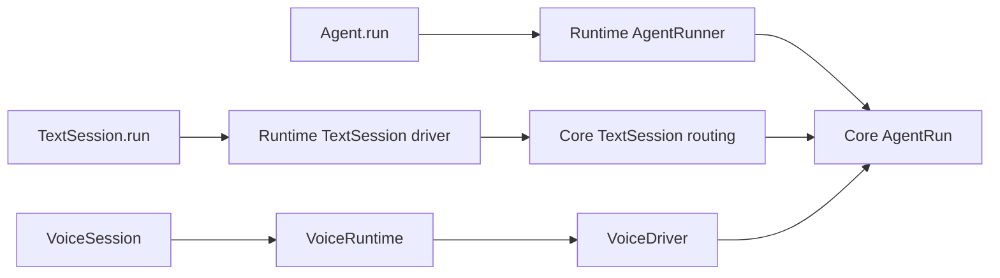

# Architecture

Crate boundaries, decision ownership, runtime composition and the design basis.

[Contributor index](README.md)

## Execution paths

The public Python API crosses generated ABI bindings into runtime executors and synchronous
Rust decision owners. Follow the path for the operation being changed, then read the
[component contract](components.md). Generated file headers identify their declaration source.



Generated bindings connect ABI contracts to implementations. Their file headers identify the
declaration source; edit that declaration or its implementation, then run codegen. Do not start
by reading generated conversions unless investigating a boundary/conversion problem.

### Direct agent invocation

1. [`Agent.run` / `run_stream`](../../livekit-agents/livekit/agents/voice/__init__.py) calls
   [`start_run`](../../livekit-agents/livekit/agents/voice/agent_run.py), which constructs
   `_core.AgentRunner` with the agent definition, model and host callbacks.
2. [`AgentRunner`](../../rust/crates/lk-agents-abi/src/agent/run.rs) is implemented by
   [`runtime::agent_run::Runner`](../../rust/crates/lk-agents-runtime/src/agent_run/runner.rs).
   It supplies `Opening::Message` and starts the invocation driver.
3. [`AgentRun::handle`](../../rust/crates/lk-agents-core/src/agent_run/machine/mod.rs) consumes
   model/tool/validation outcomes and emits
   [`AgentRunEffect`](../../rust/crates/lk-agents-core/src/agent_run/effects.rs).
4. [`runtime::agent_run::Execution`](../../rust/crates/lk-agents-runtime/src/agent_run/execution.rs)
   performs host/model work. The driver returns events to the machine and exposes streamed
   updates through [`RunStream`](../../rust/crates/lk-agents-runtime/src/run_stream/mod.rs).

Start with the `AgentRun` event and effect enums, then one handler branch. Model-step, tool-call,
output and cancellation state are subordinate to that invocation, not independent agent loops.

### Request-scoped text conversation

1. [`TextSession.run_stream`](../../livekit-agents/livekit/agents/text_session.py) constructs
   `_core.TextSessionRunner` from the configured agents and explicitly supplied state.
2. [`runtime::text_session`](../../rust/crates/lk-agents-runtime/src/text_session/mod.rs) drives
   [`core::text_session::TextSession`](../../rust/crates/lk-agents-core/src/text_session/machine/mod.rs).
3. `TextSession` owns backend frames, child routing and history transfer. It constructs an
   `AgentRun` with `Opening::Message` for each invocation; invocation effects are carried by
   [`TextSessionEffect::Run`](../../rust/crates/lk-agents-core/src/text_session/effects.rs).
4. The runtime uses the same `agent_run::Execution` for those effects. A store-bound invocation checkpoints accepted state; snapshot-only execution leaves
   saving explicit. TextSession does not own a live voice session.

A2A is a separate transport/durable-task boundary. Follow [`core::a2a`](../../rust/crates/lk-agents-core/src/a2a/mod.rs)
and [`runtime::a2a`](../../rust/crates/lk-agents-runtime/src/a2a/mod.rs) only when investigating that door.

### Pipeline voice reply

1. [`VoiceDriver`](../../rust/crates/lk-agents-voice/src/agent_session/machine/driver.rs) receives
   session events. [`AudioRecognition`](../../rust/crates/lk-agents-voice/src/audio_recognition/machine/mod.rs)
   determines user-turn observations; activity scheduling determines floor admission.
2. [`agent_activity::speech`](../../rust/crates/lk-agents-voice/src/agent_session/machine/activity/speech.rs) starts
   a [`ReplyRun`](../../rust/crates/lk-agents-voice/src/agent_session/machine/activity/reply_run.rs), which contains
   an `AgentRun` with `Opening::Coordinated`.
3. That opening lets voice supply request/history snapshots and floor constraints while the
   shared invocation owns approval, tool classification, retry and output decisions. The
   `PlanRequest` / `HandleToolResults` handshake is declared in `AgentRunEffect`.
4. [`runtime::voice::generation`](../../rust/crates/lk-agents-runtime/src/voice/generation/mod.rs)
   runs the model, tools and TTS. Outcomes return through the voice queue to `VoiceDriver` and
   its composed `AgentRun`; voice does not start the standalone text runner.
5. [`AudioPlayback`](../../rust/crates/lk-agents-voice/src/generation/machine/audio_playback.rs)
   accounts for delivered audio. Invocation output acceptance and physical speech settlement
   are separate facts; a finished model request does not mean the person heard its output.

### Realtime voice reply

Follow the same `VoiceDriver` → `ReplyRun` → coordinated `AgentRun` ownership path, then read
[`agent_activity::realtime`](../../rust/crates/lk-agents-voice/src/agent_session/machine/activity/realtime/mod.rs)
and [`runtime::voice::generation::realtime_generation`](../../rust/crates/lk-agents-runtime/src/voice/generation/realtime_generation.rs).
The provider owns server response initiation and protocol state; voice owns local floor,
interruption and presentation. Shared invocation policy receives the reply/tool outcomes.
Do not infer that a server follow-up should also start a client-generated response.

## Ownership boundaries

| Layer | Owns | Boundary |
| --- | --- | --- |
| Span recording | The spans sans-I/O machines own through their `Trace`, and the process `Tracer` with the `ScopedSpan`s of async work (`lk-agents-telemetry`) | No executor or transport: the sans-I/O crates depend on it; their Clippy policy bans its async half |
| Decision cores | Agent execution, tool/approval/output policy, session lifecycle, scheduling, MCP and A2A task decisions | Synchronous events in, effects out; no I/O, executor, or host objects |
| Data-plane core | Media transformations, buffering, gates, fan-out and playout accounting | Frames and control data in, transformed data and effects out; no device or network access |
| Async I/O crates | The shared transport, the host stream adapter, the delegation A2A client, and telemetry's export: the OTLP exporter and the Cloud session report upload (`lk-agents-net`); provider clients with retry, fallback and reconnect execution, provider-side media execution and evaluation judge orchestration; worker registration, IPC and supervision; storage (all database interaction, reported as typed errors) | Ordinary async Rust, tested on their own against real peers and processes and faked in the DST; host access only through declared proxies |
| `lk-agents-runtime` | The I/O layer of voice and text: voice session executor, room I/O, avatar transport and recording ingress, AgentRun and TextSession drivers, A2A door and MCP session I/O, HostInvoker and the process runtime | Executes core effects, returns correlated events and wires the async I/O crates; makes no decisions |
| `lk-agents-py` | Python module registration, generated conversions and adapters, and HostInvoker's Python entry | The only crate containing pyo3; no framework policy or I/O implementation |
| Python package | Public API, user callbacks, provider implementations, host SDK objects and process launch/bootstrap | Calls `_core`; host objects are reached through generated proxies and HostInvoker |
| Build tools | Binding generation and architecture checks | Read export declarations from ABI; no product execution responsibility |

A provider implementation may perform its own I/O in Python. Framework access
to that provider goes through a generated proxy entered by HostInvoker; a core
receives only data and resource IDs. The same boundary applies to application
tools and host RTC objects.

### Voice lifecycle owners

Keep one discoverable runtime boundary for each lifecycle while allowing private synchronous
submachines inside its owner:

| Owner | Runtime-facing contract | Responsibility |
| --- | --- | --- |
| `AudioPlayback` | `AudioPlaybackEvent` / `AudioPlaybackEffect` | One generated segment's source forwarding, interruption, cut-receipt wait, completion and heard-audio accounting |
| `TranscriptSync` | `TranscriptSyncEvent` / `TranscriptSyncEffect` | Transcript attachments and close, queued segments and word pacing; direct word/flush/heard effects |
| `Hooks` | Existing hook calls/results, with common terminal acceptance and dispatch | One terminal cause per hook; exit continuation deferred until dependent state is installed; abandonment suppresses delivery |
| `OutputBindings` | `OutputBindingEvent`, answered through the correlated session answer stream | Reserve, activate, retain while physical cleanup is pending, and release the exact binding |
| `GenerationPreparation` | Scoped preparation events/effects and ordinary `PlaybackAuthorization` outcomes | Admit speculative synthesis and retain step-wide authorization across segments, including text-only output |

Playback's forwarding, receipt, finishing, and accounting helpers are private. Transcript's
segment queue and pacer are private. The runtime sees the enclosing owner's protocol rather
than nested instruction enums. Output bindings cover both audio and text and may outlive
cancelled generation. Room transport owns publication/backpressure and sink observations;
it is not merged into generated-speech playback. Speech/floor scheduling and per-segment
launch holds remain distinct from generation-step authorization.

Each crate's `effects.rs` index records every named effect enum with its producer and
executor. Most executor protocols are peers; `RoomIo` exposes no `RoomIoEffect` enum.

### Effect and machine source layout

Every decision subject in `lk-agents-core` and `lk-agents-voice` has the same three parts, so
a reader can tell from the path what is state and what is output:

```text
<subject>/
├── mod.rs       the subject: its records, configuration and re-exports
├── machine.rs   the state machine: inputs in, effects out (machine/ once it has several owners)
└── effects.rs   the machine's output: what it asks the runtime to do
```

- **`machine`** holds the synchronous owners: their private state, their input enum
  (`AudioPlaybackEvent`, `AgentRunEvent`) and `handle(event, now) -> effects` with their domain
  methods. Nothing in it performs I/O; it is what the DST drives.
- **`effects.rs`** holds only the effect enums the subject's machines return, and their payload
  types (`AudioPlaybackEffect`, `ToolCallEffect`). It is the subject's contract with its
  executor in `lk-agents-runtime`: reading it tells you everything the machine can make
  happen. Effects never carry behavior beyond data.
- **`mod.rs`** is the subject's entry: `pub mod machine; pub mod effects;`, the re-exports
  callers use, and the records both sides share. These are configuration, setup, limits and
  observations that are neither state nor output (`AmdSetup`, `StreamBudget`).

`machine` is a single file until it has several owners or outgrows the file limit, then a
directory with one file per owner (`generation/machine/audio_playback.rs`,
`room_io/machine/attachment.rs`); an owner large enough to need several files gets its own
directory there (`agent_session/machine/activity/`, the active agent's state inside
`VoiceDriver`, whose effects are `agent_session/effects.rs`). Inputs shared by several machines and also forwarded by the
runtime (`generation::events::SpeechSegmentEvent`) get their own file beside `effects.rs`.
Helpers that return values instead of effects (`transcription::filters`) sit beside the three
parts.
Each crate's `effects.rs` indexes every subject's effect enums with its producer and executor;
a new effect enum is added there. Data-plane code in `lk-agents-media` and the async I/O
crates do not use this layout.

For example, `generation::machine::AudioPlayback` produces
`generation::effects::AudioPlaybackEffect`. `VoiceDriver` is in `agent_session::machine`;
`VoiceRuntime` executes it. `AudioInputRouter` routes source frames independently of
generated-audio playback.

Small helpers stay beside their component instead of introducing another module to learn.
The current core/voice source locations are:

| Component | Source location |
| --- | --- |
| AgentRun correlation IDs | `core::agent_run` domain entry; transitions remain under `agent_run::machine` |
| Chat history plans and their host adapter | `core::llm::history` |
| Provider image projections | `core::llm::provider_format` domain entry |
| TextSession fresh/fork selection and delivered-dialogue transfer | Private helpers beside `core::text_session::machine::TextSession` |
| Expressive markup host API and XML rendering | `core::markup`; steering vocabulary filtering and prompt construction share `markup::instructions` |
| Voice driver initialization and recognition dispatch | `voice::agent_session::machine::driver` |
| User-turn recognition state and STT/VAD/detector transitions | `voice::audio_recognition::machine`; configuration, commit guards and diagnostic records remain at the domain entry |
| Session recorder facts and output-node snapshots | `voice::agent_session`; startup selection facts share `agent_session::lifecycle` |
| Voice run recording and settlement | Distinct owners colocated in `voice::run_result` |
| Tool completion policy | `voice::tool_executor`, shared by runtime body and progress execution |
| Workflow templates and rendering | Constants beside their DTMF/transfer owner; common rendering in `voice::workflows` |

These locations describe source organization, not additional crates or wrapper types.

`VoiceDriver` privately owns one runtime outbox and a FIFO of scoped `VoiceCallback`s.
Domain methods return their own outcomes instead of receiving a shared collector. The
coordinator advances scheduling and close after complete domain transitions and callback
boundaries; downstream callers never pump either lifecycle manually. Timer changes use
`set_deadline`, `clear_deadline` and observational `deadline` queries. Revised deadlines do
not fire recursively within the transition that changed them. Only input flush/overlap
identity resolution remains deferred privately until that transition installs its resources.

Run completion queries attributed speech, hook, handoff and hold owners rather than a
second pending-work registry. A voice run settles into the `RunSettled` record a text run
settles into: the core records the run's items, counts the requests and tool bodies of the
speeches it owns in its own usage ledger, and the host receives the caller's `RunResult`, the
record declared in `lk-agents-abi/src/agent/run.rs`. `RunResult.input_requirements` preserves
every correlated request; the singular `question` is the first of them. Supplied history
retains which request that question exposed so the next human answer cannot answer other
waiting calls accidentally. Deadline/event ties preserve deadline-first processing, including
a receipt queued earlier but processed at its cleanup bound.

### RoomIo is the room integration owner

`RoomIo` is the single entry point for the agent session's LiveKit room integration. Its
synchronous lifecycle/selection state lives in `lk-agents-voice::room_io`; its executor and
physical participant input/output adapters live in `lk-agents-runtime::room_io`. ABI's RTC
records/ports describe the supplied SDK capabilities. Do not add another generic `Room`
controller on top of `RoomIo` or combine all child protocols into one flat room state machine.

Within this area, keep participant linking, track input/subscription, output publication and
playback, pre-connect audio, text ingress, and transcription publication discoverable by
responsibility. The existing `RoomIo` executor coordinates their attachment and teardown;
children retain their own state and resource obligations. Use room-scoped names on protocols
that cross their boundary: `RoomTranscriptionWriter` emits `RoomTranscriptionEffect`, not a
generic `WriterEffect`. Other generic child names remain audit candidates, not justification
to add new event/effect types where ordinary operations suffice.

`TranscriptSync` decides when transcript words become visible; room transcription publishes
them through room streams/legacy messages. `AudioPlayback` owns generated-speech forwarding
and completion; room output owns its physical transport sink. TTS `AudioEmitter` frames
provider audio before either. These are connected lifecycles, with separate owners.

### TTS audio emission

There is no generic all-media emitter. The familiar `tts.AudioEmitter` has two implementation
halves: synchronous PCM framing in `lk-agents-media::emitter::AudioEmitter`, and decoding,
ordered delivery, and timer execution in `lk-agents-inference::tts::emitter::AudioEmitter`.
The public Python/ABI `AudioEmitter` contract remains the same.

Provider bytes are decoded to PCM when necessary, framed progressively, and emitted as
`SynthesizedAudio` with transcript alignment and usage metadata. A short audio tail is retained
so segment completion can mark the final frame; a flush deadline releases that tail if
production falls behind. The media owner receives time as input and emits ordinary
`Vec<AudioEmitterEffect>` requests: `EmitAudio`, `ScheduleFlushAfter`,
`CancelScheduledFlush` and `ReportDroppedBytes`; provider request ids ride on the emitted
`SynthesizedAudio`. There is no
`Effects` alias or generic `HostEffect` protocol at this boundary.

`ScheduleFlushAfter` carries a relative duration; inference applies it on the injected clock.
The actual timer calls `on_flush_deadline`. Replacements and cancellation preserve the
existing one-timer semantics. Inference delivers effects after releasing the framing-state
lock, so calling the host does not reenter a borrowed/locked machine. This emits synthesized
audio; it does not authorize playback, route room tracks, or report what a person heard.
## Crates and dependencies

| Crate | Responsibility |
| --- | --- |
| `lk-agents-abi` | Public export declarations and typed boundary records: chat items, events, effects, errors and resource descriptions; contracts and data, plus the hand-written Python plugin bases (`stt.py`, `tts.py`, `llm.py`, `realtime.py`, `vad.py`) beside their proxy traits |
| `lk-agents-core` | Shared AgentRun, request planning, the attempt machine every retried request shares (connection limits, retry allowance and backoff, total deadline, cleanup), tool/approval/recovery and output acceptance; backend TextSession routing/frame composition; A2A endpoint policies and task transitions (`lk_agents_core::a2a`) over ABI-declared storage request/result records and error types; MCP tool listing, schema rendering, result and error mapping, pagination, close decisions and HTTP response classification; chat formatting, tool-argument processing, JSON repair, tool search and deterministic run/event assertions; speech tokenization and expressive markup (`lk_agents_core::tokenize`, `lk_agents_core::markup`); telemetry destination policy, metric admission and session report records (`lk_agents_core::telemetry`); no voice lifecycle or transport dependency |
| `lk-agents-voice` | Frontend/session lifecycle, recognition, speech scheduling, interruption, IVR, AMD and media coordination; transcript pacing decisions; composes agent execution from `lk-agents-core` |
| `lk-agents-storage` | Async I/O: all database interaction: schema and statements, the AgentDB and SQLite backends, retries, fencing, lease renewal and lost-acknowledgment resolution; every failure is a typed error: the database's `Uncertain`, `Rejected { running_task_id }`, `LeaseLost`, `Unavailable`, `NotFound` and `VersionConflict`, the caller's `Invalid`, `NotSerializable`, `TooLarge` and `Unauthorized`, the handler's `Refused(HostError)`, and `Cancelled` |
| `lk-agents-media` | Synchronous decoding, encoding, TTS audio framing, image preparation and conversion, resampling, media filters, recording files and sample arithmetic; optional native codecs; synchronous CPU work with no async runtime; the one worker pool primitive (bounded plain threads with per-class admission) and the process's media pool |
| `lk-agents-net` | Async I/O: the shared transport: HTTP with per-limit deadlines, SSE, WebSocket connect, owned tasks and gateway token signing; the host stream adapter through which native sources reach the host (one pull at a time, a close that settles the pull in flight); the delegation A2A client for remote agent calls; telemetry's export (`lk_agents_net::export`): the OTLP exporter for every telemetry destination and the process's exporter slot, the LiveKit Cloud session report and recording upload with its own bounded admission, the host span (`_core.TelemetrySpan`) and `Tagger` classes, event-loop stall recording, the job's sampled stack profile (`export/profile`, pprof, carried by the recording upload) and the worker's Prometheus exposition (`export/prometheus.rs`); the process environment value (`lk_agents_net::env::ProcessEnv`) and the process's blocking I/O pool |
| `lk-agents-telemetry` | Span recording: `Trace` and `ManualSpan` for sans-I/O machines; the process `Tracer`, `Cx`'s recorder, `ScopedSpan` and `start`/`end`/`event`/`measure` for async work. Depends only on ABI; no executor or transport |
| `lk-agents-inference` | Async I/O: provider clients for LLM, STT, TTS, VAD and EOT models, interruption, realtime, duplex and avatars, with their retry, fallback and reconnect execution; provider-side media execution: the TTS audio emitter (decode admission, drift timer, segment finalization), the streaming decoder's bounded output queue and provider image preparation on the media pool; speech stream adapters; evaluation judge orchestration |
| `lk-agents-worker` | Async I/O: worker registration and job assignment, IPC, process pool and supervision, and endpoint byte-stream dispatch |
| `lk-agents-cli` | Shared launcher: clap parsing, normalized JSON logs, remote CLI connection, and process shutdown deadline |
| `lk-agents-runtime` | The I/O layer of voice and text: the voice session executor and its effect execution, room I/O, avatar transport, recording ingress and the console port adapter, AgentRun and TextSession drivers, the thin A2A door (executes core's storage effects through `lk-agents-storage` and feeds the typed results back), thin MCP session I/O over the SDK, HostInvoker and the process runtime with its fork guard; wires the async I/O crates and re-exports the implementations generated bindings select |
| `lk-agents-py` | Python extension registration, generated pyo3 conversions and adapters, HostInvoker's Python entry; the only crate containing pyo3 |
| `lk-agents-bindgen` | Binding declaration parser and the resolved declaration IR |
| `lk-agents-host-derive` | The `#[host(..)]` attribute, which strips the markers rustc does not know and writes the Rust a declaration implies (a record's `new` and `Default`, a wire enum's `ALL`, `as_str` and `from_wire`, interface helpers); the `Table` and `Vocabulary` derives; telemetry's `Attrs` and `SpanValue` derives and `span`/`event`/`metric`/`record` attributes |
| `lk-agents-codegen` | Python models, stubs, provider bases, forwarders and architecture checks |
| `lk-agents-fuzz` | Deterministic simulation of the sans-I/O crates and behavioral contracts, running the runtime's real executors over faked SDK and provider ports |

```text
lk-agents-py -> lk-agents-runtime, lk-agents-abi
lk-agents-runtime -> sans-I/O crates, async I/O crates
lk-agents-runtime -> lk-agents-cli -> lk-agents-worker, lk-agents-net, lk-agents-abi
lk-agents-voice -> lk-agents-core -> lk-agents-abi
lk-agents-voice -> lk-agents-media
lk-agents-inference -> lk-agents-media
lk-agents-inference -> lk-agents-core
lk-agents-net -> lk-agents-core
lk-agents-net -> lk-agents-media (the worker pool primitive)
inference, worker, storage -> lk-agents-net
voice, media, net, inference, storage, worker, runtime, fuzz -> lk-agents-telemetry -> lk-agents-abi
async I/O crates -> lk-agents-abi
fuzz -> sans-I/O crates + lk-agents-abi
lk-agents-fuzz -> lk-agents-runtime (voice and room executors over fake ports)
abi, storage, py -> lk-agents-host-derive
```

The authoritative edge list is `GRAPH` in `rust/check/src/graph.rs`; `make -C rust check`
fails on any workspace edge it does not list.

The sans-I/O crates are `lk-agents-core`, `lk-agents-voice` and
`lk-agents-media`. `lk-agents-media` is a synchronous data-plane core with no
async runtime, so voice and inference compose it like `lk-agents-core`; inference
also uses `lk-agents-core`'s chat formatting, strict tool schemas and JSON repair
for the request bodies it sends.
`lk-agents-core` has no dependency on `lk-agents-storage`: its A2A decisions
emit storage effects over request/result records and error types declared in
ABI, and the runtime's A2A door executes them by calling storage.

`lk-agents-net` is the one shared async transport and hosts the delegation A2A
client: inference, the worker and the AgentDB backend use its HTTP client with
declared per-limit deadlines, SSE decoding, WebSocket connect, owned task handles
and gateway token signing rather than building their own. The delegation
client executes the client decisions of `lk_agents_core::a2a`.

The runtime depends on the async I/O crates to wire voice and text sessions:
providers, storage, the worker server, judges and the delegation client in
`lk-agents-net`. `lk-agents-py` depends only on the runtime and ABI: it uses ABI for the declared types its generated conversions translate, and the
runtime re-exports the implementations of declared classes that its generated
adapters select. Async I/O crates depend on ABI and never on the runtime,
`lk-agents-py` or pyo3; they reach host code only through ABI-declared proxies
and HostInvoker's declared port.

The runtime owns the process-wide Tokio runtime and fork guard, and lends
them as one value, `lk_agents_net::env::ProcessEnv`, never through a dependency
on the runtime. It is a plain struct:

| Field | Lends |
| --- | --- |
| `runtime` | The process runtime (started on first read, refused when fork-inherited) |
| `spawner`, `clock` | The executor the host awaits a chain's futures on and the host `Clock` |
| `http` | The shared HTTP pool |
| `tracer` | The process's span recording, timed by `clock` |
| `tasks` | The process's own tasks: work no session owns, each bounded and ending on its own |

Log lines never pass through `ProcessEnv`: `log` records are queued without the GIL and
`lk-agents-py`'s drain thread (`py_logging.rs`) forwards them to Python's `logging`.

Process-wide resources that need no runtime are owned by the crate whose work
they bound, made on first use in each process (a forked child makes its own):
the media pool (`lk_agents_media::pool::media_pool()`), the blocking I/O pool
(`lk_agents_net::blocking_io::blocking_io()`) and the session report admission
(`ReportAdmission::process()`). Image preparation is inference's: a host frame
crosses as an `RtcVideoFrame` proxy that hands over its own RGBA pixels. Both pools are instances of one primitive, media's
`Pool`: plain threads that start on demand and exit when idle, with synchronous
admission per class. The media pool runs codec, recording, image and model work;
the blocking I/O pool (four threads) runs name resolution, file access and
process sampling, so saturated payload work never blocks a lookup or a health
sample.

Tokio is the reactor, timers and awaits; it runs no blocking work. Names resolve
through `lk_agents_net::dns` (the system resolver on the blocking I/O pool): it is
reqwest's resolver, and WebSocket and TCP connects resolve there and connect by
address. Files are `std::fs` on the blocking I/O pool. The I/O Clippy policy bans
`spawn_blocking`, `block_in_place`, `tokio::fs`, `lookup_host`, Tokio's stdio and
tokio-tungstenite's resolving connects. The process runtime keeps
`max_blocking_threads(1)` for third-party crates that still resolve through Tokio
(web-transport-quinn's connect, livekit-api's HTTP client).

A declared class that needs the process declares `#[host(env)] type Env;` and
takes `env: &Self::Env` in its constructor or function; the generated binding
passes the runtime's value (`lk_agents_runtime::process::env()`), hidden from the
host's signature. Internal constructors take the handles they need; there is no
`Env` type parameter. Runtime-bound handles are read on use, so constructing a
class starts nothing. Rust callers and tests build their own value
(`ProcessEnv::current_runtime()`, with fakes as needed). Providers and judges call
the speech text algorithms (`lk_agents_core::markup`) directly; a synthesis's
sentence splitting is core's (`tokenize::sentences`).

The sans-I/O crates and ABI have no runtime, executor or transport in their resolved
dependency tree: no Tokio, futures, pyo3, async-trait, async-std, smol, mio, hyper,
reqwest, tungstenite, rusqlite, `livekit`, `livekit-api` or `livekit-ffi`, checked on
every wheel target (`BANNED` in `rust/check/src/graph.rs`); `livekit-protocol` records are
fine. Async I/O crates use Tokio, process and database
crates directly and reach the network through `lk-agents-net`. Runtime adapters depend on cores; cores never
depend on adapters. Build tools read declarations without adding runtime
dependencies to cores.

Reuse `livekit-protocol`, `livekit-api` and `livekit-token` from LiveKit's Rust
SDK. Protocol records may cross the ABI boundary; API clients belong to the I/O
code that uses them, and gateway token signing to `lk-agents-net`.
## Cores and the runtime

### Core interface

The composed core exposes these synchronous operations to its queue owner:

```text
handle(event, now) -> effects
wake_at() -> Option<Ts>
```

Each composed core defines its typed outer boundary. Related inputs may share
an outer envelope; private submachines keep domain-specific methods and outcomes.
Do not force all components into one global Event/Effect enum or require every
helper to return `Vec<Effect>`. Host-exported contracts live in ABI. Ordinary Rust
core-to-executor effect declarations stay in their owning subject crate/category; being
`pub` in Rust does not make them host ABI exports. Private machine inputs and state remain
with their owning subject module.

`AgentActivity` owns private activity state. Session coordination uses activity
operations for speech, recognition, handoff and exit transitions; it does not
borrow the child machines or mutate their bookkeeping. The session retains
floor, configuration, storage and close ordering across those operations.

`now` supplies monotonic time and its wall-time mapping. Core-generated IDs use
counters seeded at construction. The core reads no clocks or entropy, starts no
tasks, takes no locks, and retains no channels, callbacks, provider objects or
futures.
Environment, process and OS state enter as supplied configuration or events.
Deterministic iteration order is required for all decision state.

Events and effects are typed data. Runtime-owned resources are identified by
`ResourceId`, with descriptions such as kind, capabilities, sample rate and
label. The runtime retains the actual providers, rooms, inputs, outputs and
recorders.

### Effect execution

The runtime owns the input queue and calls the core one event at a time. It
executes effects, waits for I/O or deadlines, and returns results as correlated
events. The current default dispatches a due wake before another input at the same supplied
instant, in both production and simulation. A change to advancement pins or deliberately
revises before/equal/after-deadline and queued-earlier/processed-later receipts with tests.
Other independent events remain schedulable.
Sessions share the runtime; there is no dedicated thread per session.

Runtime tasks serve asynchronous resource lifetimes and independent I/O. A
submachine does not need a task merely because it owns state. An effect names
an operation at a declared resource boundary; its adapter performs the required
transport reads/writes and SDK integration without turning every low-level I/O
step into another framework effect.

Each resource protocol defines command submission order. Independent resources
may progress concurrently. Dependencies on completion live in the owning core:
it authorizes dependent work after validating the required outcome. Position in
an effect collection does not imply that earlier work has completed.

Every outcome-bearing effect reports success or failure, including failure to
launch. Completion acknowledgments require the operation's declared
postconditions to hold. Late work cannot invalidate an acknowledged terminal
outcome.

Tokio drives I/O, not conversational policy. Interruptions, tool scheduling,
session and workflow deadline decisions belong to cores. Provider retries,
reconnects and fallback execute in `lk-agents-inference`, and process supervision
in `lk-agents-worker`, under the shared request and lifecycle contracts. An
adapter may sequence I/O and manage its resource lifecycle; it must not make
conversational or workflow decisions.

The runtime's executors (voice session, room I/O, avatar transport and their
drains and legs) use no Tokio runtime: no `tokio::spawn`, `tokio::time`,
`tokio::net`, `Handle` or `Runtime`. They spawn and sleep only through the
injected `Spawner` and `Clock`, so the [DST](testing.md#deterministic-simulation-testing)
runs the same code on its deterministic scheduler. Tokio's executor-agnostic
sync primitives (`watch`, `mpsc`, `oneshot`, `Notify`) are allowed, and every
`select!` is `biased;`: an unbiased select picks a branch at random. A socket
belongs to a boundary adapter, like the SDK room or the console's TCP port,
which the DST replaces with a port fake; everything above the port follows the
executor rules.

### Runtime layout

Every runtime module is I/O; the decisions it executes live in the sans-I/O
crates.

```text
lk-agents-runtime/src/
  lib.rs          module list; re-exports only the implementations lk-agents-py selects
  process.rs      process Tokio runtime, fork guard, the `ProcessEnv` it lends
  tcp.rs          the console's TCP connector (a boundary adapter outside the executors)
  monotone.rs     a level-triggered cell whose value only moves forward (speech and playout marks)
  host/           HostInvoker: invocation lifecycle, scope admission, owned callback tasks
  telemetry.rs    the process exporter's install and exit flush, a running session as a stall reaches it
  output_validation.rs  an accepted output's live value and its persisted form
  agent_run/      AgentRun driver: runs effects (host calls, model streams); the declared AgentRunner
  run_stream/     a streaming run's host-facing stream and its input
  toolsets/       shared toolset groups, scopes and lifetimes over core's toolset decisions
  text_session/   TextSession driver over agent_run's execution; the declared runner
  a2a/            turn: executes TaskMachine steps against storage and the handler;
                  door/: decodes, admits, calls storage, publishes response streams
  mcp/            the SDK session, stdio/host/Streamable HTTP transports, the SDK's HTTP client over lk-agents-net
  voice/          session executor
    session/            the host's session handle: builder, owner, calls, options, storage, host drain
    legs.rs             the production executor: opens the opening streams, runs the cores
    effects.rs          executes the voice core's effects
    nodes.rs            the session's registered nodes over the host's `_SessionNodes`
    default_nodes.rs    the default nodes' pumps
    audio.rs            provider source drains into the loop
    playback.rs         output-node playback tracking
    recorder.rs         recorder observers and their clock anchor
    resources.rs        registrations held while an operation is prepared or queued
    speech_handle.rs    the host's speech handle and its refusals
    events.rs           execution envelopes, opened streams and SDK event-to-observation mapping
    io.rs               session output assembly and transcript-wrapper ownership
    transcription/      transcript synchronizer execution and its behavioral contracts
    generation/         admitted reply resource snapshots, provider/TTS/playout/forwarding pumps
    ivr.rs              IVR timers and feed over voice's navigator effects
    amd.rs              AMD timers, classification stream, tap stream, callee wait
    background_audio.rs mixer pump, file/stream reads, track publish/unpublish
    keyterm_detection.rs keyterm extraction's provider stream, reported to voice's detection pass
    console.rs          the console TCP port adapter
    remote_session/     host runtime loops and drain, room byte-stream transport
    workflows/          DTMF publish/collect; warm transfer dialing, room watching, its LiveKit and Twilio requests (TransferApi over lk-agents-net)
  room_io/        RoomIo owner, participant input readers, audio and transcription output, pre-connect receiver
  avatar/         data-stream audio output, receiver and runner, each implementing its ABI class directly
  rtc/            room event fan-out and stream ingress admission, room waits, playout ledger lock
    synchronizer.rs     the audio/video synchronizer
    rpc.rs              RPC call and handler interception and their spans
  recording.rs    recorder ingress and its handoff onto the media pool, terminal status
```

Tokenization, telemetry policy, A2A and MCP decisions, workflow and avatar
reply rules, recording bounds, codecs, the TTS emitter and image preparation do
not belong here: they live in voice, core, media or inference. Host video-frame
reading is a declared host proxy handed to the process at initialization, not
pyo3 code in the runtime.

### State-machine composition

A core is composed of smaller synchronous state machines. Each machine owns
one responsibility and its state: turn detection, speech scheduling,
interruption, agent execution, model requests, tool execution or lifecycle.
The parent owns event routing and composition, not all child decisions.

```text
Session core
├── Turn detection
├── Speech scheduling
├── Interruption
├── Agent execution
│   ├── Model request lifecycle
│   └── Tool execution
└── Session lifecycle
```

Submachines own their state and expose synchronous transition methods. They
have no independent task, channel, executor or event loop. A machine does not
mutate another machine's fields.

Keep lifecycle state private and phase-specific data together. Private phase
enums and consuming transitions serve different components; non-cloneable types
can enforce ownership transfer or permission to issue an operation. Independent
facts and synchronous accumulators retain their own data structures. Choose the
representation per component and validate it against its failure cases.

The parent coordinates child transitions through typed calls and outcomes,
collecting requested runtime effects. Internal signals may be buffered when
composition needs follow-up dispatch. The parent owns that local buffer and
processes signals in emission order until settled; no runtime I/O occurs during
this phase. Effects leave the outer `handle` for runtime execution after
synchronous decisions have settled. Internal return types and collectors are
implementation details, not a uniform submachine API or generic framework.

Use distinct types for internal communication and runtime requests. A private
collector may hold both while composing a step, but only external effects cross
the core/runtime boundary. Superseding work during settlement preserves its
caller outcome and cleanup responsibility; coalescing cannot erase an accepted
request or bypass its cancellation protocol.

```text
external event
  -> child transition
  -> buffer internal signals and runtime effects
  -> dispatch internal signals until settled
  -> return buffered effects to runtime
```

All transitions in a step use the same supplied time. The parent's next
deadline is the earliest deadline of itself or any child. Work follows what
changed; a VAD tick must not scan every subsystem.
Each step terminates. Every immediate iteration must discharge an obligation without an
equivalent replacement, or advance its owner's lifecycle toward a blocking/terminal phase.
Popping and requeuing the same unchanged work is not progress; neither is a same-instant
cancel/rearm cycle. Stop on legitimate waiting. Do not hide non-progress behind a work-dropping
iteration cap; preserve exactly-once effect delivery and terminal accounting.

Submachines are tested directly, and composition tests verify signal ordering,
cancellation and deadline propagation. The simulation scheduler controls
external event delivery; it does not reorder synchronous internal signals.

### Events, signals and effects

| Term | Meaning | Example |
| --- | --- | --- |
| Event | Input delivered to the core by its queue owner | Model response received, playback stopped, deadline wake |
| Internal signal | Synchronous communication between machines during a core step | Turn detection reports `UserStartedSpeaking` to interruption handling |
| Effect | Declarative request for the runtime to perform work outside the core | Call a model, invoke a tool, cancel playback, publish a host update |

Effects describe requested work; they contain data and resource IDs, not
executable closures. Results and failures return as events. Internal signals
are consumed by the parent within the step; they never reach the runtime.
There is no conversion from an effect into an internal signal. Runtime results
may cause a subsequent core transition to produce a signal.

An internal state change alone does not require an effect. Helper computations
remain ordinary synchronous functions; they need no event or output wrapper.

### Requests and host views

Every scheduled API operation, hook, tool and provider request has a correlation
ID. Its owning core tracks it until an observed outcome settles it. Cancellation
and timeout requests do not establish cleanup completion. IDs are unique within
their declared scope and generation. Late answers cannot change settled
decisions; resources returned by late answers still require runtime cleanup.
Journal the disposition rather than silently adopting or leaking the result.

The runtime owns each resource-creation operation before launch and retains its
result through delivery, adoption and cleanup. Completion events carry IDs and
data; the runtime retains pending resources until adoption or retirement is decided.
Ownership transfers only when the recipient accepts it. Failed or refused
handoffs preserve the sender's cleanup responsibility.
Canceling a cleanup waiter after its first poll must preserve the same close operation and
deadline until settlement; restarting close can duplicate effects, while dropping it can leak
resources. Runtime retains this ownership; no live resource or future enters decision state.
Closing a Ready session retires its assembly and permanently refuses startup.
Session startup also retains its launched tasks and pending registrations until Running
accepts them. Close cancels pending preparation; installation checks the phase while
transferring ownership, so a late startup cannot replace Closed. Failed or dropped startup
retires its tasks and schedules the existing bounded room/output cleanup. Opening provider
legs retain their input sinks through source close, independently of registry retirement.
Successful provider results are armed cleanup owners before they enter the runtime queue.
Unread, refused and discarded results retain their sink until source-close; explicit retirement
joins the session cleanup task set. Normal close freezes admission and drains accepted sends
through channel closure; Drop shares queue retirement and keeps the same cleanup owners.
Input teardown uses the same detach/cancel operations as source replacement.

Admission also retains actual registered objects until the sender leaves its local scope.
Terminal registry retirement therefore cannot destroy an object still borrowed by a sender;
a handoff releases its serialization turn before dropping its admission snapshots. A closed
speech mailbox rejects its wake before retaining another request.
Prepared session commands and audio taps carry a runtime admission guard.
Refusal or cancellation retires their registrations; successful queue submission
transfers that responsibility. Cleanup releases the handoff serialization turn
before dropping host callbacks, including when a task was never polled.

Tasks receive read-only shutdown and recorder views through `SessionShared`;
the runtime owns their publishers alongside the other session views.

Every accepted caller receives a correlated outcome. Repeated requests have
defined join, refusal or supersession semantics. Replacing pending work settles
its existing callers according to that contract. Successful close includes the
required resource cleanup.

Synchronous host properties, including speech state and resolved options, are
runtime-maintained views updated by core effects. `interrupt()` may immediately
record its request flag; the core determines the speech outcome, and a done
speech's view reads that outcome. The voice core owns each speech's state; the
host's requests and a reply's step reach it as queued inputs. A host request on
a speech (`interrupt()`, the interruption setters) is ordered at its call: the
runtime steps every request made before an input ahead of that input, and none
lands between a step and the speech views it publishes, so however a speech
ends, an `interrupt()` asked while the host read it running lands on it. A
speech created done (refused, or answered as the session closed) never ran: an
interrupt asked before its creation lands nowhere.
Other option changes become visible after the core accepts them. Tests compare
host views with settled core state.

### API validation and authority

| Boundary | Responsibility |
| --- | --- |
| ABI and generated entry adapter | Shared framework shape, field, default and range validation; equivalent native inputs use the same validation rules |
| Runtime | Resource identity/lifetime, invocation scope and correlation; retain captured context before scheduling |
| Owning core | Current lifecycle, generation, approval and eligibility decisions; a valid input shape does not authorize work |
| HostInvoker | Framework-invoked application validators and output functions execute as host code; return their result to the owning core for acceptance |

Cached host views and pre-queue checks cannot authorize core-dependent work.
The owner validates the request against its current state, including after
replacement or close. Keep framework validation shared without translating
arbitrary Python/Pydantic or Node application callbacks into Rust. Preserve the
public API's acceptance and visibility boundaries as these layers change.
## Design basis

These primary sources define the mechanisms and limits used by the contracts
above. Implementation and conformance tests verify the framework's integration.

| Area | Basis and limit |
| --- | --- |
| Code navigation | [Matklad’s architecture guide](https://matklad.github.io/2021/02/06/ARCHITECTURE.md.html) and [rust-analyzer’s code map](https://rust-analyzer.github.io/book/contributing/architecture.html): a short entry map identifies important owners, boundaries and invariants; detailed references remain separate |
| Workspace and visibility | [Large Rust Workspaces](https://matklad.github.io/2021/08/22/large-rust-workspaces.html) and [rust-analyzer’s style guide](https://rust-analyzer.github.io/book/contributing/style.html#import-style): preserve a flat crate map, recognizable dependency edges and a deliberate visible surface; private helpers need no extra facade |
| Owned concurrent work | [Structured concurrency](https://vorpus.org/blog/notes-on-structured-concurrency-or-go-statement-considered-harmful/) and [timeouts and cancellation](https://vorpus.org/blog/timeouts-and-cancellation-for-humans/): started work needs an explicit lifetime owner, cancellation and observed settlement; absolute deadlines compose across layers |
| Cross-feature behavior | [Feature Interaction Bugs](https://www.hillelwayne.com/post/feature-interaction/): individually correct components do not establish correct composition; test public execution paths and cancellation/error interleavings as well as isolated decisions |
| Sans-I/O | [Implementation guide](https://sans-io.readthedocs.io/how-to-sans-io.html) and [quinn-proto](https://docs.rs/quinn-proto/latest/quinn_proto/): synchronous, supplied-time protocol logic separated from I/O; domain-specific interfaces can preserve that boundary |
| Deterministic fault testing | [FoundationDB, SIGMOD 2021, section 4](https://www.foundationdb.org/files/fdb-paper.pdf): reproducible simulated faults; real adapter, OS and performance tests cover behavior outside the model |
| Scheduling | [POS, CAV 2018](https://doi.org/10.1007/978-3-319-96142-2_20): basic partial-order sampling, no race-based priority reassignment; sampling does not establish exhaustive coverage or leak freedom |
| Runtime cancellation and delivery | [Tokio cancellation safety](https://docs.rs/tokio/latest/tokio/macro.select.html#cancellation-safety) and [bounded sends](https://docs.rs/tokio/latest/tokio/sync/mpsc/struct.Sender.html#method.send): partial progress and enqueue success require explicit ownership handling |
| Host execution context | [Python contextvars](https://docs.python.org/3/library/contextvars.html), [PyO3 async bridge](https://docs.rs/pyo3-async-runtimes/latest/pyo3_async_runtimes/tokio/fn.future_into_py_with_locals.html) and [Node async context](https://nodejs.org/api/async_context.html): the bridge establishes execution scopes; thread crossings require supported context propagation |
| Generator and worker boundaries | [Python generator cleanup](https://docs.python.org/3.10/library/contextlib.html#contextlib.aclosing) and [Node Workers](https://nodejs.org/api/worker_threads.html#worker_threadsworkerdata): stream context persists through cleanup; opaque functions/context do not transfer between isolates |
| Tracing | [OpenTelemetry context](https://opentelemetry.io/docs/specs/otel/context/) and [tracing SDK](https://opentelemetry.io/docs/specs/otel/trace/sdk/): scoped propagation and provider ownership are separate from export delivery |
| Process cleanup | [Multiprocessing](https://docs.python.org/3.13/library/multiprocessing.html) and [process waiting](https://man7.org/linux/man-pages/man2/waitpid.2.html): start methods determine OS parentage; signalling, observed exit and reaping are separate |
| Memory measurements | [Linux process accounting](https://www.kernel.org/doc/html/latest/filesystems/proc.html): RSS includes effects that resource counts and retained-memory measurements must distinguish |
| Retry safety | [AWS timeout/retry analysis](https://aws.amazon.com/builders-library/timeouts-retries-and-backoff-with-jitter/): retries can amplify load and repeat side effects; use one retry owner and explicit replay safety |
| Foreign boundaries | [Rust FFI and unwinding](https://doc.rust-lang.org/nomicon/ffi.html#ffi-and-unwinding): unsafe interfaces require ownership/lifetime invariants; aborting panics cannot be caught |
| Borrowed buffers | [Rust slice safety](https://doc.rust-lang.org/std/slice/fn.from_raw_parts.html#safety) and [Python read-only views](https://docs.python.org/3/library/stdtypes.html#memoryview.toreadonly): retained lifetime and a read-only view do not establish immutability or safe concurrent access |
| Ownership fencing | [Chubby, section 2.4](https://www.usenix.org/legacy/event/osdi06/tech/full_papers/burrows/burrows.pdf): resource-side checks reject stale ownership; a lease alone cannot stop a former owner's execution or external effects |
| Transport conformance | [SSE framing](https://html.spec.whatwg.org/multipage/server-sent-events.html#parsing-an-event-stream), [WebSocket framing](https://www.rfc-editor.org/rfc/rfc6455#section-5.4), [ASGI](https://asgi.readthedocs.io/en/latest/specs/www.html) and [A2A](https://a2a-protocol.org/latest/specification/): test actual byte/message boundaries and the supported protocol version |
| Media observations | [AudioSource](https://docs.livekit.io/reference/python/livekit/rtc/audio_source.html) and [FFmpeg send/receive](https://ffmpeg.org/doxygen/trunk/group__lavc__encdec.html): local queue progress is distinct from receiver delivery; codec output may be buffered and requires draining |
| Coverage evidence | [Typing directives](https://typing.python.org/en/latest/spec/directives.html#assert-type), [pytest outcomes](https://docs.pytest.org/en/stable/how-to/skipping.html) and [Cargo test](https://doc.rust-lang.org/cargo/commands/cargo-test.html): static types, compilation, execution and skipped coverage establish different properties |
| Native safety validation | [Rust sanitizers](https://doc.rust-lang.org/unstable-book/compiler-flags/sanitizer.html) and [Miri limits](https://github.com/rust-lang/miri#limitations): supported runs detect classes of memory errors; unsupported FFI/targets and unexecuted paths remain outside their evidence |

Crate placement, generated API ownership, internal dispatch order, defaults and
file-size limits are repository contracts. Enforce them with architecture,
generation and behavioral checks. Calibrate capacities and timing budgets
against supported workloads; references alone do not establish suitable values
or prove the implementation correct.
