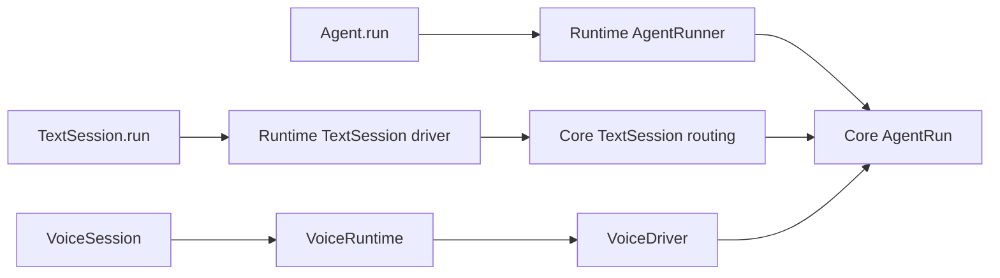

# Rust code map

Start here when following behavior from the Python API into Rust. Read one execution path,
then the owning component; the [Rust core reference](rust-core.md) defines the full contracts.

## The layers to recognize

| Layer | Entry point | Responsibility |
| --- | --- | --- |
| Python API | [`voice/agent.py`](../../livekit-agents-next/livekit/agents/voice/agent.py), [`text_session.py`](../../livekit-agents-next/livekit/agents/text_session.py), [`voice/agent_session.py`](../../livekit-agents-next/livekit/agents/voice/agent_session.py) | Developer-facing calls and application callbacks |
| ABI | [`agent/run.rs`](../../rust/crates/lk-agents-abi/src/agent/run.rs), [`voice/session.rs`](../../rust/crates/lk-agents-abi/src/voice/session.rs) | Native boundary contracts and typed records |
| Shared decisions | [`core/agent_run`](../../rust/crates/lk-agents-core/src/agent_run/mod.rs) | One invocation's model/tool progress, approvals, retries and output acceptance |
| Conversation decisions | [`core/text_session`](../../rust/crates/lk-agents-core/src/text_session/mod.rs), [`voice/agent_session`](../../rust/crates/lk-agents-voice/src/agent_session/mod.rs) | Backend routing, or live floor/recognition/media coordination |
| Execution | [`runtime/agent_run`](../../rust/crates/lk-agents-runtime/src/agent_run/mod.rs), [`runtime/voice`](../../rust/crates/lk-agents-runtime/src/voice/mod.rs) | Execute effects and feed correlated outcomes back to their owners |

`AgentRun` is the synchronous invocation owner. `AgentRunner` is the ABI's host-facing class,
implemented by runtime's `agent_run::Runner`. `VoiceDriver` owns voice decisions;
`VoiceRuntime` executes them. These names identify different responsibilities.

Arrows follow an invocation through its executors and decision owners:



Generated bindings connect ABI contracts to implementations. Their file headers identify the
declaration source; edit that declaration or its implementation, then run codegen. Do not start
by reading generated conversions unless investigating a boundary/conversion problem.

## Direct agent invocation

1. [`Agent.run` / `run_stream`](../../livekit-agents-next/livekit/agents/voice/agent.py) calls
   [`start_run`](../../livekit-agents-next/livekit/agents/voice/agent_run.py), which constructs
   `_core.AgentRunner` with the agent definition, model and host callbacks.
2. [`AgentRunner`](../../rust/crates/lk-agents-abi/src/agent/run.rs) is implemented by
   [`runtime::agent_run::Runner`](../../rust/crates/lk-agents-runtime/src/agent_run/runner.rs).
   It supplies `Opening::Message` and starts the invocation driver.
3. [`AgentRun::handle`](../../rust/crates/lk-agents-core/src/agent_run/machine/mod.rs) consumes
   model/tool/validation outcomes and emits
   [`AgentRunEffect`](../../rust/crates/lk-agents-core/src/agent_run/effects.rs).
4. [`runtime::agent_run::Execution`](../../rust/crates/lk-agents-runtime/src/agent_run/execution.rs)
   performs host/model work. The driver returns events to the machine and exposes streamed
   updates through [`RunStream`](../../rust/crates/lk-agents-runtime/src/run_stream/mod.rs).

Start with the `AgentRun` event and effect enums, then one handler branch. Model-step, tool-call,
output and cancellation state are subordinate to that invocation, not independent agent loops.

## Request-scoped text conversation

1. [`TextSession.run_stream`](../../livekit-agents-next/livekit/agents/text_session.py) constructs
   `_core.TextSessionRunner` from the configured agents and explicitly supplied state.
2. [`runtime::text_session`](../../rust/crates/lk-agents-runtime/src/text_session/mod.rs) drives
   [`core::text_session::TextSession`](../../rust/crates/lk-agents-core/src/text_session/machine/mod.rs).
3. `TextSession` owns backend frames, child routing and history transfer. It constructs an
   `AgentRun` with `Opening::Message` for each invocation; invocation effects are carried by
   [`TextSessionEffect::Run`](../../rust/crates/lk-agents-core/src/text_session/effects.rs).
4. The runtime uses the same `agent_run::Execution` for those effects. Application code explicitly
   saves the resulting session state; TextSession does not own a live voice session.

A2A is a separate transport/durable-task boundary. Follow [`core::a2a`](../../rust/crates/lk-agents-core/src/a2a/mod.rs)
and [`runtime::a2a`](../../rust/crates/lk-agents-runtime/src/a2a/mod.rs) only when investigating that door.

## Pipeline voice reply

1. [`VoiceDriver`](../../rust/crates/lk-agents-voice/src/agent_session/machine/driver.rs) receives
   session events. [`AudioRecognition`](../../rust/crates/lk-agents-voice/src/audio_recognition/machine/mod.rs)
   determines user-turn observations; activity scheduling determines floor admission.
2. [`agent_activity::speech`](../../rust/crates/lk-agents-voice/src/agent_activity/speech.rs) starts
   a [`ReplyRun`](../../rust/crates/lk-agents-voice/src/agent_activity/reply_run.rs), which contains
   an `AgentRun` with `Opening::Coordinated`.
3. That opening lets voice supply request/history snapshots and floor constraints while the
   shared invocation owns approval, tool classification, retry and output decisions. The
   `PlanRequest` / `HandleToolResults` handshake is declared in `AgentRunEffect`.
4. [`runtime::voice::generation`](../../rust/crates/lk-agents-runtime/src/voice/generation/mod.rs)
   runs the model, tools and TTS. Outcomes return through the voice queue to `VoiceDriver` and
   its composed `AgentRun`; voice does not start the standalone text runner.
5. [`AudioPlayback`](../../rust/crates/lk-agents-voice/src/generation/machine/audio_playback.rs)
   accounts for delivered audio. Invocation output acceptance and physical speech settlement
   are separate facts; a finished model request does not mean the person heard its output.

## Realtime voice reply

Follow the same `VoiceDriver` → `ReplyRun` → coordinated `AgentRun` ownership path, then read
[`agent_activity::realtime`](../../rust/crates/lk-agents-voice/src/agent_activity/realtime/mod.rs)
and [`runtime::voice::generation::realtime_generation`](../../rust/crates/lk-agents-runtime/src/voice/generation/realtime_generation.rs).
The provider owns server response initiation and protocol state; voice owns local floor,
interruption and presentation. Shared invocation policy receives the reply/tool outcomes.
Do not infer that a server follow-up should also start a client-generated response.

## Find the owner of a change

| Change | First source to read |
| --- | --- |
| Approval, tool outcome, retry, accepted output | [`core/agent_run`](../../rust/crates/lk-agents-core/src/agent_run/mod.rs), [`core/tool_calls`](../../rust/crates/lk-agents-core/src/tool_calls/mod.rs) |
| Backend agent/frame routing | [`core/text_session`](../../rust/crates/lk-agents-core/src/text_session/mod.rs) |
| Voice scheduling, hook/handoff or close ordering | [`VoiceDriver`](../../rust/crates/lk-agents-voice/src/agent_session/machine/driver.rs), [`agent_activity`](../../rust/crates/lk-agents-voice/src/agent_activity/mod.rs) |
| Generated audio, authorization, interruption receipts | [`generation/effects.rs`](../../rust/crates/lk-agents-voice/src/generation/effects.rs) and its linked producers |
| Room tracks, input/output attachment, transcription publication | [`voice/room_io`](../../rust/crates/lk-agents-voice/src/room_io/mod.rs), [`runtime/room_io`](../../rust/crates/lk-agents-runtime/src/room_io/mod.rs) |
| Provider transport/retry execution | [`inference`](../../rust/crates/lk-agents-inference/src/lib.rs), [`net`](../../rust/crates/lk-agents-net/src/lib.rs) |
| Binding conversion or native export | [`ABI`](../../rust/crates/lk-agents-abi/src/lib.rs), [`generated implementations`](../../rust/crates/lk-agents-py/src/generated/implementations.rs) |

The [core effect map](../../rust/crates/lk-agents-core/src/effects.rs) and
[voice effect map](../../rust/crates/lk-agents-voice/src/effects.rs) connect producers to executors.
Long-lived recognition, session and generation owners live under their domain's `machine`
namespace. Ordinary records, stateless planners and bounded value accumulators, such as
generation's `ReplyContext` and `TurnAccumulator`, can remain at the domain root. Use the owner
map rather than guessing responsibility from file size alone.

## Run the relevant contracts

From the repository root:

```bash
# Shared invocation/routing decisions and voice coordination.
cargo test --manifest-path rust/Cargo.toml --locked -p lk-agents-core -p lk-agents-voice

# Real runtime drivers and local-peer integration; MCP fixtures need the repo Python.
MCP_TEST_PYTHON="$PWD/.venv/bin/python" cargo test --manifest-path rust/Cargo.toml \
  --locked -p lk-agents-runtime --features media-ffmpeg,media-images

# Python contracts linked against the freshly compiled native module.
uv run --no-sync cargo test --manifest-path rust/Cargo.toml -p lk-agents-py --features ffmpeg

# Same execution vectors through direct, TextSession and VoiceSession, in a fresh process.
PYTEST_ADDOPTS="$PWD/tests/test_shared_execution.py --unit -k test_shared_execution" \
  uv run --no-sync cargo test --manifest-path rust/Cargo.toml \
  -p lk-agents-py --features ffmpeg --test py_bindings

# Voice/room composition regressions with fake SDK/provider ports.
cargo test --manifest-path rust/Cargo.toml --locked -p lk-agents-fuzz --test regressions

# Full compile/lint/boundary/codegen gate; this is not a substitute for running tests.
make rust-check
```

Plain `cd rust && cargo test` does not run runtime's own tests or the Python binding contracts:
both crates are omitted from workspace default members. Runtime being compiled through the
DST dependency does not run its separate test targets. See [local builds](rust-core.md#local-builds)
for interpreter selection, features and private target directories in parallel worktrees.
