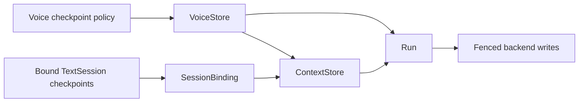

# Conversation and voice lifecycle

Persistence serves both session kinds. A session decides when its state is ready to save;
the storage layer owns database runs, reconciliation, item diffs, fencing and retries.

| Component | Owns | Communicates through |
| --- | --- | --- |
| `SpeechNormalizer` (`lk-agents-inference::stt::normalizer`) | Provider speech boundaries, utterance identity, synthesized starts and ends, owed final words | Synchronous `SpeechEvent` inputs and normalized events |
| `AudioRecognition` (`lk-agents-voice::audio_recognition`) | Accumulating user words, endpointing, manual commits, missing-final deadlines and late corrections | Recognition inputs, `AudioRecognitionEffect`, `TurnId` |
| `AgentActivity` (`agent_session::machine::activity`) | Active agent, user hooks, speech scheduling, generation and tool ownership | Correlated hook, speech, step and tool results |
| `SessionChatCtx` (`lk-agents-voice::agent`) | Accepted conversation, item identity, ordering, revisions and visibility | Accepted items, projected checkpoint history, history reloads |
| Conversation ordering (`lk-agents-abi::llm::chat_context::ordering`) | Stable-ID replacement, timestamp insertion and tool-output grouping shared by the ledger and storage reconciliation | Ordered `ChatItem` collections |
| Voice storage coordinator (`agent_session::storage`) | Checkpoint timing for recognition, delivered speech and tool steps; receipt barriers | `VoiceEffect` and correlated `VoiceEvent` acknowledgments |
| `TextSession` (`lk-agents-core::text_session`) | Text routing, child frames and accepted text checkpoints | `TextSessionEffect::Checkpoint`, `SessionStateSink` |
| `SessionBinding` (`lk-agents-storage::session_binding`) | Explicit binding, live session view and text checkpoint publication | `ContextStore`, native `SessionState` |
| `VoiceStore` (`lk-agents-storage::voice`) | Voice adapter: overlapping speech owners, recognition recovery and reconciliation under a partition lease | Shared `Run` and `ContextStore` |
| `Run` (`lk-agents-storage::thread::run`) | Database history baseline, incremental item changes, fenced checkpoint/commit and write identity | Storage backend operations |
| Runtime executors | Execute effects, own async tasks and return receipts, including task death | Storage/provider ports and session event queue |

## Speech evidence and user turns

Provider utterances and conversational turns have different identities. The normalizer fills
missing starts and ends and holds a normalized end until owed final words arrive. An
`EndOfSpeechPending` observation exposes a provider end without pretending those words arrived.
The voice core starts `final_transcript_timeout` from that evidence. Repeated ends and interim
updates do not extend the wait. At expiry, automatic endpointing may use the latest interim;
manual mode still requires a commit. A late final corrects the original user item by identity.
A new utterance, retired STT stream, reset or close cancels the old wait.

Unaccepted recognition is a draft. A bound voice session checkpoints its latest text into
`pending_user_turns` in the persisted voice state, independently of whether an assistant reply
exists. Drafts do not enter model-visible history. Acceptance moves the words into conversation
history with the same item ID and clears the pending projection. A turn accepted without a
reply still saves. On recovery, the store reconciles pending words under the acquired lease;
stable IDs prevent inserting them twice.

## Speech, tools and interruption

Generation, playback, floor ownership, tools and persistence settle independently. Releasing
the floor allows a newer reply while an older tool still runs. Ordinary interruption marks
the originating speech handle interrupted, cuts playback and retains only the delivered
transcript prefix. It does not cancel application tools, even after the generation cleanup
watchdog. Each tool retains its originating `RunContext.speech_handle`.

An ordinary late tool result belongs to the original call and is recorded with
`reply_required=false`; it cannot continue the interrupted reply. Async-tool update delivery
has a separate policy. Shutdown owns bounded cleanup of tools that remain live.

Items revise in place by stable ID. New independent items use their conversation timestamps,
with ties following existing items. Tool outputs remain with their call group, even when their
result arrives after a newer reply. A speech ID correlates speech work; a `TurnId` identifies
user recognition; neither identifies a database run. Overlapping speeches may share one run.

## Shared persistence and session-specific timing

Text execution with plain context or explicit state reads snapshots and leaves saving to the
application. `context=store.bind(app)` opts into managed text checkpoints through
`SessionBinding`; it uses the same run/checkpoint machinery as voice. Persisted application
fields still require explicit load/save for both session kinds.

Voice additionally checkpoints live recognition and delivered playback. A save carries concrete
items and a submission sequence, rather than asking storage to guess which user turn to save.
The database compares stable IDs, payloads and positions against the run's loaded baseline.
Already stored items are unchanged unless their accepted revision or position changed.

Acquisition always reads and reconciles under ownership before releasing the next model read.
Explicit local history is not proof that unseen database rows were deleted. A concurrent
writer's rows survive the first acquisition; an unchanged stored baseline permits local edits,
while another writer's changed version wins reconciliation. Progress and terminal voice saves
share a submission order so a delayed older operation cannot overwrite newer history.

Success receipts mean the included checkpoint is durable, even if another speech still owns
the shared run. Only a receipt marks edits saved. Failed or lost work returns a typed result;
a bound session closes on storage failure. Closing waits for outstanding conversation saves.
