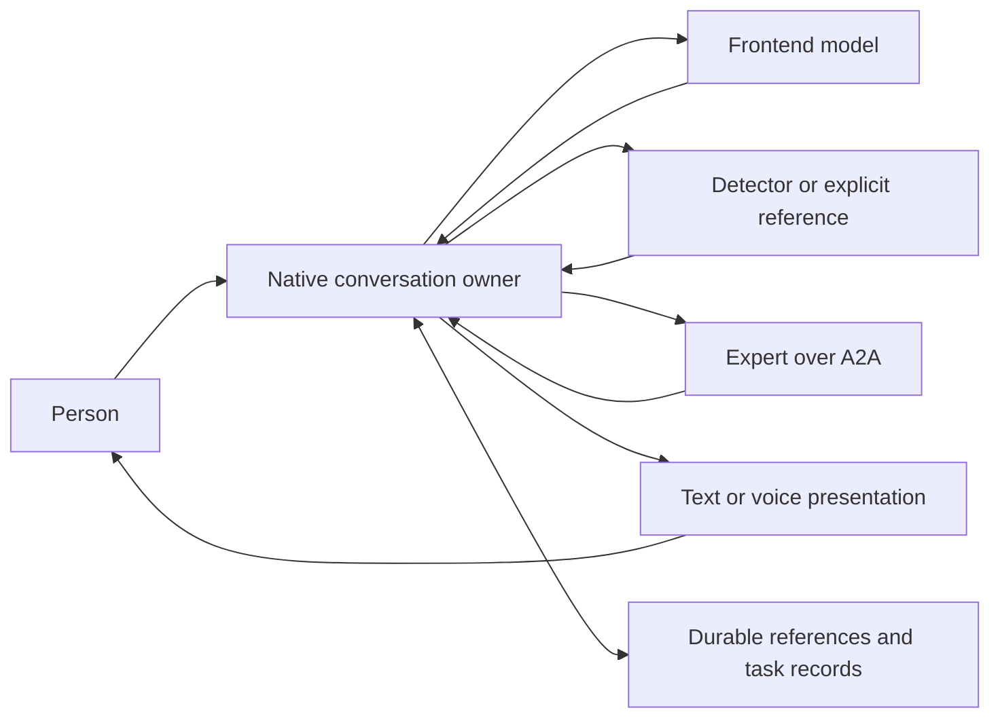

# Delegation integration

A person should be able to talk naturally to a responsive agent while a remote agent does
deeper reasoning and business work. The frontend keeps listening, handles interruptions and
maintains the conversation while remote work progresses. The remote agent can use a stronger
reasoning model, specialist instructions and tools independently of the frontend's model.

The document first explains the behavior and public API, then the native implementation and
work required. It describes the target system. Existing SDK guides remain the current contract
until implementation lands. The implementation checklist is the ordered completion roadmap.
Each milestone names its remaining changes, implementation owners and observable exit;
the acceptance matrix below supplies the detailed cases.

## Product direction

The intended experience is one capable conversational partner. Its frontend is optimized for
listening, turn taking, personality and quick conversational responses. A remote agent is
optimized for the work: reasoning through a complicated request, checking systems, running
tools, validating information and producing a reliable outcome. Models are chosen independently
for those roles. Remote agents can themselves communicate with other agents.

Delegation is an ongoing conversation between agents. The remote agent can send useful
progress, ask for missing information, continue after a response and return results across
several exchanges. Several tasks can run at once. The frontend decides how to integrate that
work into the person's conversation, preserving its voice and pacing.

Responsiveness and task completion are separate product goals. A remote tool can take sixty
seconds while the frontend remains available to listen, acknowledge a correction, handle a
side question or explain known status. Starting remote work must not hold the speaking turn
open until it finishes. A prompt acknowledgement is grounded in admitted work; the frontend
does not claim a result, successful change or completed action before it has that evidence.

In particular, the person should experience:

- **A responsive conversation while work continues.** They can keep talking and give useful
  information without waiting for the remote model to finish reasoning. The frontend can
  answer from available knowledge and say when it is still waiting for task-specific facts.
- **Natural interruptions.** The frontend yields on a detected interruption and handles
  backchannels or false interruptions according to the session's voice policy. Remote latency
  must not delay stopping playback. Interrupting speech alone does not cancel remote work.
- **Corrections that matter.** A change such as "Saturday, not Friday" is retained and
  communicated through the supported remote path. A late Friday result cannot be presented
  as satisfying the Saturday request. If an action already happened, explain its actual state
  rather than implying the correction undid it.
- **Useful questions and progress.** Ask questions at a manageable pace, grouping related
  questions when that feels natural, and summarize useful updates. Quiet periods are acceptable;
  avoid repeated filler or reading every internal event.
  Ordinary results are worded for the current conversation; exact text retains its contract.
- **Coherent continuation.** Answers reach the correct pending request. Side questions and new
  work remain possible. Returning to a stored conversation restores the work's references and
  reconciles its status, including uncertainty, without requiring the person to start over.

For example:

```text
Person:    Find a flight from Paris to Rome next Friday morning.
Frontend:  I'll check the options.
           [The remote agent reasons and searches; the frontend remains available.]
Person:    Actually, make that Saturday.
Frontend:  Saturday—got it.
           [The correction is retained and communicated; remote work continues.]
Frontend:  What budget should I use?
Person:    Up to five hundred euros.
           [The remote agent receives the response and returns Saturday options.]
Frontend:  I found two options. The first departs at—
Person:    Just tell me the cheapest one.
           [The frontend yields, then answers using the received options.]
```

The frontend's acknowledgement of Saturday records the person's preference; it does not
announce that a booking changed. The budget question represents an actual pending remote
request. The interruption changes what is presented next without restarting the search.

We assess this experience through separate observations: how quickly speech stops on an
interruption, how quickly the frontend begins an appropriate response, whether remote updates
are presented at useful moments, and how long the remote task takes. Longer remote reasoning
must not silently become longer interruption or conversational response latency. Exact latency
budgets need measurement and agreement; this plan does not invent numerical guarantees.

## Problem and scope

A voice agent may act as a travel concierge while separate agents search flights, reserve
hotels and authorize payments. The concierge needs to keep the conversation coherent while
those experts work independently. A remote call returning a string is not enough:

- A flight expert can ask a question while the hotel expert is still working.
- The person's next utterance might be a side question rather than the requested answer.
- A result can arrive while another reply is speaking, or after the person interrupted it.
- A lost connection does not tell us whether an expert accepted an answer or made a booking.
- A person can end the call and later continue the same work by text.

The rewrite already has RemoteAgent tools, A2A transport, expert presentation and task storage.
This integration extends them into a coordinated lifecycle, using the final behavior of Long's
stack as its starting point. The source PRs are listed at the end. Some earlier PR behaviors
were replaced later; their final scenarios, not each intermediate implementation, are the porting
target.

Scope includes remote and applicable local agent-tool behavior, text and voice delivery,
durable correlation, cancellation, third-party A2A and the developer-facing controls. It preserves
the rewrite's typed results, explicit application persistence and approval checks. It does not
recover Python call stacks or guarantee exactly-once external business operations.

Local Agent-as-tool persistence is text-only. Voice handoffs and VoiceTasks remain transient;
they preserve the durable root and human history. Starting voice with unresolved text-local
agent work refuses the transition without modifying it; no root-graph restoration API is
introduced. VoiceSession.current_agent exposes the live role. A separate public overlay on
SessionState is not part of this design.

## Concepts

| Term | Meaning in this design |
| --- | --- |
| Frontend / fast brain | The agent handling the person's conversation. It chooses which expert to call and ordinarily words results for the person. |
| Remote agent / slow brain | An agent doing delegated work. It owns validation, business tools, approvals and results, and can communicate with other agents. |
| Delegation | Communication with a configured remote agent. It can span multiple local tool calls, messages, contexts and tasks; it is not itself one A2A task. |
| A2A message | Input or output with a messageId and optional contextId/taskId. A peer can reply directly with a Message without creating a task. |
| A2A context | A grouping identifier for related messages and tasks. Our context view groups observed state; it is not a new protocol object. |
| A2A task | The expert server's tracked work, addressed by `taskId` within its `contextId`. One task can pause for input and continue several times. |
| Turn / invocation | One execution responding to input or delivering background results. Remote tasks can outlive that invocation and continue across several local tool calls. |
| Pending question | An expert request for input, tied to a task and a particular occurrence of the question. Several can remain open; compatible questions can be presented together in one conversational prompt. |
| Question incarnation | The local identity of one question occurrence. The same remote task can ask again, so its task ID alone cannot distinguish an old answer from an answer to the new question. |
| Partition owner | The runtime that holds the lease for one stored conversation partition and serializes its changes. A fence prevents an old owner from committing after ownership changes. |
| Delivery receipt | An observation at the output boundary: progress admitted, text handed off, or audio played. It does not prove the person understood the message. |

Local conversation identity and remote A2A identity are distinct. A third-party `contextId` is
not automatically a LiveKit thread database ID. Similarly, an A2A task is not a suspended Python
coroutine: the expert server decides how to reconstruct or continue its execution.

## Agreed behavior

| Area | Contract |
| --- | --- |
| Entry point | `RemoteAgent(...).as_tool()` |
| Explicit continuation | Optional `task_id` argument on the existing remote tool; the framework retains input-occurrence correlation |
| Configuration | Connection/auth on `RemoteAgent`; caller behavior on the conversation execution owner |
| Routing | Detector enabled by default, including one eligible pending question |
| Routing model | Configure a separate routing model explicitly; frontend-model reuse is a later optimization |
| Agent switches | Recognize responses to previously presented questions even when the current agent lacks the remote tool; retain them durably until dispatch is eligible |
| Detector disabled | Explicit task reference continues work; no reference starts new work |
| Detector failure | Bounded retries; keep pending questions; return feedback to clarify or retry |
| Updates | Enqueue immediately; awaiting is optional. `update` waits for admission; `say` confirms its local output boundary |
| Control | Inspect public remote message/task/context/event views; explicitly target a remote task for cancellation |
| Scheduling | Opt-in `inbox="live"`; retain existing queue/batch defaults |
| Call end | Remote work continues; cancellation is explicit |
| Restart | Recover durable references and questions; reconcile remote state |
| New human input | The current local agent handles unaddressed messages; targeted responses retain their input-request identity |
| Remote context | Reuse the conversation's saved default context for new work with that remote; task continuation retains that task's context |
| Stream reconnect | Resume existing tasks from durable cursors where supported; reconcile snapshots otherwise; never restart business work merely to restore observation |
| Existing guarantees | Preserve typed outputs, explicit application saves, authorization and validated-argument approvals |

## Conversation expectations

The frontend coordinates one conversation with the person while several agents work. The
person should receive useful questions and outcomes at a sensible pace, without having to
manage the arrival order of remote events. These are the default presentation expectations;
they apply to local and remote agent work wherever the same interaction is supported.

| Situation | Expected experience |
| --- | --- |
| A remote model is reasoning or a tool is slow | The frontend remains available for conversation and interruptions. It can acknowledge admitted work or report known status without inventing a result or filling every pause. |
| Five questions arrive together during a voice conversation | Choose a manageable prompt and give the person a chance to respond. Group related questions when natural; keep unrelated or demanding questions pending. Presenting a group does not merge its underlying input requests. |
| Related questions can be answered together | First name and last name can become "What's your first and last name?" Choose wording and grouping for the conversation rather than imposing a fixed number of questions per utterance. |
| Several questions remain pending | Choose the next relevant prompt fairly. An answered agent can receive a bounded follow-up opportunity, without repeatedly starving other waiting agents or displacing the foreground prompt. |
| The person skips a question or changes topic | Handle the new topic and release that question's presentation priority. Keep it open for a later response; do not immediately repeat it or interpret the topic change as its answer. |
| The person answers an earlier question, or clearly answers several | Route each identifiable response to its actual input request. Presentation order does not make the latest question the only valid target. Clarify ambiguous responses. |
| Ten ordinary progress updates arrive before the frontend can speak | Combine eligible updates into one useful summary at the next conversational opportunity. Repeated or superseded status does not require ten separate announcements. |
| A result arrives before its queued progress is spoken | Present the outcome with any still-relevant context. Omit obsolete narration such as "I'm still checking" after that check has finished. |
| Progress arrives while the person is speaking or answering a question | Wait for the conversational floor. Routine progress does not interrupt the person or repeatedly distract from the question being answered. |
| Several results become ready together | The frontend can give a combined summary while keeping each task's outcome clear. Grouping does not settle unrelated calls or discard an outcome that still needs delivery. |
| A tool uses exact `ctx.say()` output | Preserve its text and delivery order. Ordinary progress batching must not replace it with a summary, silently omit it or mark it delivered without the appropriate receipt. |
| The person interrupts a question or result | Yield according to the session's interruption policy without waiting for the remote agent. Retain results and delivery facts; continue or clarify without racing a duplicate reply. Speech interruption alone does not cancel remote work. |
| The person changes a constraint while work runs | Retain and communicate the correction through a supported path. Reconcile late results against the current request; do not present an outdated answer as satisfying the new constraint or imply an already completed action was undone. |
| An agent changes while remote work is running | Retain pending work and outcomes. Present them when the current agent exposes the matching remote tool and has access; do not force an agent switch merely because an event arrived. |
| The person returns after a disconnect | Reconcile the existing work and explain the current situation. Summarize relevant missed progress rather than narrating the entire backlog. |
| The conversation is text rather than voice | Related questions or results can be grouped into a readable message when their targets remain clear. Preserve the same input identities, validation and delivery rules. |

For example, if flights asks for a date, hotels asks for a budget and payments asks for
confirmation at the same time, voice might start with "What date would you like to fly?"
The hotel and payment requests remain pending. The person's next utterance can answer the
date, ask why it is needed, or start another topic; it is not automatically a flight answer.

Conversely, asking "What's your first name?" and then "What's your last name?" as separate
turns can sound unnecessarily mechanical. The frontend can ask "What's your first and last
name?" If the person supplies only their first name, continue with the missing information.
If separate input requests contributed to that prompt, track their responses individually;
grouping alone neither resolves them nor makes an ambiguous response sufficient. A clear
response can address several requests, each validated and reserved against its own target.
For text tool batches, the frontend selects a group and its wording in one structured
presentation response. Each selected source keeps the resulting prompt's message ID. The
owner marks those sources presented only after that prompt reaches the text output boundary;
unselected sources stay unpresented. A malformed selection fails without delivering its text.
Preserve per-request presentation evidence: an interruption before part of the grouped prompt
is delivered must not mark every included question as presented. Exact wording and approval
contracts still apply when choosing what can be grouped.

If ten eligible updates report flight options and an ongoing hotel search, voice might say
"I've found flight options; I'm still checking hotels." If both searches have already finished,
it can go straight to their results. Keep each fact associated with the correct task and do
not invent completion. Silent updates and unflagged A2A working status do not independently
request spoken announcements.

Batching here concerns presentation. Accepted communication events remain recorded under the
normal journal/retention rules, and each input request and task retains its identity. The
low-level client can still observe individual protocol events. This is separate from the
endpoint's `inbox="batch"` policy, which groups incoming requests.

The native machines enforce eligibility, ordered foreground delivery, per-request correlation,
exact wording and receipt accounting. The frontend model chooses wording and useful grouping
of questions and updates within those constraints. There is no fixed limit of one question per
utterance. Coalesce updates already waiting at a presentation opportunity;
do not require a fixed delay or wait for a particular number of updates before speaking.

## Public API

New signatures below are proposed spellings; the behavior above is agreed.
The frontend example is a fragment inside an RTC job handler: `ctx.room` is that handler's
room, and the models and expert URL are application configuration.

```python
flights = RemoteAgent(flights_url, token=token, conn_options=connection_options)

front_desk = Agent(
    instructions="Help travelers plan their trip.",
    llm=frontend_model,
    tools=[flights.as_tool()],
)
delegation = DelegationOptions(routing_model=routing_model)
session = VoiceSession(
    llm=frontend_model,
    stt=stt_model,
    tts=tts_model,
    delegation=delegation,
)
await session.start(front_desk, room=ctx.room)
```

Answer routing is conversation-wide behavior. Configure it on the execution owner
(VoiceSession, TextSession or the run/endpoint execution), so one policy
coordinates all exposed remote tools. Automatic detection requires an explicitly configured
separate routing model for every frontend type, including pipeline and realtime voice. There
is no fallback to the frontend model or implicit provider credentials. A decision model or
Gemma can be an application choice; no model family is hardcoded by the framework. Reusing a
frontend model is a later optimization. DelegationOptions/delegation are the common configuration;
this configuration does not belong on individual as_tool calls. `routing_model=None` disables
automatic routing; an explicit task_id continues known work and an omitted task_id starts new
work. The frontend model decides whether and how to acknowledge delegation. The framework
provides a dispatch fact and releases the conversational floor, without queuing an automatic
spoken acknowledgement. There is no announce option.

### Targeting a remote task

The existing delegation tool accepts an optional `task_id`. For the default text schema, the
frontend model's tool arguments can be:

```json
{
  "request": "Friday",
  "task_id": "booking-42"
}
```

The task belongs to the remote configured by that tool. Its saved state supplies the A2A
context. An explicit task selects that work for an answer, clarification or correction; the
remote agent interprets the message and decides what information is still missing. Several
required answers can belong to one task, such as first and last name. A2A supplies task-level
continuation rather than independently addressable input-request objects.

With `task_id` omitted or null, the conversation's routing policy decides whether the proposed
call continues existing work or starts new work. With detection disabled, an explicit task ID
continues work and no task ID starts new work. A turn may both answer an existing task and
start new work through the same tool; an earlier handoff must not blanket-block later calls.
An unknown, foreign or terminal task produces feedback instead of silently starting new work.

The framework consumes `task_id` before passing the remote's own input payload. Custom card
schemas retain their business arguments; a collision with the reserved `task_id` field must
fail tool setup.

Input-occurrence IDs remain in framework state for response reservation, stale-decision checks
and recovery. A model turn retains the occurrences it was offered. Before consuming a human
response, validate that captured occurrence rather than resolving the task to whatever question
is newest when the tool call arrives. Selecting a task alone does not mark its latest question
answered; task messages also support clarification and corrections without a pending question.

### Conversation APIs

| Surface | Meaning |
| --- | --- |
| `.as_tool()` | Expose the expert as a tool; conversational policy belongs to the execution owner |
| Tool argument `task_id` | Select a known remote task on that same tool; input-occurrence correlation stays with the framework |
| Conversation policy | One routing model on the owner; the frontend model decides acknowledgement and wording |
| `ctx.update(text, silent=False)` | Progress the frontend may word; silent updates inform only the model |
| `ctx.say(text)` | Ordered exact text, including through nested delegation |
| `InputRequired(question, verbatim=False)` | Finish this invocation waiting for input; a later invocation resumes the task |
| `ToolResult(..., verbatim=, reply_required=)` | Existing result wording and follow-up controls |
| `SessionState.remote_agents[remote_id]` | Public read-only views of observed messages, tasks, contexts and the communication journal |
| `await remote.tasks[task_id].cancel()` | Cancel through the bound RemoteTask; it retains its remote/context/task addressing |

Both update methods enqueue owned work and return awaitable receipts. `await update` confirms
admission, not spoken progress. `await say` confirms its local output boundary: audio playout
on the frontend voice session, or handoff to the text/A2A output on a backend. Forwarding exact
text through nested delegation does not supply end-to-end speech acknowledgement; stock A2A
has no such receipt. Interruption, close and uncertainty settle receipts with defined outcomes.

For example, an expert can report that it is checking availability, then deliver the reference
as written after the booking service confirms it:

```python
@booking_agent.tool
async def book(ctx: RunContext[BookingContext], itinerary: str) -> str:
    await ctx.update("Checking availability.")
    booking = await ctx.context.bookings.reserve_once(itinerary)
    await ctx.say(f"Your booking reference is {booking.reference}.")
    return "The reservation was confirmed."
```

Here `reserve_once` represents an application service with its own stable business idempotency.
The framework owns update delivery, but cannot make an arbitrary booking API idempotent.
Omitting an await allows the tool to proceed while owned delivery continues; it does not discard
the message. Exact output still follows the interaction's delivery order.

The tool schema keeps the same optional `task_id` whether automatic routing is enabled or
disabled. No input-request identifier appears in the model's arguments:

```json
{"request": "Find flights from Paris to Rome"}
```

```json
{"request": "Next Friday", "task_id": "booking-42"}
```

Validate task references against the conversation, configured remote and access. When routing
selects a held human response, also revalidate the captured input occurrence and its canonical
words. Schema enums do not change during a realtime call. Before a remote task ID is known, the
request and dispatch facts remain inspectable. Stopping local waiting does not prove remote
work stopped; an uncertain dispatch must be reconciled before a task can be targeted.

Retain `AgentClient.send(..., thread_id=, task_id=)` and `AgentClient.cancel(...)` for low-level
A2A access. A third-party context ID is not assumed to identify a LiveKit database. Expose typed
updates through existing session events/run streams; application observers do not drive execution.

Inspect remote communication through the bound SessionState, or a detached inspection snapshot.
Use the generated RemoteTask view for task-scoped cancellation:

```python
remote = app.session.remote_agents[remote_id]
task = remote.tasks[task_id]
await task.cancel()
```

The bound view retains the addressing and sends a validated command through its native
conversation binding. The control path serializes with an active owner or takes a short
fenced control turn when idle. It does not start a model turn or add a model-visible tool.
Data properties stay read-only. Detached snapshots are inspectable but cannot dispatch
commands; rebinding supplies fresh authority. Low-level clients retain AgentClient.cancel().
The [state proposal](session-state.md#logical-records) owns the bound/detached and durable
cancellation contract. No owner-level cancel_remote_task method is introduced.

### Conversation state across execution APIs

**Proposed state carrier:** extend the existing SessionState with durable delegation and
pending-question records. Do not introduce a separate public DelegationState. The
[shared SessionState proposal](session-state.md) owns its schema: one ChatContext per frame,
shared across execution modes, with a top-level root and private child contexts. Public
current_agent/root_agent views expose each agent context's chat_ctx; chat_history describes
what the person experienced across agents and modes, independently of child-to-parent merging.
The linked proposal owns those history semantics and separates local AgentCallState from
remote agent/message/context/task communication state. Durable internal request records retain
individual tool-call origins and dispatch progress; input requests and cancellation belong to
specific tasks. Several tasks and message-only exchanges can share a remote context. Small
references and common rules are shared, not a local/remote execution record or global input
registry. Remote communication state survives supported executor changes; presentation stays
with its live frontend owner.

The public remote views follow A2A's domain model:

```python
remote = app.session.remote_agents[remote_id]
remote.messages                         # Observed A2A Messages in both directions.
remote.tasks                            # Observed A2A Tasks plus local routing state.
remote.contexts[context_id].messages     # Same messages, grouped by contextId.
remote.contexts[context_id].tasks        # Same tasks, grouped by contextId.
remote.events                           # Append-only requests, responses and observed errors.
```

Data properties are read-only and describe retained observations, not the remote server's
complete state. Inspection performs no network calls; RemoteTask.cancel() is an explicit
command on a bound view. Contextless and message-only exchanges remain valid;
Task.history is optional and does not replace the communication journal. All client operations
for this conversation record requests, responses and observed errors. Request dispatch progress,
stream lifetime and local routing live in durable current state, alongside tasks/input_requests;
they do not create extra communication events. Related state/log changes commit atomically.
The linked [remote-state design](session-state.md#remote-agents-messages-contexts-and-tasks)
owns record definitions, current-state recovery, request correlation and commit rules.

Store binding is the single proposed entry point for restoring and continuing a conversation
across all three execution APIs. The binding selects the stored state, checkpoints framework
progress and keeps an optional app.session view current. Plain application-field mutations
still require explicit saves. Snapshots remain useful detached reads, not a second execution
input path. Neither form contains Python coroutines, media connections or the transient
presentation queue.

The following examples define the public shape across voice, text and direct agent execution.
The handlers assume configured agents/models and a runtime-provided store for the selected
thread/partition. Sharing configuration or a room alone does not select the same conversation.

```python
from dataclasses import dataclass
from livekit.agents import SessionState, persisted

@dataclass
class App:
    session: SessionState = persisted(default_factory=SessionState)
```

VoiceSession uses the existing binding API. This runs inside an RTC job handler:

```python
app = App()
await ctx.store.load_context(app)

session = VoiceSession(
    llm=frontend_model,
    stt=stt_model,
    tts=tts_model,
    context=ctx.store.bind(app),
    delegation=delegation,
)
await session.start(front_desk, room=ctx.room)
```

TextSession can use the same binding inside a managed text handler:

```python
app = App()
await ctx.store.load_context(app)

result = await TextSession(agent=front_desk, delegation=delegation).run(
    ctx.message,
    context=ctx.store.bind(app),
)
return result
```

Agent.run accepts the same binding without requiring a TextSession wrapper:

```python
app = App()
await ctx.store.load_context(app)

result = await front_desk.run(
    ctx.message,
    context=ctx.store.bind(app),
    delegation=delegation,
)
await ctx.store.save_context(app)  # Explicitly retain application-field changes.
return result
```

The state is read through app.session; no new Agent.run(state=...) input or RunResult.state
output is added. The result retains its typed output/status contract. Applications without a
declared SessionState field can use store.bind() and let the store manage the state internally.
Binding construction itself performs no I/O; execution activates the selected conversation.

Remove detached TextSession execution inputs and the result/state envelope. Storage has not
been released: keep one encoding and no legacy migration path. The continuation API has one
state source: the binding. A bound execution must reject competing explicit history/state inputs rather
than choosing one silently. A plain unbound run does not implicitly discover stored session
state. A standalone invocation must settle its local owned work before returning; it cannot
become a hidden live endpoint.

### Decisions to finish

The task_id tool contract is agreed. Remaining public decisions are collected under
[questions retained during implementation](#questions-retained-during-implementation),
including cancellation/control activation, delivery errors and protocol error inspection.
The [completion roadmap](#implementation-checklist) tracks implementation and acceptance;
private layout or generator work does not authorize another public primitive.
The protected-step/interruption-policy comparison stays deferred in the TODO below.

## Inbox policies

| Inbox | Message arriving while work runs |
| --- | --- |
| `queue` | Wait; each message gets its own turn and reply |
| `batch` | Answer a burst together; earlier tasks reference the answering task with `mergedInto` |
| `concurrent` | Overlap without a lease; no application-field or routing-state saves |
| `reject` | Refuse the busy request, identify the running task, create no new task |
| `live` | Continue background tools while one owner serializes conversational and result-delivery turns |

The first four exist today. A2A/delegation default to queue; SMS, WhatsApp and email to batch.
Live is selected per endpoint/partition, independently of fast-brain/slow-brain roles:

```python
@backend.a2a_session(endpoint="booking", inbox="live")
async def booking_endpoint(ctx: A2ASessionContext):
    return await booking_agent.run(
        ctx.message,
        context=ctx.store.bind(),
        delegation=delegation,
    )
```

Application loading/saving is omitted above and remains explicit. Live lets this backend handle
another turn while a tool works. VoiceSession can already converse while waiting for an expert;
a frontend text endpoint can separately enable live execution and shared call/text ownership.

Under `live`, a tool's progress can release the conversational turn while the tool continues.
Its A2A task remains working. A new request gets a new turn under the same owner. When the tool
finishes, a delivery turn incorporates its result and replies to the tasks that result belongs
to. This turn may have no new human message. There is still one writer of conversation state;
`live` does not let several invocations mutate that state independently.

## Execution model

### A conversation with two experts

Consider a person asking the travel concierge for flights and a hotel in Rome:

1. **Start the work.** The fast brain calls the flight and hotel tools. Each request gets durable
   internal state retaining its originating tool call; its SDK payload is recorded in the
   communication log before dispatch. Responses and corresponding state updates commit together.
   Another send can continue the same task or start separate work; a direct Message reply needs no task. Reusing RemoteAgent
   configuration does not share another person's communication state.
2. **Ask a question.** Flights reports `input-required`: "When do you want to fly?" The owner
   records the pending question. The voice session presents it when the conversational floor
   is available. A hotel question arriving meanwhile waits; its existence is not proof it was heard.
3. **Handle a side question.** The person asks why the date is needed. The fast brain can explain
   without invoking flights. Nothing is sent as a date answer. The flight question remains open;
   another queued question can subsequently get presentation priority.
4. **Route a relevant reply.** The person says "The flight should be next Friday." With the
   default detector enabled, the session checks previously presented, unresolved input requests
   against the conversation and this message. It can select the earlier flight question even
   if another question has since been presented. If a local child currently lacks the flight
   tool, retain the response against that question until dispatch is eligible. Ambiguous input
   permits clarification while the requests remain open; new work reaches the current agent.
5. **Continue the expert task.** The native machine validates and reserves that question. The
   runtime sends a new A2A message using the flight task's existing `taskId` and `contextId`.
   The expert validates the input and either continues, asks again, or completes. A subsequent
   question on that same task has a different local question occurrence.
6. **Handle nested work.** If flights delegates payment, each hop retains its own task and
   pending-question references. A payment answer follows those references back through the
   chain. Intermediate progress does not create several competing frontend announcements;
   explicitly exact receipts can propagate to the person.
7. **Deliver the outcome.** The flight result resolves the local call correlated with that
   request. The frontend words the outcome; exact text uses the ordered delivery path. Hotel
   work can remain pending. Task history and the remote relationship survive individual local
   call settlement. Never attach a result to an unrelated newer tool call.



### Input-response detection

The detector matches human input to response-eligible requests already presented in the
authorized conversation. It is enabled by default, including when there is only one pending
request. Already-reserved requests are not offered as fresh targets. Without eligible
presented candidates, normal input handling proceeds without this classification call.

Its inputs are the accepted human message, relevant human-visible conversation, each
candidate's question/content and its qualified occurrence reference. Include previously
presented questions from inactive agents; do not use tool availability as a recognition filter.
Do not disclose private remote reasoning/history or classify against unseen pending questions
merely because they exist in state. Delivery evidence distinguishes presented, partial and
queued questions, including a grouped prompt that was interrupted halfway through.

The model returns a structured match to zero, one or several candidates, or an unclear result.
It does not pick an arbitrary tool, mutate input state, approve an operation or start new work.

| Presented request and new input | Decision |
| --- | --- |
| Date question; "Friday" | Select that input occurrence. |
| Date question; "Why do you need that?" | No automatic response dispatch; let the current agent handle the side question. |
| Date question; "Also find a hotel" | New work for the current agent; the date request remains open. |
| First/last-name prompt backed by separate requests; "My first name is Ada" | Match only the identifiable first-name request; keep missing input pending. |
| Several questions; a response clearly addressing more than one | Select each identified occurrence; validate/reserve each independently. |
| "Yes" with several plausible targets | Clarify rather than choosing the latest request by default. |

Core validates every returned reference against the current conversation, authority, input
occurrence and response state. A verdict arriving after a request was replaced or answered
cannot reserve the old target. Persist accepted reservations with the canonical human-message
reference before dispatch. If the current local agent lacks the matching remote tool, retain
the response until an eligible agent returns, then revalidate. No outgoing A2A request is
needed while it waits.

The current agent still receives the human message and the framework's routing observation.
If an utterance answers a question and introduces another topic, recognizing the response
must not hide the remaining intent. Record the human message once. The frontend chooses new
remote work through its tools; a relevant tool call can reuse the same routing result and
reservation rather than consuming the response again. Both input admission and tool-call
routing use the same native validation/reservation/dispatch path, with no duplicate send.

An invalid verdict, provider failure or ambiguous match uses bounded retry/clarification and
keeps unresolved requests pending. An explicit tool `task_id` skips task selection by the
detector and retains native task/response validation. The framework carries the offered input
occurrence when consuming a human response; the model does not supply its ID. With detection
disabled, continuation requires an explicit task ID.
Recognition never delays local voice interruption handling. Use the separately configured
routing model; automatic frontend-model reuse is outside the initial scope. The common
configuration spelling and exact retry settings remain design decisions; no new detector
base class is required. Explicit-reference mode with detection disabled needs no routing model.

Routing a continuation does not certify that its content satisfies the question. For example,
the expert can receive a clarification about an existing request and ask for the date again.
If one input request asks for both first and last name, a partial response can continue that
request and the owner asks for the missing information; grouping does not require splitting
one request into new records. Routing never grants approval for a business action.

### Streaming updates and reconnection

A long-running tool reports progress without waiting for its final result. Each ctx.update()
produces a working task status event; the open HTTP/SSE response or task subscription carries
it to the frontend's RemoteAgent reader. The conversation owner records the event and task
state, then offers eligible progress for presentation. Voice words it when the floor permits;
a text frontend sends its output on the client's stream. Receiving an update does not require
another frontend model turn, but choosing how to word it may. Flagged progress can be worded;
unflagged working text remains status. Exact text takes the ordered say path.

Streaming updates and accepting another conversational turn are separate capabilities. The
agreed opt-in live policy lets a turn release conversational ownership while its work runs on;
one owner still serializes conversation and result delivery. Progress itself never makes the
task completed. Slow or disconnected observers detach without canceling the business work.

Streaming progress and recovery of known task references belong to the initial integration.
Durable cursor replay is a follow-up beyond the first delegation delivery. The remaining
reconnection design describes that later target. Initial recovery reconciles known task state
and resumes observation where supported, with missing intermediate progress left explicit.

Our endpoints retain communication events durably before publishing them with a stable cursor.
Reconnect subscribes to the existing task after the consumer's last applied cursor, replays
retained events and joins live delivery without a gap. The consumer stores that cursor with
the corresponding accepted event/state update. A duplicate delivery must not append artifact
content twice or create another input request. State, event and cursor writes share the normal
fence/idempotent storage-write contract; publication cannot precede the required durable write.

Apply this independently to backend-to-frontend and frontend-to-client links. Each cursor is
scoped to its serving peer, authorized conversation/task and stream; it is not request_id or
the receiving journal's sequence. Cursor ownership and persistence belong to the native client/
subscription machinery. Applications do not implement a second recovery loop around RemoteAgent.

For example, a sixty-second tool sends progress at ten and forty seconds. The connection drops
at twenty seconds, and the tool completes at sixty. A reconnect at sixty-five resumes the same
task after the last applied cursor and receives the retained forty-second update and final
outcome. It does not send the original business request again. The frontend can summarize
missed progress; replay does not blindly speak every old update or prove earlier speech played.

Stock third-party A2A resubscription does not guarantee historical replay or stable event IDs.
Use a peer's replay/cursor capability only when supported. Otherwise reconcile with GetTask
and resume observation where possible, without claiming every intermediate update was recovered.
A task snapshot does not prove acceptance of a particular message. Missing task identity or
an unprovable outcome stays unknown. Expired cursors or gaps beyond retention are explicit;
they must not silently resume midway through artifact appends or masquerade as a complete replay.

### Failure, interruption and return

The owner reserves a pending question before sending its answer so two concurrent sends cannot
both consume it. If sending definitely fails before anything leaves, the question remains
answerable. If the expert might have accepted it but the acknowledgement was lost, the owner
keeps the answer's message identity and reconciles with the peer. Starting a fresh task could
repeat the work, so uncertainty is a recorded state rather than an assumed failure.

Spoken interruption affects presentation. If the person interrupts a result, the next frontend
turn reads the retained result and what was established as delivered. It does not race a second
independently regenerated result reply. A queued question or exact utterance also cannot be
recorded as heard merely because it was generated.

Ending the call closes its local media and subscriptions without canceling the remote tasks.
On reconnect, or when continuing by text, an authorized conversation loads durable delegation
and question references and reconciles the expert's current task state. Completed work can be
presented, and still-pending questions can be continued. This requires a stored thread/partition;
an in-memory conversation gains no automatic durability.

Explicit cancellation is separate: the application selects a recorded remote task and
records cancellation intent, journals the request/outcome and updates durable dispatch/task
state. A refused or lost cancellation response is not proof a booking was stopped. Similarly, recovery does not restore Python stacks, replay a
payment, or assume an uncertain spoken receipt was heard.

### Invariants

- One coherent foreground prompt can include several compatible input requests, with separate
  identities and presentation/response tracking. Passing over a question releases presentation
  priority without closing it. Follow-up priority covers only the answered expert's next output
  and respects the foreground prompt.
- Each question has an incarnation. Replays do not create new questions; stale answers cannot
  resolve replacements. Input predating presentation is not automatically an answer.
- Keep factual history, model-request notes and presentation receipts separate. Later updates
  become correlated notes, not fabricated tool calls. Continued tasks read relevant shared history.
- Progress-only wording cannot start business tools. Honor silent/no-reply outcomes; preserve
  exact-message ordering. After interruption, the next turn reads retained results and delivery
  facts instead of independently regenerating a competing result reply.
- Reserve before dispatch. Definite pre-send failure restores the input request; lost
  acknowledgement retains its in-flight identity for reconciliation. Retries preserve request
  and message/task identities. Supported client operations use the same write-before-I/O rule.
- Mutable request/task/input state owns recovery. The append-only journal records communication
  content/errors, with related state and log changes committed together. Local dispatch or
  stream-lifetime updates do not create extra communication events.
- Local failure/close never clears persisted dispatch uncertainty. A locally finished operation
  with no conclusive remote outcome still requires reconciliation; unsupported reconciliation
  remains explicitly unknown and cannot justify blind resend.
- Task projections reuse A2A models; direct messages do not become synthetic tasks. A closed
  stream is not a terminal task outcome. Public views show observations, not a complete remote
  inventory. Reconcile stale poll/stream races and ambiguous artifact replay explicitly.
- Shared Agent/RemoteAgent objects hold configuration, not conversation state. Validate peer,
  conversation and access independently of model-visible tool names.
- Every waiter settles on completion, failure, cancellation or owner loss. Call end stops local
  frontend resources without implicitly cancelling remote work. Local cleanup remains bounded.
- Restart reconciles durable references and remote state. It restores neither Python stacks nor
  the transient presentation queue, and does not blindly replay uncertain speech. Durable recovery
  requires an authorized stored thread/partition.
- Checkpoint accepted input before delegation reads the same partition. Refuse self/ancestor
  delegation that would wait on an owned partition. Preserve explicit application saves.
- Same-partition text reaches a call through its fenced owner and retains its transport task.
  RoomIO bindings and legacy primary selection do not select that owner. VoiceTasks own their
  input independently; agent replacement cannot grant access to an unrelated expert.
- Task IDs do not guarantee exactly-once business effects or speech across crashes. Use stable
  business operation IDs. Approval still matches validated arguments and consumes each answer once.

## Rust end state

VoiceSession, TextSession and bound Agent.run use the same native conversation coordination.
The local and remote delegation subjects stay separate, composed with the existing AgentRun
and voice machines. Rust owns conversation state, routing admission, recoverable dispatch,
presentation eligibility and result propagation. Python supplies application configuration,
tools, instruction callbacks and provider adapters through generated host contracts.

The native responsibilities follow the product expectations:

| Native component | Owns | Product outcome |
| --- | --- | --- |
| ABI declarations and codegen | Shared state/views, references, protocol exposure, verdicts, receipts and host contracts | The same inspectable state and typed API across execution modes; public Python forwarding and views are generated. |
| Core session coordination | Root/current agent, accepted input, history membership and shared local/remote coordination | A supported switch between voice and text continues the same conversation, with private agent histories and one human-facing history. |
| Core local delegation | Child creation/continuation, accepted output, parent-call resolution, dialogue merge and cleanup | A child can collect information and return its result without losing the person's dialogue or repeating an already accepted output. |
| Core remote delegation | Remote contexts/tasks/messages, input reservations, request dispatch/reconciliation and result correlation | Several remote tasks can progress independently; an answer or result retains its original destination across agent changes and recovery. |
| Core and voice presentation decisions | Shared eligibility and presentation selection; voice floor, foreground prompt, playback/interruption and VoiceTask interaction | Related questions and ordinary updates can be grouped naturally; pacing and exact output retain their delivery contracts. The model words the selected material. |
| Runtime executors | Active partition owner, effect execution, notifications, checkpoint ordering and owned-task cleanup | One writer advances a bound conversation while background work and frontend delivery have explicit lifetimes. |
| Net A2A client | Cards, SDK operations, streams and transport observations | The same RemoteAgent path talks to our endpoints and supported third-party peers. Restoring observation does not restart business work. |
| Inference | Detector model/provider behind an injected routing port | Routing can interpret the person's intent; native validation still decides whether the selected input request can accept that response. |
| Storage | Atomic framework checkpoints, canonical content, encoding, fencing, write receipts and leases | A fresh owner recovers retained state after a crash, while application-field saves remain explicit. |

The [SessionState proposal](session-state.md#combined-working-structure) owns the record
definitions. Its public SessionState/AgentState and remote views are native inspection APIs.
ToolCallRef, AgentCallState and input references retain their agreed roles; remote Task,
Message, StreamResponse and error payloads reuse A2A models. Local completion/output/error
fields remain ordinary public fields, independently of remote protocol task status.

Private native records retain request method/identity, dispatch progress, response reservations
and delivery facts. A held response references the canonical human message and selected input
occurrence; creating its outgoing A2A message is a later step. These records support the public
views without introducing another public controller or a second global question registry.
Data crossing the storage boundary is declared in ABI; storage never imports a core machine.
Storage encoding uses canonical content and references rather than rewriting copied histories
and the entire communication journal into every session checkpoint.

Shared coordination is extracted from the relevant parts of today's TextSession implementation.
Retain AgentRun's model/tool loop and voice's floor/media logic. The decision machines accept
typed inputs and injected time, then emit effects; models, databases and sockets stay outside
them. The runtime executes those effects and reports their outcomes. Internal enum states and
owned handles guard execution without adding Python state-variant classes.

For a bound remote call, the native boundary is:

1. Admit the human input and validate its call/input references. Reserve a response against
   its actual input occurrence when applicable; retain it if dispatch is temporarily ineligible.
2. Checkpoint the prepared outgoing request and communication entry. Persist dispatch_started
   before handing the request to the A2A client.
3. Execute the exchange. Feed received protocol content or a typed failure back into core;
   a closed local stream is not proof that the remote task ended.
4. Atomically checkpoint related request/task/input state and journal observations before
   dependent frontend delivery. Later cursor support joins this same atomic boundary.
5. Offer eligible material for presentation. Delivery receipts update the person's history;
   a queued event or received result does not itself prove delivery.

Unbound execution uses the same decisions in memory, without a durable recovery promise.
Recovery loads current state and reconciles uncertain operations. It does not restore Python
stacks or replay communication content as commands. An accepted child result is propagated
from stored output; an unprovable remote send remains uncertain. Business operation
idempotency remains the application's responsibility.

### Delegation code layout

Keep local agent-as-tool execution and remote delegation as distinct subjects under delegation/.
The core and runtime own their respective decisions and executors; a2a_client/ owns transport.
Use the existing crate graph:

| Crate | Target responsibility/folder |
| --- | --- |
| ABI | session/ for shared conversation records/references/views; delegation/local/ and delegation/remote/ for their orchestration contracts. a2a/ retains protocol/client/endpoint contracts; storage/ retains binding/checkpoint contracts. |
| Core | session/ for shared coordination, with input.rs and remote.rs applying common rules to the native snapshot; delegation/local/ and delegation/remote/ for their distinct decisions, retention and sibling tests. agent_run/ retains the invocation loop; a2a/ retains protocol and endpoint/task behavior. |
| Runtime | session/ for bound ownership and shared effect driving; delegation/local/ for child execution and delegation/remote/ for remote orchestration across persistence, detector and transport ports. |
| Net | a2a_client/ remains the reusable transport client. Move the current remote orchestration executor to runtime/delegation/remote/; net does not gain storage or inference dependencies. |

This local/remote separation and code layout are agreed.

Move existing code into these subjects and remove superseded paths. Regenerate affected
bindings from ABI instead of editing generated files. Keep transport, storage and voice floor
implementations in their owning crates. No new crate is needed. File moves and native behavior
changes are covered by the implementation checklist below.

Completion is demonstrated through readable product stories over these real executors, with
controlled model/host/transport boundaries and production storage in the existing DST. Add the
missing remote exchange and fresh-owner reconstruction seams rather than reproducing delegation
decisions in a fake. Check delivered conversation, remote requests and committed state together;
real HTTP/SSE peers, generated bindings and E2E provide the separate conformance checks.

## Primitive and API inventory

This is the review inventory for the planned domain records, execution interfaces, public
methods and test handles. It distinguishes new concepts from existing types being renamed or
extended. The record definitions remain owned by the [SessionState proposal](session-state.md).
Entries marked proposed are not agreed names/signatures. Implementation must not silently
introduce another domain object outside this inventory; ordinary private holders and generated
wrappers are implementation details of the listed objects, not independent lifecycle owners.

### Public state inspection

Applications receive framework-owned read-only views; these are not new controllers they must
construct. The default RemoteAgent.as_tool() application path keeps its existing shape.

| Type | Change | Purpose |
| --- | --- | --- |
| SessionState | Existing public facade, extended. | Shared root/current agent, human history and remote communication views across supported modes. |
| AgentState | Replaces/evolves SessionFrame; becomes the per-agent inspection view. | Private ChatContext, local calls/input requests and accepted output/error. Current voice activity enum has a naming collision to migrate explicitly. |
| ToolCallRef | Renames/evolves ParentCall. | Specific parent tool call receiving a child's output; not human-answer routing. |
| AgentCallState | Renames/evolves PendingChildCall. | Local agent-as-tool admission/execution, validated arguments and associated child agent-state ID. |
| AgentInputRequest | New durable local input record. | Local request for human input and its continuation/selected response. |
| RemoteAgentState | New communication aggregate/view. | One configured remote's retained messages, tasks, contexts and events for this conversation. |
| RemoteContextState | New derived read-only view. | Group existing messages/tasks by context; it is not another stored message history. |
| RemoteTask | New generated bound task view around the existing SDK Task observation. | Read task-owned input/cancellation state and issue cancel() through its native binding. |
| InputRequest | New remote-task input occurrence record. | Preserve source/response message IDs and response handling state through later task changes. |
| A2AJournalEntry | New typed communication entry using the existing journal storage path. | Record an SDK request, response or observed error with local operation correlation. |

The new inspection records are AgentInputRequest, RemoteAgentState, RemoteContextState,
RemoteTask, InputRequest and A2AJournalEntry. SessionState already exists; AgentState,
ToolCallRef and AgentCallState evolve existing records rather than adding parallel copies.

| Alias/closed set | Change |
| --- | --- |
| InputRequestState | New generated Literal values: open, responding, responded, superseded, closed. |
| A2AJournalKind | New generated Literal values: request_recorded, response_received, request_error. |
| A2ARequest, A2AResponse | New generated typing unions over supported SDK operation/result types; no new wire-model classes. |
| AgentCallState.status | Reuse the current approval/ready/running lifecycle; no new public AgentCallStatus variant hierarchy. |
| AgentActivity, name proposed | Rename the existing transient voice AgentState enum if needed to free the agreed per-agent state name; this is not another state machine. |

Message/A2AMessage, Task, TaskState, TaskStatus, Part, Artifact, AgentCard, SendMessageRequest,
GetTaskRequest, ListTasksRequest, CancelTaskRequest, SubscribeToTaskRequest,
SendMessageResponse, StreamResponse, ListTasksResponse, TaskStatusUpdateEvent,
TaskArtifactUpdateEvent and A2AError are reused SDK schema types. Their constituent protocol
types/codecs are generated from that schema rather than handwritten framework copies.
AgentClientError, RunResult, InputRequired, ToolResult, ChatContext and SpeechHandle already exist.

### Public configuration and methods

| Surface | Change or remaining contract |
| --- | --- |
| RemoteAgent(...).as_tool() | Existing entry point; no per-tool answer-detector/announcement options. |
| Remote-tool argument task_id | Optional known-task selection on the same tool. Omitted/null uses owner routing, or starts new work when detection is disabled. The framework strips this field from business input and rejects schema collisions. |
| RemoteAgent(..., id=...), proposed | Optional stable configured remote identity, separate from a model-visible name. Exact spelling/default identity is unresolved; current RemoteAgent has name/description but no separate identity option. |
| DelegationOptions | Existing generated owner-level configuration with nullable routing_model. A separate configured model enables automatic routing; None disables it. No announce flag: acknowledgement is frontend model behavior. Reuse existing connection/retry settings. |
| VoiceSession/TextSession and Agent.run/run_stream owner policy | Accept the same delegation configuration. An execution that performs automatic input detection must be given its separate routing model. Exact keyword placement remains open. |
| Agent.run(..., context=store.bind(...)) and run_stream | Extend existing methods to activate shared state. No new state input/result path; reject competing explicit history while bound. |
| SessionState.root_agent/current_agent/chat_history/remote_agents | Generated inspection properties. The remote properties messages/tasks/contexts/events expose the records above. snapshot() keeps its existing detached-read role. |
| TextSession detached state/history entry points | Migrate existing state arguments/results to the agreed binding path, with no compatibility path; add no new parallel continuation API. |
| ctx.update(text, silent=False) | Extend the existing update method with immediate enqueue and an optional-await admission receipt; add silent progress behavior. |
| ctx.say(text) | New exact-output method with immediate enqueue and an optional-await local delivery receipt. Return/interrupt/close outcomes still require a final signature. |
| RemoteTask.cancel() | Async command on the bound task view, with no repeated remote/context/task arguments. Success requires observed cancellation to be persisted; retain explicit refusal/uncertainty outcomes. |
| Agent.as_tool(..., merge_chat_ctx=...) | Rename the existing merge_chat_history option without a compatibility alias. needs_approval and fresh/fork remain existing capabilities. |
| inbox="live" | Add a value to the existing endpoint policy; no public LiveSession/LiveLane class. |
| InputRequired(question, verbatim=False) | Remove tool= and the associated blind direct-answer path. Match input first, then continue the owning local agent or the recorded remote task. |
| ctx.uninterruptible(), deferred | Long's protected business-step context manager and interruption-policy comparison stay outside the initial delivery. Retain the TODO below. |

<!-- TODO: Revisit Long's protected-step API and its relationship to IGNORE_ON_ENTER and
RunContext.disallow_interruptions() in a later compatibility pass. Keep business-step lifetime
and voice interruption semantics explicit; this comparison is outside the current alignment. -->

### Internal native records and interfaces

Names below identify the intended responsibilities. A proposed internal name does not imply
a public Python export or an additional SDK constructor.

| Type/interface | New or reused | Responsibility |
| --- | --- | --- |
| SessionSnapshot, working name | Use one private conversation snapshot for every execution mode. | Persistent shared conversation data; separate from the public native view's resource handle. |
| SessionSinkGuard | Private native lifetime holder; no Python export. | Detaches a voice execution's temporary checkpoint sink on close or abandoned startup, preserving an application-supplied ContextStore. |
| Session, SessionConfig, SessionInput, SessionEvent, SessionEffect | Extracted existing TextSession coordination into core/session/. | Conversation records live at the domain entry, transitions in machine/ and typed effects in effects.rs. AgentRun remains the invocation loop. |
| SessionDriver, working name | Extract/evolve runtime text-session Driver. | One bound owner executing effects; voice retains its own floor/media driver. |
| AgentStateId, working name | Rename/reuse FrameId. | Native agent-context identity; Python can continue seeing a string. |
| ClientRequestId and InputOccurrenceId, proposed native-only wrappers | New typed identities if needed at the serialization/transition boundary. | Prevent mixing a client operation ID with a task's input occurrence; no new Python ID classes. |
| FrameOptions, provisional | New extracted immutable policy record. | Child policy snapshot currently including merge_chat_ctx. Intended to remain internal; whether the options view is publicly exposed and its final name must be decided. |
| RemoteRequestState, working name | Evolve/replace current InteractionState at operation scope. | Method, request/payload identity, caller/input correlation, dispatch_started and local operation lifetime. It does not replace the SDK task's status. |
| RemoteTaskState, internal data | Persisted data underlying the public RemoteTask view. | SDK Task observation, task-owned input state and cancellation intent; no serialized command capability. |
| RemoteAgentView, RemoteContextView and RemoteTaskView, internal ABI traits | Generated bindings for the three public inspection types. | Native storage handles retain the enclosing SessionState's bound or detached owner. Getter results copy SDK values; grouping adds no duplicate histories or network calls. |
| SessionCommands, SessionInputCommand, RemoteCommand and RemoteInput, internal ABI port/data | One serialized owner for input admission and remote observations. | Presentation receipts, response reservations, preparation, dispatch markers, responses and errors receive their checkpoint before acknowledgement. An accepted remote input observation returns its existing InputRequestRef; no new controller or stored command capability. |
| SessionInputCommand::Retain/Delivered/Close and ToolStep::InputResponseDelivered, native only | Extend the existing owner command and diagnostic trace. | Retain a local input occurrence, checkpoint exact response delivery and close only its transient owner's occurrences. The trace names the admitted request and canonical human/call item IDs; a side question neither rewrites a waiting result nor grants approval. |
| LocalInputs and LocalInputDelivery, private voice records | Transient eligibility and an owned checkpoint receipt for local input. | Retain the exact live body or agent/task context selected before the write. Changing the speaking floor cannot redirect or discard an accepted response; body death closes only that body's occurrences. Nothing restores a Python await or saves another agent tree. |
| DelegationInput, internal host record | Replaces the live continuation's bare response string. | Business arguments plus their structured-input flag and optional exact input reservation. A clarification can reach the same live task without consuming its question; local live delegates receive text. Generated from ABI; applications do not construct it. |
| ConversationHistory and ConversationStateFailed | Internal voice effect/input; no Python types. | Publish core-accepted history through the native binding before host callbacks; preserve pending recognition and refreshed remote state. The core closes voice on a refused state publication. |
| InputPresented and ToolReport.input_request | Reuse the shared InputRequestRef in a private voice effect and the existing host report. | A checkpointed A2A occurrence follows rephrasing into actual output delivery. The existing voice inbox holds transient speech correlation; a failed/unspoken presentation can be retried without creating another input occurrence. No new question or presentation class. |
| RouteInput, InputRouted and InputReserved | Private voice effect/inputs extending the current driver. | The first frontend plan waits for classification and checkpoint admission. Saved reservations reach the conversation independently of the assistant waiter, including after interruption. No host export or new saved record. |
| RemoteTaskDriver and its Driver/Command/Message/Completion, internal ABI/runtime | One bounded native message inbox for a live remote task. | New business input, immutable prepared-request recovery and task reconciliation share the original observer. A new tool call awaits admission, while the originating call receives the final result. Producer-owned receipts settle on task death or owner loss; no suspended Python response future. |
| Drivers and Registry, private runtime records | Weak operation handles and transient task occupancy in the existing command port. | Saved operations establish task association. A late reply that merges requests cannot replace an existing observer; it wakes that observer to reconcile accepted work. No second durable task index or saved authority. |
| RemoteCallAdmission and RemoteResponseClaim, private native receipt/lifetime token | Wrap the validated call admission and existing driver handle. | The owner atomically reserves an exact response before connection or preparation. Dropping an unsent admission releases its claim; an admitted command retains it independently of its caller. Weak registry entries carry no serialized state or host authority. |
| CallAction, CallCandidate, CallRoutingRequest, CallRoute and CallAdmission, internal ABI | Ephemeral proposed-call input, model verdict and validated admission. | Classify new work, continuation or a captured response independently of human-response recognition. Invalid/unavailable decisions produce feedback; admission rechecks the current task and exact reserved words before preparation. |
| AgentRun.input_offers, FrozenInputOffers and capture_offers/captured_offers, native only | Model-turn metadata on the existing run and FunctionCall.extra. | Freeze offered occurrences before model tool execution and overwrite provider-supplied metadata. Later questions cannot substitute for an older offer; private metadata is excluded from exported caller history. |
| CaptureInputOffers, InputOffers and RemoteResponseQueued, private voice effect/inputs | Extend the current voice driver without a host API. | Capture the owner's offers before remote tool admission; successful response preparation retires only its exact presented occurrence, without claiming delivery. |
| Experts.prompted_responses | Transient field on the existing frontend inbox. | Wake an eligible frontend once per held occurrence. Duplicate admission follows the durable response operation, rather than suppressing every call to that tool in one human turn. |
| ReplyInputGate and AfterCapture, private voice enums | One gate on the existing ReplyRun for capture, transcript and response admission. | Remote tool calls wait for the matching model/request identity while realtime audio continues. A stale verdict or lost producer cannot release a newer turn. |
| ReplyInputScope and Deferred.input_scope, private voice data | Freeze the human version or initial authority snapshot on the existing reply/proposal. | A delayed classifier may complete that same turn's admission; a later human message cannot supply authority to an earlier proposal. A frozen delivery receipt does not reauthorize a revised turn. |
| VoiceDriver.input_plans and Experts.responses | Private maps on existing native owners. | Settle first-plan waiters across agent replacement; retain admitted responses for eligible live remote continuations. Source occurrence and current waiting request must still match. These maps never enter SessionState or the communication journal. |
| Source::InputRouting | One private provenance variant on the existing voice chat record. | Retain the admitted destination in later model requests without adding human-facing dialogue or another state class. A revised verdict replaces the same message's private observation. |
| Run.start_with and ObservedLlm, DST only | Configure the existing simulation runner and observe its fake model boundary. | Exercise ordinary native session arguments, the production binding and real executors. The observer records model requests; it does not implement routing or persistence. No SDK export. |
| Setup.input_routing and Detail::Chat.input_candidates, DST only | A separate fake-model profile and a compact observation on the existing chat record. | The survey scripts real classifier tool output, including grouped, unclear and invalid selections, through the production parser and admission. Default authored setups remain explicit; no copied histories or replacement routing machine. |
| RoutingCase, RoutingModel and _RoutingStream, tests only | Labeled recognition cases, a provider observer and its stream adapter. | routing_cases/evaluate_routing/routing_summary run and report the production TextSession classifier, schema, parser and reservations with a scripted frontend. Optional prompt replacement is for experiments; there is no second routing implementation or SDK export. |
| FakeTools.expert_answers and Registry.session, DST only | Extend the existing fake and expose its existing native session port to authored stories. | Observe exact local handoffs and exercise real command receipts, including a lost receipt. No replacement executor or SDK API. |
| FunctionCall.output_id and Batch.call_ids, native only | Computed identities on existing records. | Use one output item identity rule for live-body lookup and final replacement. Reply templates reference model-visible wire calls; delivery events retain their unique framework entry IDs. |
| tool_pairs, native history helper | Ordered call/result pairing for imported and generated history. | Sequentially reused provider IDs remain distinct; opaque imported output IDs survive and overlapping ambiguous calls cannot consume an arbitrary result. |
| PendingCall.id and ToolCallRef.call_id | Canonical call-item identity on existing records. | Recovery, input provenance, local result propagation and approval admission use FunctionCall.id. Repeated provider call_id values remain wire labels and cannot alias an earlier invocation. |
| ToolStep::CallAdmitted.item_id | Canonical identity on an existing diagnostic event. | Account for a restored call spending its approval independently of a reused provider wire ID. No additional public event or persisted state. |
| lk.approval_source and ToolStep::Calls.input_answers, private approval metadata/trace | Extend existing call metadata and diagnostics. | A granted call records the exact read-back it consumed. Each tool decision sees only its invocation's admitted canonical IDs; two answered confirmations cannot collapse into one grant or spend each other's permission. |
| FakeLlm.reusing_call_ids and Detail::Tool.item_id, DST only | Extend the existing model fake and tool observation. | Repeat provider call IDs between replies while tracking each admitted framework call independently. |
| SessionBinding.memory() | Private factory on the existing storage binding type. | A default voice session uses the same native state, command admission and checkpoint implementation in memory. A supplied binding adds persistence; there is no separate public conversation controller. |
| SessionCommand and CommandPort | Shared native runtime command queue in session/. | Text and voice use bounded command admission and producer-owned receipts. Voice checkpoints run on owned tasks alongside audio and interruption events. Ending the receiver settles received, queued and capacity-waiting requests; a client retains no execution authority after owner loss. No Python export. |
| voice::conversation::{Work, ConversationWrite}, private runtime records | A voice command's acquisition/write phase and typed write receipt. | Retain the original command, outcome, ScopedTask and matching caller while media/events continue. A retry re-admits the original input; one command kind cannot resolve another kind's receipt. No second conversation snapshot or Python API. |
| RemoteRecovery, internal ABI decision | Reuses the core journal's recovery classification. | Carries an unsent original SDK request, a task to read, an accepted direct reply or uncertainty. Returned through the native owner; neither serialized nor exported as Python state classes. |
| RemoteInvocation, internal runtime input | Groups the existing invocation arguments and services. | Production and DST use the same remote executor; only its endpoint client is injected. No new Python API or second controller. |
| SessionStateSink.bind_commands and SessionRecovery, internal native binding/recovery inputs | Extend the existing binding/owner command path without a control object. | The bound view holds only a nonserialized weak SessionCommands capability. RemoteTask.cancel() reaches the task's configured live driver; cancellation recovery retains its original prepared operation or reconciles a sent control with GetTask. |
| Control, CancellationStep and CancellationResult, private core cancellation data | Move cancellation decisions into the existing remote-delegation policy. | Select immutable dispatch or observation, reconcile a lost acknowledgement, and confirm the returned protocol state. Runtime executes those actions and settles the existing task-driver receipts. No public controller or second task state. |
| RemoteTaskRef | Reuse/promote the current core A2A TaskRef shape. | Context/task addressing; keep internal unless a public control signature requires it. |
| InputRequestRef | New shared reference, not a lifecycle owner. | Qualify a local or remote input occurrence; keep internal by default. |
| InputCandidate | Ephemeral detector input resolved by the core. | The qualified reference, question, canonical assistant presentation and any held human response eligible for correction; no private model history or authority to dispatch. |
| InputRoutingRequest | Ephemeral native request for the configured routing model. | Classification-attempt identity, canonical human message, visible history and presented candidates; no persisted command or second history. |
| InputRoute | Internal ABI detector verdict. | Match zero/one/several input references or request clarification; use existing LLM interfaces rather than a new public detector base class. |
| InputAdmission | Private native result after validating the detector's offered references. | Carries atomically reserved occurrences separately from the frontend model's explanatory note. Forwarding reads these references after the checkpoint; it never parses that note. No saved record or Python API. |
| AgentRun presentation purpose and RunInputRequirement.presentation_message_id | Extend the existing model step and requirement metadata; no new public class. | The frontend names the selected sources and their combined wording before text is emitted. Native validation rejects duplicate/unknown indices. The owner independently checks the full prompt's delivery; metadata alone cannot mark a source presented. |
| PresentationEvent | Evolve existing voice Presentation/ExpertInboxEvent records. | Transient normalized notification with original correlation, grouping and exact-output information. |
| SessionCheckpoint | Private acquired scope extending the existing checkpoint contract. | Retains partition ownership from state reload through atomic framework state/history/task/journal writes, even when voice is idle or its last speech finishes. Dropping it releases ownership. It neither saves arbitrary application fields nor enters the Python API. |
| VoiceHistory, private I/O record | Captures the conversation and the database baseline observed by that snapshot. | Reconciled receipts retain their fence and observation order; overlapping writes cannot relabel a stale snapshot as a new local edit. This is not a persisted format or a public constructor. |
| TranscriptForward, private I/O request | Serializes the existing transcript writer's paced output, direct captures and delivery drains. | One physical output order and owned receipts across synchronization changes; no new Python API or presentation policy. |
| DeliveryReceipt, working name only | Internal awaitable adapter over existing signal/playback machinery if required by binding generation. | Immediate enqueue with an awaitable admission/delivery result. Public constructor/result type is not agreed; do not silently invent one. |
| HttpExchangePort, working name | New injected network boundary if the current concrete GatewayHttp exchange cannot be reused directly. | Let DST run real client/executor logic over fake HTTP observations; do not fake the entire remote delegation controller. |
| FakeA2AHttp, working name, native test-only | New implementation of that boundary in the existing DST. | Model accepted requests/lost responses, SDK task snapshots, stream fragments and faults without replacing native client or delegation decisions. |
| ProtectedStepGuard, conditional working name | Needed only if the protected-step context-manager contract is adopted. | Scoped cancellation protection with explicit ownership and shutdown bounds. |

Held human responses are private fields on their owning input record, referencing canonical
human content. No separate ResponseQueue/DelegationSubmission/OutgoingA2AMessage class is
planned. Durable presentation facts evolve existing TextSessionDelivery, ConversationReceipt
and voice playback/delivery records; do not add a second independent conversation history.

Input admission is atomic across a grouped response. An inactive agent's presented request
remains recognizable even when the current agent has no matching remote tool. Reserving that
response saves its canonical human-message reference without creating an outgoing request or
changing the current agent. A correction can replace a reserved response before dispatch;
any prepared earlier request is retired while its original journal payload stays unchanged.
Once dispatch may have begun, reconcile that exact request instead of rewriting it. Restoring
the native snapshot validates presentation and response references against human history.

LocalInteraction, RemoteInteraction, existing DelegationHost/RemoteEvent contracts,
VerifiedAuthority, AgentRun, LocalAgentTool, SessionStateSink/SessionBinding, the A2A server
task/inbox machinery, RunWrites/Commit, Resend, signal cells, Owned and TaskSet are reused,
moved or narrowed. They are not additional new owners. Local delegation can remain functions
and transitions over the shared state; the folder split does not require another local
controller class. Existing errors are extended only for outcomes callers actually branch on.

The general E2E framework separately proposes four test-only types: E2E, RunningApp,
VoiceClient and ReceivedSpeech. Their APIs, reuse and fake-provider policy are owned by the
[E2E plan](e2e.md#planned-test-only-types). Text clients and model/service fakes reuse existing types.

There is no new public Delegation/DelegationState, unified local/remote call record,
QuestionGroup, Person/people fixture, detector-provider hierarchy or parallel protocol model.
Future durable stream replay adds scoped cursor state to subscriptions; it does not add a
public replay/journal controller to the initial integration.

This is the complete planned domain/API inventory, including conditional candidates. Final
codec row shapes, generated awaitable adapters and private transition-holder layouts are not
all specified yet. Validate those in the first schema/codegen proof and update this inventory
if they require another type. Do not claim that every eventual private Rust struct is already
designed, or conceal an additional domain concept as a mechanical helper.

## Implementation readiness

The product direction and local/remote layout are aligned. The general E2E foundation,
bound-state continuation, generated remote inspection and native communication journal are
implemented. The agreed task_id schema, separate human-response/proposed-call classification,
owner-level model configuration and frozen-occurrence validation are implemented. Text and
voice use the same native admission and live-task driver. Stories cover held responses,
clarifications, working-task corrections, independent new work, agent replacement, canonical
human words and SQLite reconstruction. Remote results retain their originating item identity
when provider call IDs repeat; a peer merge wakes the existing observer instead of creating
another result owner.

Concurrent calls for the same reserved response now share one native owner before connection
or preparation. The duplicate receives a neutral tracked fact while the original progresses;
an unsent abandoned admission releases its claim. The public regression holds the original
at card discovery and verifies successful duplicate feedback before any response is prepared,
then checks one outgoing response and one business effect. Native cases cover lost admission
receipts, canceled callers, corrections and existing live observers.
Local input continuation now uses matched occurrences and canonical call provenance; the
named-tool and history-only local paths are removed. An accepted child output is checkpointed
before its parent call is resolved and the child is removed. Generic root questions survive a
text-to-voice transition, while a saved text child stack is refused without rewriting it.
Active native owners execute RemoteTask.cancel(), journal its dispatch before I/O, and require
an observed canceled task before reporting success. Concurrent callers share that control
operation. Idle controls, remote history-only continuation cleanup, complete recovery, live
backend execution, conversation pacing and delivery parity remain implementation work.
Several public signatures and lifetime contracts above remain open.
Do not treat the architecture agreement as approval of every provisional type name.

The continuation checkpoint passes Rust rules and generator checks, the 152 Python binding
contracts, Python lint/type checks, and the changed host stories with focused reruns for the
repaired cases. Those stories cover a local child's side question followed by its recognized
response, a VoiceTask keeping its answer out of an earlier remote request, explicit task
clarification with and without an acknowledgement, and concurrent bound task cancellation.
Native executor and DST cases additionally hold response checkpoints across agent changes and
human revisions. These proofs do not replace the full acceptance and campaign gates below.

| Remaining area | Resolve |
| --- | --- |
| Shared native state/codegen/storage | Review this inventory; finalize agent/remote identity and initialization, options/view visibility, one snapshot encoding, bound-history editing and retention of referenced content. Prove the generated protocol/view representation. |
| Input routing | Retain exact correction/version checks, remove unused predecessor command readers, and expand the proposed-call evaluation corpus. |
| Live/exact delivery | Finalize update/say receipt return and interruption/close outcomes, plus RemoteTask.cancel() error/control-activation lifetime. The protected-step comparison is deferred. |
| Cross-channel release | Finalize no-taskId inbound continuation versus merged task behavior and UI commands without an active owner. |

The recovery milestone includes native state and recovery in text **and pipeline voice end to
end**. Build state/storage first, then connect the same owner to voice; the milestone is not
complete at the text boundary. The recovery proof must include the real
remote request/observation path needed for one known-task, peer-accepted-response/lost-reply
restart story, alongside atomic framework checkpoints. A companion case retains an outcome
that the peer cannot prove as unknown. Scaffold work must not be reported as that recovery
proof. The voice proof includes a slow remote operation, progress, an input-required question,
a spoken response, interruption of frontend speech and the eventual result. Confirm actual
receiver audio as well as transcripts and service effects. Realtime parity follows that proof.

The voice DST remains a release gate. The 1,024-seed survey and eight-call soak pass. Recorded
32,768-seed campaigns still report contract/subject findings; the gate remains red.
An unchanged checkout also fails its initial survey, so each finding needs a focused
reproduction before attribution. Seed numbers alone do not identify equivalent cases across
revisions. Saved storage replays and authored regressions cover snapshot baselines, canonical
tool-result projection, recognition recovery, tool-group order and paced/unpaced transcripts.
Approval checks also account for a restored call consuming a grant and reject spending the
same answer twice.

Each storage snapshot retains its own read baseline and receives the actual reconciled write
result. Native write provenance distinguishes an earlier checkpoint from an intervening
writer's edit, even after lease reacquisition; submission order spans the whole activation.
Acquiring a lease does not publish unsequenced local revisions. A mutable baseline shared by
overlapping turns cannot establish which values a late snapshot intentionally edits.

Focused regressions cover a final
realtime transcript retaining its known timestamp and position, a newer storage observation
updating a previously loaded row while preserving local edits, and restored tool outputs
keeping their canonical timestamps. A realtime tool can also retake the idle floor after its
speech is interrupted; speech interruption does not end application work.

Retained replays include seed 1,646 under Arrival, seeds 3,024 and 3,642 under BasicPos, and
seed 4,110 under TaskBridge. Rerun a finding with `VOICE_SEED=<seed> VOICE_POLICY=<policy>` on
its recorded revision. The latest full campaign still finds payload preservation, input
resolution and voice/media failures. Focused storage replays 14,379 (TaskBridge) and 21,482
(BasicPos) now pass; the remaining payload finding starts at seed 32,820. The selected-question
finding at seed 6,074 remains open; blank input no longer consumes its pending requirement.
Provider errors now carry their opaque request identity, correcting the harness attribution
in replay 6,569 after a different request's open hung. Smaller passing windows do not close
the full gate.

The selected real-process run passes all 74 cases: seven Gemma delegation journeys, two stock
A2A cases, one ADK case and 64 v1 client compatibility cases. The current native checkpoint
also passes the authored DST regressions, 152 Python binding contracts and focused task-driver,
registry and recording tests. The retained 32,768-seed campaign reports 15 distinct findings;
its source snapshot and executable are preserved for focused reproduction. These results do
not close the broader project gate described below. Cloud
AgentDB conformance remains unverified. The cross-server storage journey was attempted against
staging: its two
SQLite cases passed, but both AgentDB cases were refused with `token lacks the agent
databaseAdmin grant`. The pinned SDK issues the new `agentThread` grants, so this run exposes
an authentication-contract mismatch with that deployment. Keep the single agreed grant path;
do not add a legacy authorization shim to make this external gate pass. SQLite and lost-ack
fault tests do not substitute for the remaining AgentDB gate.

## Response-recognition evaluation

The labeled corpus has 22 development and 13 held-out cases, authored before tuning. Cases
cover direct and negative responses, partial/grouped details, mixed intent, side questions,
new work and ambiguous destinations. For independent confirmations, a bare yes/no requires
clarification unless the person identifies one destination or explicitly answers both/all.
An ordinary TextSession uses a scripted frontend and a separate real Gemma routing model;
both the raw verdict and the native reservations must match. This does not evaluate frontend
tool choices or claim that business work was sent correctly.

One sample per case with `google/gemma-4-31b-it` on 2026-11-17 produced:

| Prompt / split | Exact verdicts | Source selections | Unexpected selections | Missed selections |
| --- | --- | --- | --- | --- |
| Baseline / development | 20/22 | 21/22 | 1 case | 0 |
| Frozen candidate / development | 22/22 | 22/22 | 0 | 0 |
| Baseline / held out | 11/13 | 11/13 | 1 case | 1 case |
| Frozen candidate / held out | 12/13 | 12/13 | 0 | 1 case |

The baseline's other development mismatch was `unclear=true` for yes to a date request; it
selected no source and did not forward that message. The held-out miss remains in the corpus:
"Cancel the hotel, but leave the flight as it is" selected the hotel request but missed the
negative flight response. Labels and the frozen prompt were not changed after that result.
The baseline held-out comparison ran after the candidate was frozen, without further tuning.
The native prompt is byte-identical to that candidate (SHA-256
`c072ffb77141846b1b13154c8602926bf62395408e79510171814d209e9516f4`).
Keep every failed run and its effective prompt, native state and latency report. These small,
single-sample results support the candidate; they do not establish robust routing reliability.

The broader project E2E run is still a failing gate: 200 passed, 16 failed and 19 failed
during setup. Eleven failures reached the configured AgentDB service's legacy
`agent.databaseAdmin` permission requirement. Nineteen raw HTTP/WebSocket journeys timed out
waiting for their first registered route. Four noise-cancellation compatibility cases missed
their activation/noise assertions. One v1-to-2.0 avatar case missed received video in the full
suite and passed unchanged in isolation. Keep these results separate from the seven passing
Gemma journeys; investigate the route, provider and avatar baselines before attributing those
failures to this slice. Do not add legacy grants or weaken assertions to make this gate pass.

An SDK interruption check also observed a pending Toolset.aclose task at teardown after its
behavioral assertions passed. The full Python suites, isolated case and targeted rerun passed;
the intermittent cleanup observation remains open and needs a deterministic regression.

## Questions retained during implementation

Record unresolved contracts here while implementation proceeds on the agreed boundaries.
Routine private type layout and generator work do not require another public primitive.

- Which AgentDB staging deployment supports the pinned SDK's `agentThread`/`agentDatabase`
  grants? The configured staging endpoint still requires `agent.databaseAdmin` when creating
  a thread, preventing the live cross-server storage acceptance story from reaching execution.

- When interruption prevents complete `ctx.say()` delivery, should awaiting its receipt raise
  an existing delivery error or return an outcome the caller must inspect? Either way, the
  receipt settles and remote business work continues. The recommended contract is an error.

- The pinned Python A2A SDK exposes protobuf operation models but no JSON-RPC error class.
  Native storage preserves the SDK's exact code/message/data. Decide whether public inspection
  should expose that error as its JSON mapping or through the existing typed client exception;
  neither choice should introduce a second wire schema or discard protocol error details.

- Which existing typed error should a task cancellation expose when a peer refuses cancellation
  or its outcome remains unknown after reconciliation? Successful cancellation still requires
  a persisted observed canceled state.
- A fresh frontend still needs current custom authentication for a third-party endpoint before
  opening a control operation. Reuse its configured client where available; never infer custom
  credentials from saved addresses or share them through a process-wide endpoint-only cache.
- For inbound A2A messages without taskId, which endpoint policies continue waiting work versus
  create/merge transport tasks? Current-agent handling of unaddressed human input is agreed;
  the transport-task behavior needs to remain explicit when live execution is added.
- Retained replay 32,820 exposes a pending history edit being relabeled against a newer baseline.
  Recover by rebasing nonconflicting changes and protecting unread foreign edits, with recovery
  logged. Preserve local intent; surface an existing typed conflict only when a clean recovery
  cannot proceed. Prove the three-version rule before changing the persistence oracle.
- Which interruption and frontend-response latency budgets should gate the recorded voice
  journeys? Measure the normal and held-remote baselines before choosing numerical limits.
- The bounded protected-business-step API is deferred with the existing interruption-policy
  TODO; no implicit protected section is introduced by this work.

## Implementation checklist

This is the remaining path to completion, in execution order. It builds on the native state,
checkpoint, routing, E2E and interoperability foundations already described above. An agreed
API, a passing small seed window or a single live conversation does not complete a milestone.
Its exit needs the implementation, generated host surface, maintained documentation and the
named acceptance evidence.

| Order | Milestone | Exit visible to a person or application |
| --- | --- | --- |
| 1 | Task routing | The same remote tool can answer, clarify or correct known work, and start independent work without a mistaken fork or duplicate response. |
| 2 | State and A2A completeness | Public state and protocol observations remain faithful across every supported reply shape, local continuation and storage boundary. |
| 3 | Task controls and recovery | A bound task can be canceled; a fresh frontend recovers known work and reports unknown outcomes honestly. |
| 4 | Live backend execution | New turns and independent tasks progress while earlier business work is held, under one serialized conversation owner. |
| 5 | Conversation scheduling | Questions, progress and results enter a natural conversation at the right time and survive agent changes without losing their destination. |
| 6 | Delivery and channel parity | Awaited exact output has a defined local delivery boundary; pipeline voice, realtime voice and text uphold the same delegation contracts. |
| 7 | Full acceptance | Readable deterministic journeys, crash campaigns, external peers and recorded model conversations prove the whole product. |
| 8 | Documentation and release | Finished guides replace the plans, required gates pass, and the branch is ready for review with complete evidence. |

### 1. Task routing

**Build**

- [x] Apply the agreed owner-level DelegationOptions(routing_model=...) configuration, with
  None disabling automatic routing. Keep acknowledgement with the frontend model and retry
  with existing connection settings; no per-tool policy or announce flag.
- [x] Implement the agreed optional task_id on default and custom remote tool schemas. Strip
  it before business input reaches the peer, and reject reserved-field collisions at setup.
- [x] Validate the task against the configured remote and authorized conversation; obtain its
  context from saved observations. Reject unknown, foreign and terminal targets with useful
  feedback instead of silently creating new work.
- [x] Route proposed tool calls as continuation, new work or unclear when no explicit task is
  given. Reuse the separately configured routing model and native admission path. Human-input
  recognition and tool-call routing have different purposes; a no-match human verdict alone
  does not authorize a later tool call to start fresh work.
- [x] Reuse an admitted human response and its canonical words exactly once. Capture offered
  input occurrences with the model turn and revalidate them before consuming a response.
  Task selection also supports clarification and correction without an input-required state.
- [x] Allow one human turn to answer existing work and request new work through the same tool.
  Replace the current endpoint/turn shortcut where it would suppress that new intent.
- [x] Apply the same contract to VoiceSession, TextSession and bound Agent.run/run_stream.
  Detection-disabled execution continues an explicit task and starts new work without one.

- [x] Coalesce concurrent calls for the same reserved response before connection/preparation.
  Return a neutral tracked fact for duplicates while the original owner progresses; release
  an unsent failed owner without losing the held response. Different corrections and new work
  remain independently admissible. Prove the race with both bodies held at card discovery.

**Owners:** core delegation/session decisions and tool schemas; ABI declarations/generated
bindings; runtime command execution; the Python adapter supplies host-specific inputs only.

**Exit story:** a flight task asks for a date. A side question can stay local or explicitly
reach that task. Friday reaches the original task once, a hotel request starts separate work,
and a late decision about an older question cannot answer a newer question. Run with detection
on/off, custom schemas and agent replacement. No model-supplied input-request ID is needed.

### 2. State and A2A completeness

**Build**

- [ ] Finalize configured remote identity and initialization without conflating a tool name,
  endpoint or restored authority. Settle any public configuration change before adding it.
- [ ] Finish the shared SessionState contract: root/current agent properties, private agent
  histories, human-perceived chat_history, accepted local output/error and bounded child cleanup.
  Preserve validated-argument approval and merge only the child's conversation with the person.
- [ ] Complete generated public message/task/context/event views, detached snapshot behavior,
  retained-reference rules and compaction. Keep one unreleased storage encoding and binding
  continuation path; application saves remain explicit and services remain application-owned.
- [ ] Preserve SDK Message/Task/SendMessageResponse/StreamResponse unions, status states,
  structured/file parts, extensions, optional history and protocol error code/message/data.
  Journal every supported request, response and observed error before presentation normalization.
- [ ] Complete interleaved artifact append/replacement handling, direct Message results,
  result selection and typed-output validation. Duplicate observations must not append content
  twice; unflagged working text remains status rather than an announcement.
- [ ] Keep request dispatch facts and task/input state mutable beside the append-only
  communication log. Commit related state/log/history atomically with the existing fencing
  and idempotent write machinery. Fix any remaining canonical-item/order preservation gaps.
- [ ] Validate peer/task/context identity, shared-thread authority, nesting and cross-user
  isolation at the native boundary. Keep local agent calls and remote communication distinct.

**Owners:** ABI and codegen; core local/remote/session machines; storage; thin runtime adapters.

**Exit story:** the same frontend reaches stock peers returning direct text, structured/file
results, artifacts and tasks with partial history. Its inspected state retains the original
protocol content and accepted outcome after reconstruction. A typed local child completes,
resolves its exact parent call and is cleaned up without losing the person's dialogue or
spending an approval twice. State writes never implicitly save application mutations.

### 3. Task controls and recovery

**Build**

- [ ] Connect await remote.tasks[task_id].cancel() to the existing native cancellation and
  journal path, including a short fenced bound operation between runs. LiveKit endpoints reuse
  current worker/server credentials to mint endpoint/thread tokens; no new bind authentication
  parameter is required. Reuse current configured clients for custom authentication. Detached
  snapshots remain inspection-only; loading state installs no credentials.
- [ ] Preserve cancellation intent separately from observed cancellation. Reconcile an applied
  cancel with a lost receipt, expose refusal/unknown outcomes through existing typed errors,
  handle late success and settle every caller on close or owner loss. Coalesce overlapping
  callers; a later explicit cancellation after a definitive refusal can create a fresh request.
  An uncertain attempt still reconciles its original operation before any retry.
- [ ] Complete recovery from a fresh frontend for saved task/context/input references, held
  human responses, accepted outcomes and uncertain dispatch. Reconstruct from current state;
  replaying the journal for inspection never resends work, repeats artifacts or replays speech.
- [ ] Implement bounded card/503/read/stream recovery and known-task snapshot/resubscribe
  fallback. A lost connection never restarts a business operation; without a recoverable task
  identity or peer proof, retain an unknown outcome rather than guessing success or retrying it.
- [ ] Exercise text, voice and text-to-voice-to-text continuation across independent owners.
  VoiceTask/handoff awaits remain transient. Refuse unresolved durable text-local work when
  entering voice, preserving it for later text execution.
- [ ] Finish SQLite and AgentDB cross-worker proofs: lost write acknowledgements, lease loss,
  overlapping checkpoints, worker death, stale snapshots and compaction with unfinished work.
  Resolve the staging grant mismatch through a compatible environment, preserving the agreed
  agentThread/agentDatabase authorization contract.

**Owners:** core task/request recovery decisions; runtime delegation/session commands;
storage leases and writes; net's existing client operations; generated bound task commands.

**Exit story:** the peer accepts Friday, its response is lost, and the frontend crashes. A new
frontend recovers the original task and outcome without another booking or another response
send. A second story proves that genuinely unprovable work remains unknown. Cancellation works
before/after restart, including refusal and lost acknowledgement. Ending the call alone leaves
remote business work running. Inspect both framework state and the business-service ledger.

### 4. Live backend execution

**Build**

- [ ] Add opt-in inbox="live" to the existing backend endpoint policy, preserving queue/batch
  defaults. This controls slow-brain request execution; frontend voice responsiveness is a
  separate obligation and does not require applications to opt into this inbox policy.
- [ ] Let long work yield progress and conversational ownership while independent turns/tasks
  continue. One native owner serializes state, result delivery and storage checkpoints.
- [ ] Complete ordered delivery turns, sender-aware batching, in-process notifications and
  cross-worker notification/storage boundaries. Preserve request/operation attribution when
  another local agent is current or a result arrives after newer input.
- [ ] Handle new input without taskId consistently with endpoint policy/current-agent routing;
  keep explicit task continuation separate from new-task/mergedInto behavior. Resolve the
  remaining inbound-policy decision before changing that wire behavior.
- [ ] Bound queues and owned work, make pressure retryable where appropriate, and join all
  acquired resources on owner loss. A slow observer or dropped reader does not cancel business
  work. Standalone runs settle their owned work rather than becoming hidden live endpoints.

**Owners:** core A2A/session scheduling; runtime text/delegation drivers and notifications;
worker/storage boundaries; existing TaskSet, signal, Spawner and Clock primitives.

**Exit story:** a backend tool is held at a fake business service while the person sends a
side question and starts another independent task. Both receive useful responses before the
service is released. Release it and verify one final effect, correct attribution and complete
cleanup, locally and across workers. Controlled gates represent the sixty-second operation;
hermetic correctness tests do not wait sixty real seconds.

### 5. Conversation scheduling

**Build**

- [ ] Pace independent questions and allow natural groups such as first/last name. Retain
  every source independently when a person answers part of a group or clearly answers several
  tasks; clarify ambiguous yes/no instead of choosing an arbitrary destination.
- [ ] Batch ordinary progress/results already available at a presentation opportunity.
  Remove superseded queued progress and handle an in-flight announcement overtaken by a
  question/result. Keep exact output ordered and preserve the communication log.
- [ ] Retain recognized responses while the current agent lacks the relevant remote tool.
  Revalidate and dispatch when an eligible agent returns. Tool/endpoint identity, not the
  original Agent object's identity or a model-visible name alone, controls access.
- [ ] Implement fairness, passing, nested delegation and ordinary wording without duplicate
  acknowledgements, questions, results or invented claims about work that has not completed.
- [ ] Finish correction behavior before/after dispatch and after speech becomes audible.
  A late Friday result cannot satisfy a Saturday request; if business work already happened,
  explain the observed state and continue through the supported correction path.
- [ ] Keep remote work off the conversational floor. Preserve interruption/backchannel/false-
  interruption behavior, VoiceTask scope and separate room bindings. Complete the unique-item
  audit of retained turn telemetry and fillers as well as presentation and result ownership.

**Owners:** core/voice presentation and input machines; frontend model wording under native
eligibility/delivery rules; runtime executes the decided effects.

**Exit stories:** five independent questions are paced; first/last name can be asked together;
a first-name-only answer keeps missing information pending; ten updates are summarized; a
result overtakes obsolete progress; the person interrupts while remote work is held; an agent
switch retains an earlier answer. Assert the delivered conversation, pending state and business
effects separately. No fixed batching delay or blanket one-question-per-utterance limit is added.

### 6. Delivery and channel parity

**Build**

- [ ] Finish immediate enqueue and optional-await update/say receipts. Awaited progress means
  admission. Awaited exact text means its local output boundary: backend A2A/text handoff or
  frontend audio playout. Finalize interruption/close outcomes using existing error types.
- [ ] Carry source references through rephrasing and actual delivery for pipeline and realtime
  voice. Unheard or interrupted output cannot mark an entire prompt delivered; partial/grouped
  presentation needs its own admission evidence and readable regression.
- [ ] Preserve exact-output ordering across nested remote hops, output failure and speech
  interruption. Persisted remote receipt evidence does not prove the person heard audio across
  all hops; speech delivery may remain uncertain after a crash.
- [ ] Finish same-partition text arriving during a call and results delivered through another
  channel, with task/outcome identity and answered-by-voice attribution preserved.
- [ ] Complete realtime voice parity, agent/tool replacement, VoiceTask isolation, room-binding
  independence, reconnect and close. Every host-awaitable receipt resolves and every stream,
  task and lease is closed or released through its owner.
- [x] Reproduce the observed interruption teardown leak with a held toolset-close boundary,
  then fix it in the owning cleanup path. Do not add sleeps or relax the leak assertion.

**Owners:** core delivery contracts; voice scheduling/generation/recognition machines;
runtime output/room/delegation/cleanup adapters; ABI-generated receipts and host forwarding.

**Exit story:** exact text crosses two remote hops, reaches the frontend output and produces
received audio. Interrupt it, close it and fail its output at controlled points; each waiter
settles truthfully. Repeat applicable stories through text, pipeline and realtime voice, with
real received output and no leaked host tasks. A busy remote never delays local playback stop.

### 7. Full acceptance

**Prove**

- [ ] Map every final behavior in the reviewed source stack to a named test/story, an existing
  equivalent contract, or an explicitly deferred scope item. Later replacements in Long's stack
  remain the target; do not restore abandoned forced-forwarding or duplicate execution paths.
- [ ] Extend ordinary applications in the shared E2E framework to flights/hotels/payments,
  overlapping questions, agent switches, nested calls, approval, corrections, cancellation,
  reconnect and frontend/backend restart. Verify effects at the service, not from LLM wording.
- [ ] Keep correctness inference/routing/speech scripted, with unexpected requests failing.
  Run real core/runtime/storage code, fake only declared boundaries, and inject both partial
  delivery and committed-then-lost responses. Every production cancellation bug gains a DST case.
- [ ] Complete stock A2A and pinned ADK coverage for direct Messages, tasks, error details,
  flagged/unflagged progress, artifacts, malformed/unsupported protocol and recovery. Define
  explicit failure for unsupported vendor-private input protocols rather than guessing them.
- [ ] Complete voice live evaluations with Gemma and an explicitly selected Decision model,
  using separate frontend/routing instances. Include related/independent questions, partial
  answers, ambiguity, simultaneous new work, side questions and corrections. Add real speech
  providers to the received-audio runs; tone speech proves the framework boundary separately.
- [ ] Keep response-recognition and proposed-call-routing evals separate. Freeze prompts and
  development labels before held-out evaluation, retain every failure and preserve the known
  held-out miss. Further tuning requires a fresh held-out check, not relabeling a failure.
- [ ] Record delivered audio/transcripts, canonical state, communication journal, service ledger,
  model IDs/prompts and foreground timings. Compare normal/held-remote responsiveness; agree
  concrete latency budgets before claiming the conversational performance gate is complete.
- [ ] Run the full authored DST, survey/campaign/soak and acceptance matrix below. Minimize and
  fix remaining findings, checking the same case/configuration against baseline before
  attribution. Small passing windows and passing reruns do not erase a retained failure.

**Owners:** shared tests/fakes and E2E framework; DST port fakes and authored regressions;
provider/stock-peer conformance; model evaluation artifacts. No second test-only controller.

**Exit:** deterministic journeys prove routing, business effects, storage/recovery and cleanup;
recorded model conversations demonstrate the intended wording, grouping and responsiveness.
Evidence covers the complete scenario, including voice, rather than just the text boundary.

### 8. Documentation and release

**Finish**

- [ ] Update each owning feature guide alongside its implementation: product expectations,
  public examples, await guarantees, persistence, errors and recovery. Complete both plans'
  SessionState/local-agent and remote-delegation contracts, then retire their duplicated
  proposal content from the active documentation index.
- [ ] Update tools, A2A, server, session, persistence and testing guides plus maintained clients,
  console and example APIs where needed. Keep the four internal guides' distinct ownership:
  architecture maps, components' responsibilities, runtime lifetimes and host bindings.
- [ ] Audit the final public/native primitive inventory. Reuse SDK A2A models and existing
  owners; generate Rust-owned host views/forwarders from ABI. Remove stale APIs and unreleased
  storage aliases instead of maintaining parallel implementations. Keep deferred APIs deferred.
- [ ] Run make fix/check; Rust check/test-checks/tests/bindings; hermetic host/plugins/smoke;
  the full DST survey/campaign/soak; configured project E2E, v1 compatibility and stock-peer/ADK
  suites. Retain seeds and failure artifacts. Resolve AgentDB grants, endpoint startup, provider
  compatibility and avatar failures through diagnosis; no legacy grant shim or weakened tests.
- [ ] Review cancellation/ownership, authority, duplicate effects, resource bounds, telemetry and
  content retention against the acceptance matrix. Settle remaining API/error and latency
  decisions with explicit evidence. Produce the final reviewable branch and verification report.

**100% completion means:** every initial-delivery milestone above is closed, its public and
native contracts agree, the maintained guides describe that implementation, and required
verification is complete. No unexplained task/waiter/lease leak, invalid response dispatch,
duplicate business action or failing required gate is counted as success. An unresolved external
blocker stays visible and keeps its acceptance gate open; changing that scope needs a separate
decision. Passing the selected Gemma/v1 set does not close the broader project gate.

### Follow-up: durable stream replay

This remains outside the agreed initial delegation delivery. Initial recovery must restore
known task references, reconcile snapshots and resubscribe where supported; it must explicitly
report gaps it cannot recover. The follow-up supplies retained event-by-event resume across
both backend-to-frontend and frontend-to-client links:

- [ ] Persist outgoing events before publication, expose a stable cursor and replay retained
  events before joining live delivery. Bound retention and slow observers.
- [ ] Atomically checkpoint received event/state/cursor and deduplicate supported replay,
  including artifact appends and input occurrences. Never resend business work to restore a stream.
- [ ] Prove connection loss during a sixty-second operation with several updates, completion
  while offline, sender/receiver crashes, replay-to-live races and expired cursor/retention gaps.

Frontend-model reuse for routing, the protected-step/IGNORE_ON_ENTER/disallow_interruptions
comparison, and automatic remote-question VoiceTask collection also remain outside this
initial delivery. Preserve their TODOs and the durable references needed for later extension.

## Acceptance tests

Expand these into independent regressions. Run applicable cases across text, pipeline voice
and realtime voice, with local/remote parity where transport is irrelevant.
Use the [conversation expectations](#conversation-expectations) as readable delivery stories:
five simultaneous questions, a combined first/last-name prompt, ten queued progress updates,
results overtaking progress and interruption. Assert both the person's delivered conversation
and the separately retained input/task/event state; exact output must not be coalesced with
ordinary progress.

| Area | Required cases |
| --- | --- |
| Responsiveness | Long-running or stalled remote work while the person speaks, interrupts, asks a side question or changes a constraint; prompt local playback stop, available frontend turns, grounded acknowledgement/status, stale results not presented as satisfying corrected constraints |
| Intent/routing | One/multiple questions; answers, side questions, new work, correction, refusal, silence; new/continue/unclear, invalid verdict, retry/exhaustion/cancel; missing/foreign/stale references |
| Questions | Queued/unheard/partial questions, naturally grouped first/last-name questions, partial response to a group, clear responses to several requests, interruption partway through a grouped prompt, input before presentation, passed questions answered later, fairness, double answers, one of several requests resolved |
| Nested/isolation | Multiple experts/tasks/hops, same tool names across peers, shared configuration across users, self/ancestor partition refusal |
| Updates/history | Immediate result after progress, bursts/silent/exact/no-reply updates, results overtaking progress, no fictitious calls or stored routing instructions, shared history and partial delivery |
| Tasks/streams | Same-task continuation, concurrent tasks in one context, contextless/direct messages, repeated questions, duplicate messages, terminal follow-up, context mismatch, merged tasks; drops before/after ack, mid-artifact or post-commit; duplicate/stale events, poll/stream races, resubscribe/get fallback, unsupported replay; stream closure without task completion |
| Stream replay follow-up | Sixty-second tool with several updates; detach/reconnect and completion while offline; sender/receiver crash around event/state/cursor commit; duplicate chunks, replay-to-live races, expired cursor/retention gaps, slow observer detach, no task cancellation or request resend to restore a stream |
| Journal/views | Supported-operation request correlation, native responses/errors, no dispatch/stream-state marker entries; atomic state/log writes, restart from current state, content replay without I/O/speech or repeated artifact appends; message IDs echoed in task history/status, conflicting payloads, optional/truncated history, partial list observations, context grouping, read-only snapshots and compaction of pinned references |
| Cancellation/storage | Barge-in versus cancel, queued-question cancel, late success, reader close, dropped executor/acquire, refused save, committed-then-lost writes, lease loss, worker death during an answer, stale status, saved state/outcomes |
| Public APIs | Both schemas, custom card schemas/overrides, bindings/types; awaited/unawaited update/say, dropped receipts, observer failure; inspect before task ID exists, task-scoped cancel after reconciliation/terminal state/reconnect, unauthorized scopes |
| Channels/recovery | Text during calls, results after newer input, question handoff, overlapping senders, reconnect, agent/tool replacement, VoiceTasks, multiple bindings, restored/expired references, uncertain speech |
| Third party | Stock SDK/ADK, direct Message versus Task on the same send path, unflagged status, input-required, interleaved/appended/replaced artifacts, empty/structured/file output, metadata/extensions, failed/rejected/canceled/auth-required, SDK error codes/details, missing IDs, wrong-operation response shapes, unsupported versions/required extensions and malformed frames |
| Authority | Forged metadata/IDs, expired grants, peer/context/task mismatch, cross-user references, URL authority and removed tool access |
| Approvals/accounting | Yes/no/side question, changed arguments with identical read-back, parallel repeats, one-time grant; lost reply after business effect; usage counted once, correlated spans, bounded resources and PII-aware diagnostics |

Use machine tests for transitions and real executors over injected ports for runtime behavior.
Extend DST execution coverage for live backend/cross-channel races; an invariant alone does not
exercise an executor. Hermetic tests use observed events and virtual time. Keep paid-model
experiments separate from deterministic stock-peer/ADK acceptance.
Use real conversation/audio evaluation to assess wording, pacing and interruption quality.
DST proves scheduling, correlation and delivery behavior under controlled inputs; passing it
alone does not establish that a model's conversation sounds natural.

### E2E authoring framework

These journeys use the general [shared E2E framework](e2e.md), which owns application launch,
voice/text clients, resource cleanup, artifacts and the deterministic-provider policy. Voice
callers are one capability of its e2e fixture; delegation does not add a separate people API.

Delegation test apps use ordinary public SDK APIs. The frontend, remote agents and input-routing
model use scripted inference for correctness runs, while real native delegation decisions,
task state, storage and RTC/A2A transport are exercised. Scripts provide model output through
the normal parser/validation path; they do not implement a second delegation state machine.
Live-provider conversation evaluation runs separately through the same applications.
Completion also requires recorded runs with a real frontend LLM and a separate configured
routing model, starting with Gemma. Add a Decision model comparison after that baseline.
Exercise related-question grouping, partial/grouped answers,
side questions, ambiguity and corrections through the ordinary SDK path. Record exact model
identifiers and settings, scenario results, routing/delivery timings, transcripts and correlated
task/journal evidence. Review actual wording and audio as well as routing outcomes; a scripted
pass does not count as live-model evidence. Credentials and model identifiers are explicit
configuration, with no implicit provider fallback.

Build a small labeled Gemma eval set with development and held-out cases. Evaluate response
recognition with a scripted frontend, and frontend delegation with scripted routing, before
running both models together. Check selected source occurrences, unwanted forwarding, duplicate
business sends and latency; do not score wording against a fixed sentence. Long's detector
classifies a proposed delegate call, whereas shared input admission recognizes a human response.
Keep those labels distinct. His reviewed stack uses the same Gemma model, scripted parsing and
routing tests, and real conversation trials; its comparative routing benchmark remains a TODO.

### E2E journeys

Use a small set of concierge app modules with configurable remote endpoints and controlled
business services. Reuse them across journeys; keep individual regressions focused on one
outcome. The existing text state/storage recovery proof is the foundation for the remaining live
voice stories. These are acceptance tests, rather than new product demos under examples/.

| Journey | What the person does | Evidence |
| --- | --- | --- |
| Slow work, responsive voice | Start a long search, interrupt speech, ask a side question and correct a constraint while the remote works. | Recorded audio and foreground timings; the accepted correction and remote requests; eventual results match the current request. |
| Parallel questions and progress | Start flights and hotels, receive a burst of updates, answer a grouped first/last-name prompt partially and answer another question later. | Natural grouping and pacing; individual input reservations; responses reach their actual targets and routine updates are summarized. |
| Response across a local handoff | Hear a remote question, enter a local child without that tool, answer the earlier question and return to an eligible agent. | Response retained through the handoff without dispatch, sent to the original task once eligible, no duplicate human-history entry or forced agent switch. |
| Return and recovery | Leave the call while work runs, return by text on the same thread/partition, then exercise a separate fresh-owner restart after a peer accepted a response but its acknowledgement was lost. | Retained task/input identities, reconciled outcome, business-service ledger and atomic storage records; no blind resend, implicit cancellation or uncertain speech replay. |
| Third-party remote | Point the same frontend at a stock A2A SDK peer, then an ADK peer. | Real HTTP/SSE in separate processes, supported questions/results on the same client path, truthful behavior when optional progress/replay capabilities are absent. |

Each E2E journey uses real process/room/transport boundaries where applicable. Controlled
services make slow work and failures reproducible; deterministic tests release explicit gates
rather than sleep for a minute. A real-model voice run assesses the conversation itself.
Keep the audio/transcript, correlated communication journal, business-service ledger and
foreground timings as reviewable evidence. Exact latency budgets remain to be agreed.

## Documentation and release gate

[Milestone 8](#8-documentation-and-release) owns the release checklist; the acceptance matrix
owns detailed coverage. Documentation moves to these owners as each implementation slice lands:

| Contract | Owning guide |
| --- | --- |
| Conversation state, private/human history, bindings and recovery | SessionState guide converted from the companion plan; persistence guide owns storage/save mechanics. |
| Remote communication, task routing and conversational coordination | Delegation guide converted from this plan. |
| A2A wire fields, methods, errors and interoperability | protocol/a2a.md. |
| Agent/tools/session use and transient VoiceTasks | Their existing feature guides, linking shared contracts rather than restating them. |
| Native ownership and lifetimes | The four existing internal architecture/components/runtime/bindings guides. |
| Test authoring, peer setup, journeys and replay | Internal testing guide and the shared E2E README. |

Give each exhaustive contract one owning guide. SessionState owns state/history/binding/recovery;
delegation owns conversational coordination, routing and remote communication. Update the
maintained guides with each implementation slice and retire completed proposal content.
Durable stream replay is a follow-up scope item, not a gate for the first delegation delivery.
For each public method, document immediate behavior, await guarantees, persistence and failure
outcomes. Migrate implemented contracts out of this proposal. Release requires no unaccounted
waiter/task, no new ownership/cancellation regression, no unvalidated answer dispatch,
stock-peer compatibility, and explicit disposition
of known failures. Do not weaken assertions to obtain a passing run.

## Source stack

Long's stack supplies behavior and edge cases. The official A2A SDKs supply the protocol model
and operation boundaries; pinned source references and the reuse decisions live in
[What we reuse from A2A](session-state.md#what-we-reuse-from-a2a). The framework adds durable
communication history, local routing and delivery tracking rather than copying SDK helper classes.

Base: [#7757](https://github.com/livekit/agents/pull/7757). Reviewed head:
`e0fff7d69f476b8a9491a28093d20a4b1f1a9e39`.

| PR | Contribution |
| --- | --- |
| [#8200](https://github.com/livekit/agents/pull/8200) | Hermetic storage/A2A tests |
| [#8201](https://github.com/livekit/agents/pull/8201) | Exact text, artifact answers, conversation-scoped state |
| [#8202](https://github.com/livekit/agents/pull/8202) | Failure identity, retained outcomes, expert recovery |
| [#8203](https://github.com/livekit/agents/pull/8203) | Continuation and nested question references |
| [#8204](https://github.com/livekit/agents/pull/8204) | Live inbox, background work, streams and cancellation |
| [#8255](https://github.com/livekit/agents/pull/8255) | Question queue and interrupted-result records |
| [#8256](https://github.com/livekit/agents/pull/8256) | Call/text continuity, ordering and barge-in |
| [#8421](https://github.com/livekit/agents/pull/8421) | Model-mediated routing and passed questions |
| [#8493](https://github.com/livekit/agents/pull/8493) | Stock A2A/ADK and flagged progress |
| [#8532](https://github.com/livekit/agents/pull/8532) | Final delivery/history rules, multi-hop and Getaway |

Use final stack behavior: later PRs replace forced forwarding, task-filtered conversation
history and automatic interrupted-result regeneration. Long's remaining TODOs—duplicate result
replies, re-sending in-flight work and transient 503 recovery—remain acceptance work here.
