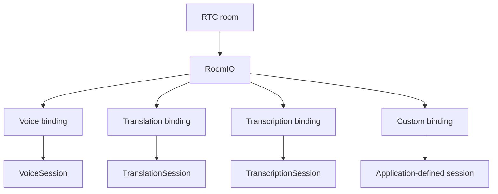

# Shared RoomIO

This is a design proposal for a general room I/O foundation shared by built-in
and application-defined sessions. The API described here is proposed behavior. Existing
contracts remain in [VoiceSession](../voice-session.md),
[component contracts](../internals/components.md) and
[runtime lifetimes](../internals/runtime.md#cancellation-and-task-ownership).
After implementation, move accepted public behavior and internal contracts into
their owning guides and retire this proposal.

## Objective and agreed direction

Provide a small public RoomIO API that built-in and application-defined sessions
can compose. Each session attaches to one room. Several sessions can use that
room through separate bindings, with explicit ownership of their inputs and
publications.

VoiceSession, TranslationSession and TranscriptionSession are consumers of the
same foundation. Single-source and multiple-source input, audio output and
attributed transcript publication are common capabilities. RoomIO depends on
the ports a binding requests, rather than the session's concrete type.

VoiceSession and TranslationSession are the first two integration milestones.
TranscriptionSession's multiple-input and attribution requirements constrain the
shared design from the start; its engine port can follow independently. That
delivery order does not restrict the shared API to those first two consumers.

The design should make incorrect resource ownership difficult to express in
Rust. Types enforce authority and ownership; synchronous machines enforce
lifecycle transitions and asynchronous correlation. The DST verifies those
mechanisms under failures and reordered execution.

The current scope includes bindings, shared ownership, typed input/output ports,
legacy compatibility and the first session integrations. A new Protobuf session
protocol is explicitly deferred and TBD; its design does not block this work.

The public room-I/O model has exactly two concepts:

| Public concept | Responsibility |
| --- | --- |
| `RoomIO` | Shared room resources and binding creation |
| `RoomBinding` | One consumer's input/output ports and resource lifetime; returned by `RoomIO.bind(key)` |

Ordinary VoiceSession startup needs neither explicit construction nor additional
configuration. Internal registries, activation/cleanup guards, capability types
and host adapters are fine where they protect an invariant or implement a
boundary. They do not become additional SDK concepts. Reuse existing machinery
and consolidate redundant wrappers, without removing useful internal structures
merely to make their count smaller.

## Consumer requirements

These workloads exercise different combinations of shared capabilities. They
are examples of RoomIO consumers, not an exhaustive set of supported session types.

| Session                     | Room inputs                                              | Room outputs                                               | Session-owned decisions                                                             |
| --------------------------- | -------------------------------------------------------- | ---------------------------------------------------------- | ----------------------------------------------------------------------------------- |
| VoiceSession                | One selected participant's microphone and optional video | Agent audio and user/agent transcripts                     | User turns, reply scheduling, interruption, hooks and conversation                  |
| TranslationSession          | An exact audio track, including its publisher            | Translated audio, source captions and translated captions  | Provider execution, translation segments, retargeting and effective output language |
| TranscriptionSession        | A changing set of participants' microphone tracks        | Captions attributed to their original speakers and tracks  | Mixing, sample timeline, STT execution and speaker attribution                      |
| Application-defined session | Its selected tracks or track collection                  | Its owned audio publications and/or attributed transcripts | Application-specific processing and execution policy                                |

The current v1 [TranslationSession](https://github.com/livekit/agents/blob/main/livekit-agents/livekit/agents/beta/translation/translation_session.py)
is an independent session. Its [TranslationRoomIO](https://github.com/livekit/agents/blob/main/livekit-agents/livekit/agents/beta/translation/room_io.py)
duplicates room attachment and publication work because voice RoomIO also reaches
into conversational session behavior. Translation adds concrete requirements:

- Select an exact audio publication; a participant may have several tracks.
- Attribute source captions to the source publisher and source track. Attribute
  translated captions to the local publisher and translated output track.
- Label output using the language actually spoken, including when a retarget is
  still being applied by the provider.
- Settle old audio and paced captions before applying a new output label or
  replacing a language-dependent track publication.
- End output segments from provider boundaries or an audio gate, with a bounded
  wait for trailing transcript text.

[Tina's TranscriptionSession PR #8389](https://github.com/livekit/agents/pull/8389)
adds a different composition: several microphone streams feed one STT stream.
The [inspected implementation](https://github.com/livekit/agents/blob/0bed8151d7097bd4e0a87f8ebd8fe5814d6f6f60/livekit-agents/livekit/agents/beta/transcription/session.py)
retains per-stream timing and historical track attribution for delayed results.
Interim segments have stable identities and may be revised before finalization.
Those requirements apply to the shared publication contract even when the
transcription engine is integrated later.

One room per session and one participant per session are separate choices.
RoomIO supports a binding following one source or a collection of sources, as
well as several bindings sharing those sources. A session can compose internal
processing pipelines over its binding; an application can compose independent
sessions over the same room. Each session's product API selects that arrangement.

## RoomIO and RoomBinding



There is one internal RoomIO owner per SDK room. Explicit construction and the
sessions' convenience startup paths must resolve to that same owner. It owns
room event distribution, subscription claims, stream-handler registrations and
the registry of bindings. Closing one binding releases only its resources.

A `RoomBinding` is declared with one opaque key scoped to its RoomIO, for example
`room_io.bind("front-desk")`. The key names an attachment and its owned resources;
it does not select a participant or track. Source selection is separate consumer
configuration. Duplicate active keys are refused before resource acquisition.
Construction declares the binding; activation establishes its owned lifetime.

Reusing a key after close creates a new binding incarnation. Resource claims,
operations and receipts carry that incarnation, so late work from an earlier
binding cannot affect the replacement. The readable key is not an RPC request
ID, a physical track SID, a persistence partition or an authorization grant.

A failed or uncertain resource cleanup does not establish that the old
publication or handler is gone. Keep its key reserved until retirement can be
established; return the cleanup outcome rather than allowing a replacement to
publish over possibly live resources.

A shared room handle permits binding creation. A binding grants access only to
its selected inputs, publications and observations. Disconnecting or deleting
the SDK room requires a separate room-administration capability held by the job
or application. This is an ownership boundary within framework code;
application code retaining the SDK room or administrative API retains its
explicit authority.

Closing the RoomIO owner stops admission and joins all binding cleanup. It does
not implicitly delete or disconnect the SDK room. Existing voice shutdown and
room-deletion options must be reconciled with this ownership rule before the
VoiceSession migration; they cannot acquire authority over unrelated bindings.

### Shared resources

| Resource                                | Owner and release rule                                             |
| --------------------------------------- | ------------------------------------------------------------------ |
| SDK room connection                     | Job/application; RoomIO borrows it                                 |
| Room events and incoming topic handlers | Shared room owner; bindings have scoped registrations              |
| Track subscription                      | Shared subscription owner; each binding holds an owned claim       |
| Input readers and processing            | Binding-owned, with explicit source identity and bounded delivery  |
| Published audio track                   | Its publication owner; other bindings cannot clear or unpublish it |
| Transcript route                        | One explicit producer owner for its selected subject and role      |
| Cleanup tasks                           | Owning TaskSet; resources remain owned until cleanup settles       |

Subscription claims must distinguish subscriptions created by RoomIO from ones
that were already active externally. Releasing the last RoomIO claim must not
undo another owner's subscription. Room events carry facts; session policy
decides how a participant departure affects execution.

Each input consumer has its own admission and queue state. A slow consumer must
not block another binding. Catch-up, loss reporting and failure behavior are
explicit policies at the consumer boundary. Queue bounds cannot silently
discard words while reporting complete transcription. Sharing subscription
ownership is required; sharing decoded frames or identical processing pipelines
is an optimization to justify separately.

### Downstream resource identity and routing

The binding key supplies an ownership namespace. Each resource also has a local
role/key and operation generation; SDK publications retain their physical SIDs.
Wire names and metadata follow their own compatibility contracts.

| Resource | Binding scope | Shared room responsibility |
| --- | --- | --- |
| Remote track input | Selection, reader, queue and subscription claim | Share subscription ownership for the actual remote track |
| Local track output | Publication owner, logical role and publication generation | Publish/unpublish the physical track and correlate receipts with its owner |
| Incoming text/byte stream | Binding subscription or exclusive route claim | Register each SDK topic handler once and route admitted streams |
| Transcript output | Producer claim, attributed segment and publication route | Encode the existing transcript protocol and arbitrate producer conflicts |
| Participant attributes | Explicit claim to the attribute or framework role | Serialize updates and prevent competing owners of singleton state |
| Telemetry and cleanup | Binding incarnation, resource identity and owned tasks | Attribute shared work once and join owner-level cleanup |

An output label may include the binding key for discoverability, but labels are
not resource identity. A translated track can change name or SID while retaining
its binding; old receipts still identify the publication being retired. Selecting
an input track never renames or transfers ownership of that remote publication.

RPC redesign is outside this proposal. Preserve existing application RPCs and
framework playback routes; the shared RoomIO work does not introduce a new
binding-scoped RPC API or select a new RPC wire format.

Standard topics such as `lk.transcription` retain their protocol names. The
shared owner handles SDK registration and admission; bindings consume routed
streams according to explicit matching and delivery policy. Media can fan out
to independent consumers, while commands have one selected handler. Closing one
binding cannot unregister the room's topic handler while another still uses it.

## Session-independent room ports

RoomIO provides selection, input streams, publications and observations. It
receives explicit requests from sessions and returns correlated results.

| Shared RoomIO responsibility                                                             | Session responsibility                                               |
| ---------------------------------------------------------------------------------------- | -------------------------------------------------------------------- |
| Discover/select tracks and follow their lifecycle                                        | Choose which sources serve the workload                              |
| Read audio/video, normalize input, run configured processing and admit pre-connect audio | Interpret media, mix sources or invoke providers                     |
| Execute output publication, replacement and playback accounting                          | Decide output eligibility and segment boundaries                     |
| Publish attributed transcripts and preserve frontend protocol compatibility              | Produce text, revisions, finalization and language/subject decisions |
| Report participant, track, connection, keypad and text facts                             | Turn-taking, away timers, interruption and text-reply policy         |
| Release binding resources and report cleanup outcomes                                    | Decide whether to continue, fail or close the session                |

Custom sessions use these same ports. They do not implement an Agent interface
to obtain room access. Sessions compose the shared binding and retain their own
state machines.

### Source selection

Input selection supports participant-based following, exact-track selection and
collections of matching tracks. Voice defaults can preserve the current
single-participant behavior. Translation pins the publication it translates;
transcription follows its accepted set of microphones.

### Single-source and multiple-source input

A room binding is a scope for resources, not one audio stream. It can own a
collection of independent source streams. Consumers obtain an input capability
with the cardinality their engine accepts:

| Input capability        | Consumer contract                                                                                                                                                |
| ----------------------- | ---------------------------------------------------------------------------------------------------------------------------------------------------------------- |
| Single audio input      | One readable audio stream under an explicit selection/follow policy; used by VoiceSession and the current single-track TranslationSession                        |
| Audio source collection | Source-added/source-removed observations and an independently owned stream per source; used by TranscriptionSession and a future meeting translation composition |

The single-input adapter selects one source from the room and exposes one
continuous input to its engine. A microphone replacement can change the selected
track under that follow policy; attachment identity still separates the old and
new source. VoiceSession retains its one primary audio input, alongside its
separate optional video and text inputs. It does not receive a collection or
implicitly mix other participants into the conversation.

A collection consumer decides how to process its sources. TranscriptionSession
mixes them into its STT input and retains the reverse attribution map. A meeting
translation consumer can run independent translation pipelines per selected
source and target language. Mixing and translation routing remain session-owned
decisions. The current v1 TranslationSession translates one track; multi-source
translation is a consumer extension, not an existing capability assumed here.

RoomIO exposes independent source streams and has no mixing operation or mixed
input capability. A mixer belongs to the consuming session's media pipeline.
Its signal-processing implementation can be reusable media code, with the
session owning configuration, timing, source membership and attribution.

Expose these as distinct Rust input capability types. Voice startup requires
the single-input capability; collection consumers require the source-collection
capability. RoomIO's single-input view selects one source. A consumer that needs
a mixed stream constructs it in its own pipeline after acquiring the source
collection; a multi-source input cannot silently become a single stream.
The public Python binding validates the same capability requirements before
starting the engine. This does not require one RoomIO implementation per
cardinality or a generic base class for every session.

Each source stream has one receiver owner. When several bindings follow the
same track, they have separate delivery state and subscription claims. Within a
collection, adding or removing a source does not replace unrelated source
streams. Closing a source ends its input; the session still owns any provider
results and transcript finalization owed for audio already consumed.

### Source identity and time correlation

Frames and source lifecycle observations retain participant identity, track
identity and attachment generation. A retired reader cannot deliver frames into
a replacement attachment. Historical attribution remains available for results
that legitimately arrive after a source leaves.

Source sample time, provider stream time, a session's derived media timeline and
wall time remain distinct. RoomIO supplies source facts and offsets; a mixing
engine owns the mapping from its output samples back to source intervals.
Provider reconnects retain their own stream bounds so late results cannot be
attributed to newer audio.

### Transcript and output identity

A publication request identifies its segment, attributed speaker, exact track,
language when known, and whether the text is a delta, replacement or final.
Stable segment IDs support revisions. Attribution is supplied explicitly;
publication must not guess it from a participant's current microphone.

Translation separates the original source from the local output publication.
Old segments retain their original track and language while draining. The
translation machine decides when a language transition is ready; RoomIO
executes the requested publication transition and acknowledges settlement.

Bindings that would publish the same logical transcript need an explicit
producer-selection policy. Running voice, translation and transcription
together must not accidentally duplicate source captions. Exact route keys and
conflict behavior remain an API decision below.

## Rust ownership guarantees

The following names describe roles; exact Rust and host API names remain open.

| Type or mechanism                                              | Guarantee                                                                                                                                        |
| -------------------------------------------------------------- | ------------------------------------------------------------------------------------------------------------------------------------------------ |
| Separate room-administration capability                        | Ordinary bindings expose no room deletion/disconnection operation                                                                                |
| Non-cloneable binding owner                                    | One authority releases the binding's resources; borrowed handles grant only declared operations                                                  |
| Non-cloneable subscription claim                               | A binding releases its own claim through the shared owner, rather than directly unsubscribing the SDK track                                      |
| Owned publication                                              | Clearing, replacement and unpublication require that publication's authority                                                                     |
| Non-cloneable stream receiver                                  | Consumers cannot accidentally compete for the same receiver                                                                                      |
| Distinct single-input and source-collection capabilities       | An engine cannot accidentally receive a different input cardinality; RoomIO selects individual sources and the consumer owns any mixing pipeline |
| Distinct binding, attachment, publication and segment ID types | IDs from different domains cannot be interchanged                                                                                                |
| Owned resources and ScopedTask/TaskSet handles                 | Cancellation retains cleanup responsibility and joins acquired resources                                                                         |
| signal producers held by progress owners                       | Waiters settle when their operation or owner ends                                                                                                |

One lifecycle enum holds each operation's valid states. For example, publication
startup holds either pending acquisition, the active owned publication, or its
cleanup state. It cannot independently claim both successful startup and a
missing publication. A creation receipt arriving after cancellation transfers
the resource into cleanup.

Rust types establish authority and ownership. Dynamic generation checks are
still required for delayed frames, receipts and callbacks. The synchronous
owner accepts an observation only for its current attachment or operation.
Historical transcript attribution is a separate retained record and never
grants authority over the current input.

## Session endpoints and RoomIO bindings

Session I/O ports describe what an engine consumes and produces. RoomIO bindings
provide room-backed implementations of those ports and own their room resources.
The RoomIO owner itself is neither an audio input nor an audio output.

Today VoiceSession accepts custom endpoints through `session.input.audio`,
`session.output.audio` and `session.output.transcription`. Starting with `room=`
also creates native room defaults; an explicit audio endpoint replaces the
corresponding room leg. The runtime composes the selected output with transcript
synchronization and other session-owned wrappers. See the
[host endpoint properties](../../python/livekit-agents/livekit/agents/voice/io.py)
and [runtime output composition](../../rust/crates/lk-agents-runtime/src/voice/io.rs).

Preserve endpoint assignment for custom I/O. Proposed `start(io=binding)`
activates the declared binding, installs its ports into the session's I/O composition and
retains that binding until its resources settle. Replacing an endpoint affects
that binding's leg and preserves the session's wrappers and playback protocol.
It does not replace the shared room owner or another session's endpoints.
Manually composing binding ports requires an explicit binding lifetime covering
their use and cleanup.

| Consumer | Session-facing I/O shape | Room-backed implementation |
| --- | --- | --- |
| VoiceSession | One primary audio input/output pair, optional video input, and transcript output | A single-source selection view and owned publication ports |
| Single-track TranslationSession | One source audio input, translated audio output, and distinct source/output caption routes | An exact-track input and publications retaining source, output-track and language identities |
| Meeting translation composition | Multiple independent source/pipeline endpoint sets | A source collection and a publication set keyed by the selected translation routes |
| TranscriptionSession | A source collection and attributed transcript output | Independent track readers and caption routes; its mixer feeds STT outside RoomIO |

Port types can be shared while each session exposes the cardinality its engine
needs. A collection is not installed into VoiceSession's single `input.audio`
slot. A transcription session has no synthesized audio output to configure.
Multi-source transcript output accepts explicit speaker/track identities per
segment, rather than changing one global current participant between writes.
The exact plural endpoint API for meeting translation remains provisional.

Endpoint introspection needs a consistent contract too. The current Python
`output.audio` getter retains an explicit override while the native runtime may
be using a room default. The proposed API should expose effective endpoints
unambiguously; whether that uses the existing properties or a separate resolved
view is a decision to settle before changing getter behavior.

## Public API sketch

The shapes below are illustrative, not implemented signatures. Explicit RoomIO
construction is optional. The normal VoiceSession path stays unchanged:

```python
session = VoiceSession(...)
await session.start(agent=front_desk, room=ctx.room)
```

With no explicit `room`, startup retains today's job-room default and offline
behavior outside a job. Custom endpoint assignment remains available. An
offline or custom-only session does not acquire an RTC attachment merely to
participate in the binding API.

Applications opt into explicit bindings when they need named attachments or
several sessions on the same room:

```python
room_io = RoomIO(ctx.room)

await voice.start(
    agent=front_desk,
    io=room_io.bind("front-desk"),
)

await translation.start(
    io=room_io.bind("spanish-translation"),
)

await transcription.start(io=room_io.bind("meeting-captions"))
```

The binding exposes its `input` and `output` endpoint bundles, so an individual
endpoint remains inspectable and assignable, for example
`session.output.audio = binding.output.audio`. The exact source-configuration
arguments are a separate API decision; the binding key is never inferred as a
source selector.

### Convenience startup and shared ownership

The existing `start(room=...)` convenience obtains the shared owner internally
and supplies a binding identity. That identity is generated by the owner and
cannot collide with application keys: internally, automatic identities and
user-supplied keys are distinct variants, not strings with a reserved prefix.
Starting a second session on the same SDK room obtains a separate binding from
the same owner. Explicit construction after convenience startup also resolves
to that owner; it cannot install a second set of room handlers.

Owner identity follows the SDK room connection/local participant, not the room
name. Two SDK room objects connected to the same LiveKit room do not share a
local owner's publications, handlers or legacy-primary selection.

Explicit startup activates and owns its declared binding. The consumer closes
that binding on normal close, failed startup or cancellation, after settling
acquired resources. Session close does not close the owner or other bindings.
When the last binding ends, shared work with no remaining claims stops; the
room-associated owner can admit a later binding. An explicit owner close stops
all admission and joins all binding cleanup, as described above. It does not
disconnect the application's SDK room.

### Startup argument contract

| Startup form | Behavior |
| --- | --- |
| `start(agent=..., room=room)` | Resolve the shared owner and create an automatic binding using voice defaults and supplied room options |
| `start(agent=..., io=binding)` | Use the binding's room and activate that binding with the session's required capabilities |
| `start(agent=...)` | Keep existing job-room, console and offline startup behavior |
| Both `room=` and `io=` | Reject before activation; there must be one explicit room attachment source |
| Binding already activated by another consumer, closing, or closed | Reject before acquiring resources; create a fresh binding to attach another consumer |

Voice-specific `room_options` continue to configure the voice consumer in either
room-backed form. They do not change the shared owner's policy or affect other
bindings. A mismatch between requested capabilities and a consumer's input shape
fails before acquisition. Shared-owner legacy configuration is set on the owner,
not silently reconfigured by per-session defaults.

Custom composition exposes binding input streams and publication operations;
SDK pumps, task registries and queue internals remain private.

Built-in convenience options resolve into the same binding contract exposed to
custom consumers. A binding can request input streams, audio publication,
transcript publication or a combination. Input-only transcription and sessions
without conversational state are supported compositions. RoomIO does not grow
one constructor or mode switch per session type.

## Existing protocols and LegacyProtocol

The current implementation scope preserves the existing client protocols while
introducing shared RoomIO ownership and bindings. A new session protocol and
its client API are deferred. Bindings can be composed through the server/host
API without requiring new frontend discovery, targeting or negotiation.

`primary` belongs only to the legacy bridge. It selects the binding projected
through the existing single-session frontend protocol. It is not a general
RoomIO or session-engine role, and is separate from the job's existing
primary-session reporting/recording lifecycle.

### Automatic compatibility and advanced configuration

Compatibility is automatic by default for both `VoiceSession.start(room=...)`
and explicit `RoomIO(room)` construction. Ordinary applications do not need to
know about or construct `LegacyProtocol`. Existing startup, room options and
custom endpoint assignments retain their behavior.

Bindings and legacy support coexist. Both startup paths use bindings; the legacy
bridge consumes their capabilities and projects its selected primary. Using an
explicit binding never opts a session out of compatibility by itself.

`LegacyProtocol` names the internal compatibility adapter, not another public
object applications must construct. Advanced settings for bridge enablement,
primary selection and eligible audience belong on `RoomIO`; their exact
signatures remain to be settled. The audience identifies frontend recipients
and callers, not the speakers selected as session inputs. Audience selection
must preserve the existing eligibility and application access rules.

By default, each successfully started legacy-compatible binding becomes the
primary, replacing the previous primary through the ordered transfer below.
Selection commits with successful activation: a failed or cancelled startup
does not take over the bridge. Concurrent activations and explicit transfers
are serialized by the owner, so there is one ordered selection history.
Translation and transcription do not introduce competing legacy voice targets
unless they explicitly implement the required legacy capabilities.

Primary selection and transfer live under legacy configuration. An explicit
primary configuration pins that choice rather than allowing subsequent startups
to replace it; applications can return to automatic selection. Changing an
already active binding's selection explicitly remains supported. Primary loss
ends that projection; another binding is not promoted automatically. An already
configured shared owner cannot have its policy silently changed by a later
session startup. Disabling legacy is an explicit advanced option; it does not
activate a replacement protocol in this phase.

A legacy bridge has at most one active primary at a time, scoped to this RoomIO
owner/local RTC participant. Applications can explicitly switch the primary to
another active binding that supports the required legacy projection. Eligibility
is capability-based; a transcription or translation binding is not automatically
capable of serving conversational legacy controls.

Primary transfer has one ordered cutover. New legacy input is routed to the new
primary after that point. Requests already admitted retain their original binding
incarnation and correlation; they are never executed again against the new
primary. Outgoing projection work is fenced by a primary generation, so delayed
events from the previous primary cannot be emitted as the new primary's state.
Settle old open transcript projections and establish the new state using the
existing protocol's supported operations; define the exact handover and
in-flight response behavior before implementation and verify it with legacy
clients. A failed transfer must not expose two primaries.

Switching the legacy projection does not itself close either session, rebind its
inputs, cancel its application tools or mute its audio publications. Audio
audience/floor changes are separate explicit session/output policy. A target
that closes during handover resolves the transfer with a typed outcome rather
than silently selecting a third binding.

### Preserved wire behavior

| Existing surface | Compatibility rule |
| --- | --- |
| `VoiceSession.start(room=..., room_options=...)` | Retain convenience startup, source selection and voice defaults |
| `session.input.audio` / `session.output.audio` | Retain custom endpoint assignment and session-owned wrapper composition |
| `lk.chat` | Retain its wire name and payload; route untargeted requests through the legacy primary's existing eligibility policy |
| `lk.transcription` | Retain its topic, segment/revision/final semantics and speaker/track attribution |
| Legacy transcription packets | Retain the existing compatibility publication path and client-capability handling |
| `lk.agent.state` | Keep one explicit legacy voice-state producer for the local participant |
| Existing remote-session protocol | Retain its topic and encoding; untargeted messages reach the designated compatible session |
| Existing avatar playback RPCs | Retain plain and segment-qualified routes and their caller/segment correlation |

Binding keys remain internal ownership names in this phase. Do not prefix
standard topics, rewrite remote track SIDs or add required binding targets to
existing payloads. The shared owner routes current protocol operations to their
owned binding resources. RPC redesign remains out of scope.

Legacy frontends retain the interactions their protocols can represent; shared
bindings do not imply that those frontends gain arbitrary multi-session
selection or control. Transcription and translation continue to use the existing
media and attributed-caption mechanisms where applicable.

Several audio publications still require a deliberate audience/track-selection
policy, especially for clients that automatically subscribe. Participant
attributes such as `lk.agent.state` are room-visible and cannot be made
recipient-private by an audience filter. Verify supported delivery and
subscription mechanisms before claiming per-recipient visibility or audio
isolation. Preserve existing single-session behavior while defining these
multi-binding cases.

Compatibility journeys cover voice alone and beside translation/transcription:
chat/control reaches voice once, state has one producer, captions retain their
subjects, playback reports reach the correct publication, and closing another
binding leaves voice usable. Also cover legacy disabled, several legacy-capable
voice bindings, automatic takeover on successful startup, failed/cancelled and
concurrent startups, explicit primary selection, primary loss, reconnect and
audience changes. No new-protocol clients are required for this work.

### RemoteSession shares the legacy cardinality limit

The current remote-session host exposes one VoiceSession through a SessionPort:
history, agent information, state, usage, run input and I/O controls all refer to
that session. In a room-backed job, hosting is enabled for the job's first claimed
session and disabled for later sessions. The room transport registers the single
`lk.agent.session` topic. This permits multiple local sessions but exposes only
one through that legacy remote-session surface.

Shared RoomIO owns one legacy room transport and its registration, with routing
through the same legacy primary used by the other single-session projections.
Each compatible binding provides its own session access capability; a request
captures the selected capability and binding incarnation at admission. Do not
register an independent room transport for every binding or let closing one
binding unregister the owner's transport.

The job's reporting/recording primary remains a separate lifecycle role. Remove
the coupling that makes it the only possible remote-session host without moving
recording ownership or job-close behavior when the legacy primary switches.
Console transport is separate from this room-level ownership and must retain
its existing lifecycle.

Legacy clients still observe one remote session at a time. Switching cannot be
implemented by merely replacing a SessionPort: establish which state/history a
connected client reloads, how old event streams finish, and how already admitted
responses remain correlated without appearing to belong to the new session.
The existing wire protocol may limit seamless handover; verify that behavior
with real clients and require a supported reset/reconnect if necessary. Do not
claim transparent handover before this is demonstrated.

Tests cover remote requests admitted on either side of cutover, delayed events,
I/O controls scoped to the selected binding, primary closure, and transport
registration surviving secondary closure. Independently addressing and observing
several remote sessions belongs to the deferred Protobuf protocol below; it is
not achieved by starting multiple legacy hosts on the same topic.

## Deferred: Protobuf session protocol (TBD)

Design a new session protocol in Protocol Buffers as a separate follow-up,
coordinated with the shared protocol definitions and client SDKs. It must account
for multiple sessions, input sources and output publications from the outset.
`primary` will remain a legacy-only concept.

The Protobuf schema, transport, discovery, addressing, capability negotiation,
subscriptions, command/result semantics, versioning and reconnect behavior are
all TBD. The client helper API and migration from legacy are also TBD. The
previous client-flow and SDK API sketches are not part of the proposed contract.

Current work should retain explicit internal binding, attachment, publication
and segment identities so the future protocol can describe them. It must not
invent a temporary wire format or require a new client implementation. Designing
or shipping that protocol is not an acceptance condition for shared RoomIO,
VoiceSession migration or TranslationSession integration.

## Session integration

All consumers follow the same v2 crate and binding boundaries:

- Session lifecycle and processing decisions are synchronous Rust decisions.
- Provider I/O, retry and reconnect execution use the inference layer and its
  shared request policy.
- Runtime drives those decisions and RoomIO effects with injected clocks and
  spawners. It owns provider streams and bounded resource cleanup.
- Python supplies construction, provider adapters and application callbacks;
  mechanical forwarding and records are generated from ABI declarations.

### VoiceSession

Migrate current voice room attachment to a binding while retaining its existing
behavior. Conversational state, turns, interruption and away timers remain with
VoiceSession. Its room-deletion options require the explicit authority described
above. Existing voice configuration is the compatibility baseline for this consumer.

### TranslationSession

Use translation as the second real integration to exercise the shared ports
under continuous speech and exact-track attribution. Its lifecycle, segment
settlement and effective-language transitions belong to its own machine.

Capture the existing translation tests as behavioral cases: exact-track
attribution, source changes, provider-defined and silence-defined segmentation,
trailing text, resampling, retargeting, language labels, publication replacement
and close. Provider capabilities determine which fallback applies. Translation
does not require conversational agent execution or a persisted routing frame.

Review existing model adapters and choose the v2 provider boundary before the
port. A meeting-level API that manages several translation pipelines remains a
separate consumer design decision.

### TranscriptionSession

The shared binding supports multiple selected microphone streams and transcript
publication attributed to any of those sources. Selection, reader lifetime and
publication use the same RoomIO primitives as the other sessions. The mix clock,
energy gates, STT streams and speaker attribution stay in TranscriptionSession.

Test those binding capabilities during the foundation work, including mute,
unmute, replacement, departure and delayed captions. Integrating the full engine
is a subsequent milestone, without requiring a second room adapter or access to
voice-specific state.

### Application-defined sessions

A custom session composes the public binding ports directly and owns its own
processing lifecycle. Built-in adapters provide examples of the supported
contract rather than privileged access to shared room resources. Exact binding
construction and capability APIs remain part of the public API decision below.

## Delivery slices and acceptance

| Slice                                      | Result required before continuing                                                                                                                                     |
| ------------------------------------------ | --------------------------------------------------------------------------------------------------------------------------------------------------------------------- |
| Ownership and API contract                 | Resolve the decisions below; define binding lifetime, capabilities, resource claims and source/publication records                                                    |
| Shared owner and VoiceSession              | Production RoomIO runs through bindings; existing voice behavior remains covered; two bindings survive independent startup/close                                      |
| Track collections and publication subjects | Exact and multiple-track inputs, retained attribution, transcript route ownership and output replacement have direct regressions                                      |
| TranslationSession                         | Real translation engine uses shared RoomIO; voice and translation work independently and concurrently                                                                 |
| Legacy compatibility | Existing startup and client wire contracts pass with one or multiple bindings; primary projection and audience rules are explicit |
| Documentation and conformance              | A public RoomIO guide owns the shared contract; consumer guides explain their specific configuration and behavior; accepted internal contracts move into their owners |

TranscriptionSession's full engine port follows the initial integrations. Shared
multi-input and attributed-publication support is part of foundation acceptance,
independently of when that engine ships.

## Validation strategy

The [voice DST boundary](../../rust/crates/lk-agents-fuzz/src/boundary.rs) already
includes production room executors over fake RTC ports. Existing
[room regressions](../../rust/crates/lk-agents-fuzz/tests/regressions/room/mod.rs)
exercise production input/output, readiness, publication failure and cleanup.
Add shared-room composition coverage that runs the real shared owner and
bindings on one injected scheduler and clock.

| Layer                    | Evidence                                                                                                                 |
| ------------------------ | ------------------------------------------------------------------------------------------------------------------------ |
| Pure Rust tests          | Selection, subscription claims, lifecycle transitions, generation checks and transcript identity                         |
| Room composition DST     | Real RoomIO executors with several bindings under cancellation, faults and reordered receipts                            |
| Session composition DST  | Real session engines using shared RoomIO as they are integrated; provider ports are faked                                |
| Python binding contracts | Public construction, custom binding composition, callbacks, errors and cleanup semantics                                 |
| Local-SFU E2E            | Actual subscription/publication behavior, concurrent tracks, caption attribution and existing frontend compatibility     |
| Provider conformance     | Each consumer's provider boundaries and supported capabilities against controlled peers; live checks reported separately |

The shared-room checks must establish:

- Closing or failing one binding leaves unrelated bindings usable.
- Subscription and handler registrations remain while another owner needs them.
- A consumer's delay or queue failure cannot stall another binding.
- Track replacement, mute, unmute and departure preserve the selected input's
  identity and the attribution of delayed transcripts.
- Voice's single-input adapter follows only its selected source; source
  collection changes preserve other sources, and mixing occurs only in an
  explicitly selected session pipeline.
- A cancelled startup retires resources created before its receipt arrived.
- Audio and captions drain under their original publication and language before
  replacement; stale observations cannot affect the new publication.
- Transcript routes do not publish the same retained occurrence twice.
- Room loss and owner close settle every readiness, stream and cleanup waiter.
- Each publication is released once and every owned task is joined.
- Reusing a binding key cannot let old track receipts, topic
  registrations or attribute updates affect the new incarnation.

Use scripted port consumers to test binding composition before all engines are
available. Full session claims require the actual session executors; a model of
their behavior is not a substitute. All DST timing follows injected time.

## Decisions to settle before implementation

| Decision                                           | Proposed starting point                                                                                                                                  |
| -------------------------------------------------- | -------------------------------------------------------------------------------------------------------------------------------------------------------- |
| Public surface and ownership                       | A small RoomIO handle plus scoped binding ports; separate administration capability                                                                      |
| Owner discovery and explicit close                 | Resolve one owner per SDK room; specify how explicit construction and convenience startup share it and who closes it                                     |
| Voice room-deletion options with multiple bindings | Require explicit administrative authority; settle behavior when unrelated bindings remain                                                                |
| Transcript route conflicts                         | One producer owner per logical subject/role route, with explicit selection rather than accidental duplication; define route keys and conflict errors     |
| Input processing and overload policy               | Binding-specific processing and explicit bounded delivery; determine defaults for voice, translation and transcription                                   |
| Readiness                                          | Separate room connection, binding readiness and selected-source availability; define what an empty multi-input binding awaits                            |
| Consumer capability requirements                   | Define how sessions request input/output ports and validate supported capabilities without concrete session-type checks                                  |
| Crate and import placement                         | Follow existing architecture boundaries; settle session-independent RoomIO placement and its public import path without adding a crate solely for naming |
| Shared observations and accounting                 | Attribute session work to its binding and shared room work to one owner; define recording and metric ownership to avoid double counting                  |
| Legacy enablement and audience | Automatic compatibility; latest successful compatible startup becomes the sole primary unless explicitly pinned; ordered switching; settle legacy-client handover and audience changes |

Use this table to review the remaining choices together. Record the resulting
contracts in their owning guides as implementation and verification establish
them; keep the public signature sketch provisional until then.
