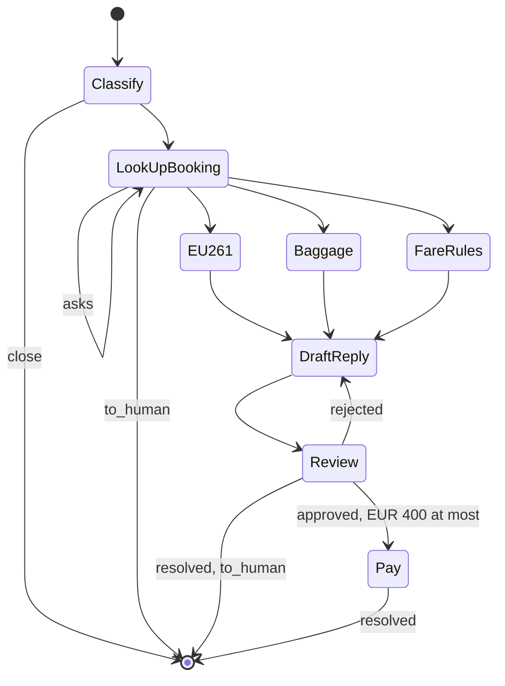

# Skyline Air support

A made-up airline's customer care, on the local stack of [`../README.md`](../README.md): one
agent, `support`, whose one tool awaits a graph. The graph decides from the customer's
message, asks for what is missing and continues on the answer, in a later turn and on any
worker, and pays only after a reviewed reply.

| File               | What                                                                                          |
| ------------------ | --------------------------------------------------------------------------------------------- |
| `support_agent.py` | The `support` agent, the `Triage` graph and its three agents, the text door and the room door. |
| `skyline.py`       | The airline's own system: bookings, flights, baggage files, payments, the policy, in memory.    |
| `console.toml`     | How the console lists and starts it.                                                            |
| `scenarios/*.yaml` | Simulation scenarios: `compensation`, `missing_details`, `spam`.                                |

## The agent and the graph

```python
@support.tool
async def triage(ctx: RunContext, email: Email) -> TriageResult:
    return await Triage(Classify(email), state=Ticket())

@server.a2a_session(endpoint="triage", description="Skyline Air customer care.")
async def text(ctx: A2ASessionContext[None]) -> RunResult[str]:
    return await support.run(ctx.message, message_history=ctx.message_history)
```

`support` hands a request to `triage` and relays what comes back: the reviewed reply, or that
a colleague answers by email. The graph is a class, `class Triage(Graph[TriageResult, Ticket])`
with its `nodes`; awaited, it is a task on the lane's agent stack.



`Triage.mermaid_code(start_node=Classify)` draws it from the return annotations of the nodes'
`run()`.

- **A node that waits.** `LookUpBooking` returns `InputRequired("What is your booking
  reference?")` when the message has none, or none of the sender's, and the PIR for a bag. The
  turn ends with that question; the customer's answer runs `LookUpBooking` again with it on
  `ctx.reply`. While it waits the stack holds the graph's name, the asking node and the
  `Ticket` as JSON. After three questions a person takes over.
- **Agents called as functions** where judgment is needed: `Classify` reads the message,
  `DraftReply` writes the reply, `Review` checks it against the facts and the policy, two
  rounds at most.
- **Code for everything with a right answer**: the booking lookup (only for the passenger's own
  address), EU261 by delay, cause and distance, the baggage allowance, the fare rules, and what
  was already paid.
- **Money moves last.** `Pay` runs only after an approved reply and only up to EUR 400.

`TriageResult.action` is `resolved` (answered, and paid when something was due), `to_human`
(the payment is above EUR 400, the reply failed review twice, or the booking was never found;
the draft and the reason ride along for the colleague) or `close` (spam).

## Run

With the stack and the environment of [`../README.md`](../README.md), from this directory,
one terminal each:

```sh
uv run python support_agent.py dev
```

The console (`../../console`) then talks to the airline. The customer writes from an address,
which the bookings are checked against. Try: "Tom Okafor, tom.okafor@example.com. You
cancelled SK517 to Lisbon two days before departure", then the booking reference it asks for,
SKY5C1: EUR 400 is paid. A reload shows the whole thread from the threads service.

| The customer                    | Expected                                                                  |
| ------------------------------- | ------------------------------------------------------------------------- |
| Ana Garcia, SKY4F2              | SK204 3h20 late, 1240 km: EUR 250 paid                                    |
| Marcus Lee, SKY7Q9              | SK880 5h late, 5850 km: EUR 600 due, a colleague answers                  |
| Priya Nair, SKY2M8              | SK312 4h late, thunderstorm: nothing due                                  |
| Tom Okafor, SKY5C1              | SK517 cancelled two days ahead, 1850 km: EUR 400 paid                     |
| Eleanor Smith, SKY9B3           | a bag three days late, EUR 180 of receipts, PIR AMSSK10422: EUR 150 paid; or a refund of the flex fare: EUR 320 paid |
| anyone with another's reference | not found under their address, asked again                                |

The airline is seeded per worker, so a second claim on the same booking finds the first
payment and pays only the difference; restart the worker to start over.

## Scenarios

`scenarios/` holds the simulation sets for `lk agent simulate`:

```sh
lk agent simulate text --scenarios scenarios/missing_details.yaml --agent-name skyline-support
```

`compensation` covers a payment made on the spot, one above what is paid without a person, and
an extraordinary circumstance; `missing_details` the waits: no booking reference, a bag without
its PIR, someone else's booking; `spam` a message with nothing to act on. Restart the worker
before a run, since payments stay in memory. The simulation reaches the room door, where the
graph waits in memory: the customer's next turn runs the asking node again.

## Tests

`tests/test_airline_support_example.py` runs the graph on scripted models: the EU261 payment,
an earlier payment taken off, the over-limit hand-off, a reply failing review twice, spam, and
a missing booking reference asked, saved and rebuilt between turns, then paid on the answer.
The console's `e2e/airline.spec.ts` holds the same wait in the browser against the live stack,
and reloads to read it back from the thread's history.
